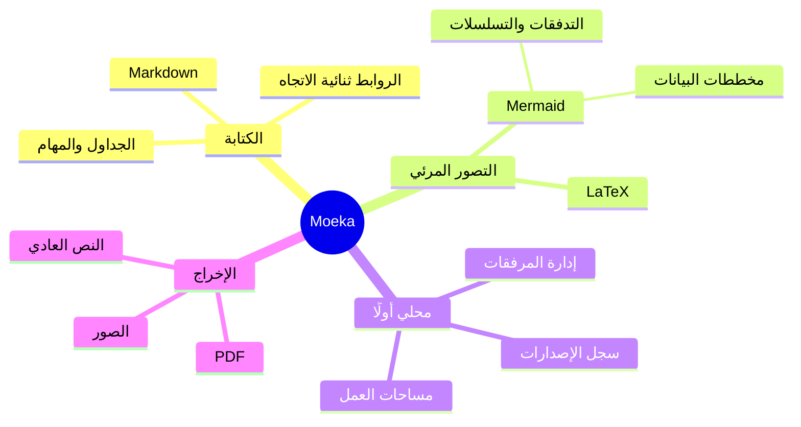

# Moeka
Moeka تطبيق **لتحرير Markdown** أنيق وسلس ويعمل محليًا بالكامل. استخدامه بسيط للغاية، ومع ذلك فهو قادر على إدارة المعرفة وتنسيق المحتوى الكثيف. أصبح Moeka متاحًا الآن على macOS وWindows وLinux ([نزّله الآن](https://moeka.app/)). نأمل أن يساعد هذا المحرر البسيط الجميع على بناء قواعد معرفتهم بسرعة؛ ويقدّم لك هذا الدليل الأساسيات.

يستخدم Moeka تنسيق `Markdown` للنصوص. يناسب Markdown الكتّاب لأنه يحافظ على قابلية القراءة ولا يقطع تدفق الكتابة. يمكنك معاينة الصيغ المدعومة من قائمة السياق، أو استخدام [الاختصارات](#دعم-الجداول)، أو كتابة `/` في سطر فارغ لفتح قائمة التنسيق.

> يجب أن يكون مستند Markdown قابلًا للنشر كنص عادي من دون أن يبدو كأنه يحتوي على أوامر تنسيق. تتكوّن الصيغة كلها من علامات ترقيم اختيرت بعناية لتبدو مثل معناها: فالنجوم تبدو كالتأكيد، وعلامات القوائم تبدو كقوائم. -- John Gruber


### قائمة غير مرتبة
- هذه قائمة غير مرتبة.
  - هذه قائمة غير مرتبة متداخلة.
  - هذا هو العنصر الثاني.
- هذا هو العنصر الثاني.
### قائمة مرتبة
1. هذه قائمة مرتبة.
   1. هذه قائمة مرتبة متداخلة.
   2. هذا هو العنصر الثاني.
2. هذا هو العنصر الثاني.
   - هذه قائمة غير مرتبة.
   - هذا هو العنصر الثاني.
### قائمة مهام
- [x] يمكنك كتابة المهام هنا.
  - [ ] المهام المتداخلة مدعومة أيضًا.
  - [ ] جرّب الضغط على `Tab` أو `Shift + Tab` في هذا السطر.
- [ ] أضف عناصر مكتملة أخرى لاحقًا.
***
### دعم الجداول
| الميزة                       | الاختصار                                      |
| ---------------------------- | --------------------------------------------- |
| `Command / Ctrl + B`         | عريض                                          |
| `Command / Ctrl + I`         | مائل                                          |
| `Command / Ctrl + U`         | تسطير                                         |
| `Command / Ctrl + Shift + X` | يتوسطه خط                                     |
| `Command / Ctrl + E`         | كود داخل السطر                                |
| مزيد من الصيغ                | راجع الأمر `/` أو قائمة التنسيق بالنقر الأيمن |
## صيغة كتل الكود
```rust
fn greet(name: &str) {
  println!("hello, {name}");
}
```
### معادلات LaTeX
ضع الصيغة بين `$...$` لكتابة معادلة داخل السطر مثل $E = mc^2$، أو ضع كل علامة `$$` في سطر مستقل لكتابة معادلة كتلية:
$$
\operatorname*{arg\,min}_{\theta \in \mathbb{R}^n}
\left[
  \frac{1}{m}\sum_{i=1}^{m}
  \left\lVert f_\theta(x_i)-y_i \right\rVert_2^2
  + \lambda \left\lVert \theta \right\rVert_2^2
\right]
$$
### مثال على مخطط Mermaid

## الصيغة داخل السطر
- استخدم **العريض** أو *italic* المائل للتأكيد.
- استخدم ++التسطير++ لتمييز العبارات المهمة؛ `~U~` يظهر كرمز سفلي وليس كتسطير.
- أمثلة التسطير: ++underline++ وكذلك صيغة HTML ‏<u>underline</u>.
- استخدم `كود داخل السطر` للكلمات المفتاحية أو المقاطع القصيرة.
## صيغة مربعات التنبيه
> [!TIP] هذا عنوان مربع تنبيه
> يمكنك متابعة كتابة النص داخل المربع. عند الطي، يظهر emoji المناسب ويبقى العنوان عريضًا.

> [!WARNING] تنبيه
> الأنواع NOTE و IMPORTANT و WARNING و CAUTION وغيرها مدعومة.
## صيغة الروابط
- استخدم [رابطًا داخليًا](#moeka) للانتقال إلى عنوان في الملف الحالي.
- استخدم روابط wiki مثل [[مرجع نمط التصميم.md]] لربط الملفات.
- استخدم [رابطًا خارجيًا](https://google.com) لفتح أي عنوان ويب.
- استخدم صيغة الحواشي[^note] للانتقال إلى سطر مرجعي.
- استخدم [رابط ملف](<مرجع نمط التصميم.md>) لفتح ملف أو عنوان.
- اضغط مع الاستمرار على `Command / Ctrl` وانقر على هذه الروابط لفتحها.
## صيغة داخلية موسعة
- مثال الرمز السفلي: H~2~O. مثال الرمز العلوي: E=mc^2^. تعمل أيضًا Foo~zoo~ أو Bar^baz^.
- صيغة ==التمييز== مدعومة لإبراز النص.
- تدعم اختصارات emoji مثل `:rocket:`، مثل :rocket: .
- [^note]: هذا هو سطر الحاشية الذي يمكن الانتقال إليه من مواضع أخرى.

لمزيد من تفاصيل Markdown، راجع [دليل صيغة Markdown من GitHub](https://docs.github.com/en/get-started/writing-on-github/getting-started-with-writing-and-formatting-on-github/basic-writing-and-formatting-syntax).
