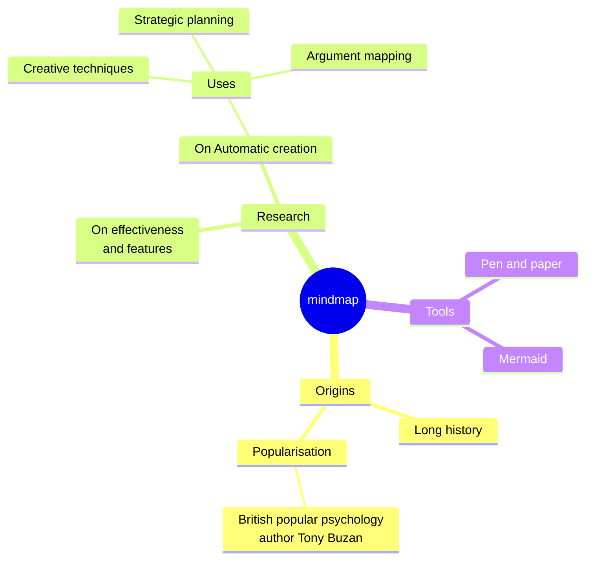
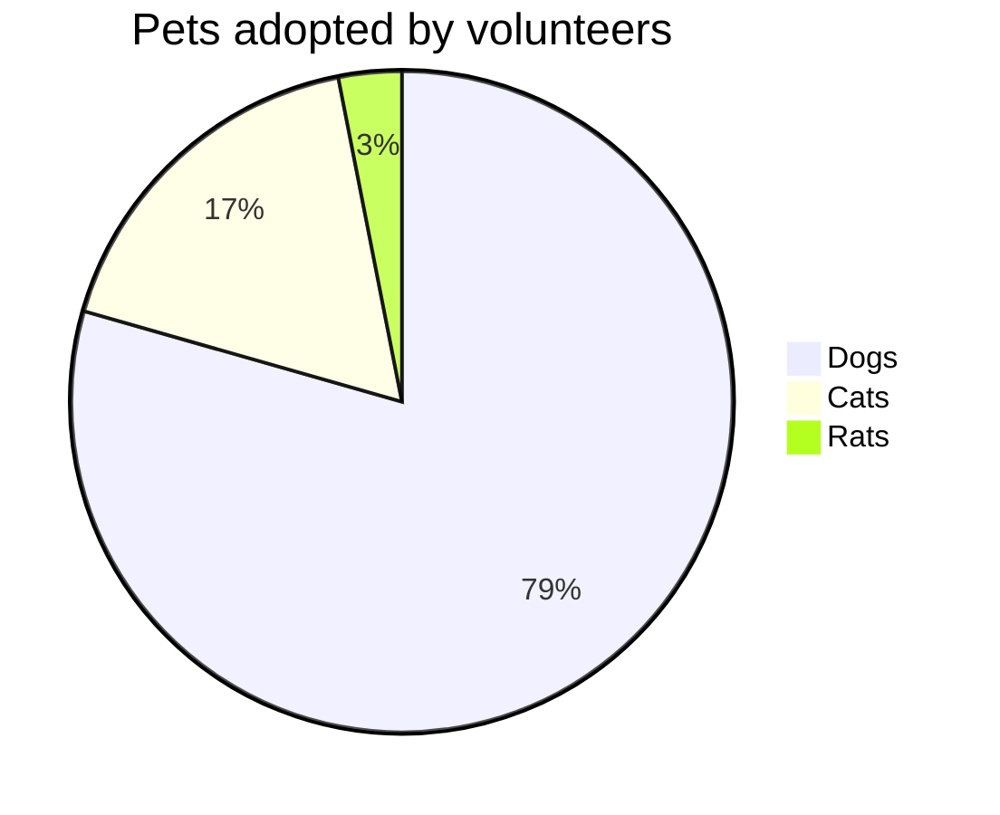

# Moeka
Moeka هو تطبيق **لتحرير Markdown** أنيق وسلس ويعمل محليًا أولًا. البدء به بسيط، لكنه قوي بما يكفي للكتابة المكثفة. يمكنك استخدامه على macOS، أما ~~Windows و Linux~~ فسيأتيان لاحقًا. يساعدك هذا الدليل على بناء قاعدة معرفتك بسرعة.

يستخدم Moeka تنسيق `Markdown` للنصوص. يناسب Markdown الكتّاب لأنه يحافظ على قابلية القراءة ولا يقطع تدفق الكتابة. يمكنك معاينة الصيغ المدعومة من قائمة السياق، أو استخدام [الاختصارات](#التعامل-مع-الجداول)، أو كتابة `/` في سطر فارغ لفتح قائمة التنسيق.

> يجب أن يكون مستند Markdown قابلًا للنشر كنص عادي من دون أن يبدو كأنه يحتوي على أوامر تنسيق. تتكوّن الصيغة كلها من علامات ترقيم اختيرت بعناية لتبدو مثل معناها: فالنجوم تبدو كالتأكيد، وعلامات القوائم تبدو كقوائم. -- John Gruber


### قائمة غير مرتبة
- هذه قائمة غير مرتبة.
  - هذه قائمة غير مرتبة متداخلة.
  - هذا هو العنصر الثاني.
- هذا هو العنصر الثاني.
### قائمة مرتبة
1. هذه قائمة مرتبة.
   1. هذه قائمة مرتبة متداخلة.
   2. هذا هو العنصر الثاني.
2. هذا هو العنصر الثاني.
   - هذه قائمة غير مرتبة.
   - هذا هو العنصر الثاني.
### قائمة مهام
- [x] يمكنك كتابة المهام هنا.
  - [ ] المهام المتداخلة مدعومة أيضًا.
  - [ ] جرّب الضغط على `Tab` أو `Shift + Tab` في هذا السطر.
- [ ] أضف عناصر مكتملة أخرى لاحقًا.
***
### التعامل مع الجداول
| الميزة                     | الاختصار        |
| -------------------------- | --------------- |
| `Command + B`              | عريض            |
| `Command + I`              | مائل            |
| `Command + U`              | تسطير |
| `Command + Shift + X`      | يتوسطه خط       |
| `Command + E`              | كود داخل السطر  |
| `Command + Option + C`     | كتلة كود        |
| `Command + Option + Q`     | اقتباس          |
| `Command + Option + U`     | قائمة غير مرتبة |
| `Command + Option + O`     | قائمة مرتبة     |
| `Command + Option + Enter` | مهمة            |
| `Command + K`              | رابط            |
| `Command + Option + T`     | جدول |
| `Command + 0`              | فقرة |
| `/ image`                  | صورة            |

| --------------------- | --------  |
| --------------------- | --------- |
| `[[`                  | رابط wiki |
| `/ image`             | صورة      |
## صيغة كتل الكود
```rust
fn greet(name: &str) {
  println!("hello, {name}");
}
```

### معادلات LaTeX
اكتب معادلة عرض بسيطة لترى معاينة كتلة داخل المستند.

$$
E = mc^2
$$

### مثال على مخطط Mermaid
استخدم مخططًا بسيطًا لمشاهدة معاينة الرسوم.





## الصيغة داخل السطر
- استخدم **العريض** أو *italic* المائل للتأكيد.
- استخدم ++التسطير++ لتمييز العبارات المهمة؛ `~U~` يظهر كرمز سفلي وليس كتسطير.
- أمثلة التسطير: ++underline++ وكذلك صيغة HTML ‏<u>underline</u>.
- استخدم `كود داخل السطر` للكلمات المفتاحية أو المقاطع القصيرة.
## صيغة مربعات التنبيه
> [!TIP] هذا عنوان مربع تنبيه
> يمكنك متابعة كتابة النص داخل المربع. عند الطي، يظهر emoji المناسب ويبقى العنوان عريضًا.

> [!WARNING] تنبيه
> الأنواع NOTE و IMPORTANT و WARNING و CAUTION وغيرها مدعومة.
## صيغة الروابط
- استخدم [رابطًا داخليًا](#moeka) للانتقال إلى عنوان في الملف الحالي.
- استخدم روابط wiki مثل [[My Design Style.md]] لربط الملفات.
- استخدم [رابطًا خارجيًا](https://google.com) لفتح أي عنوان ويب.
- استخدم صيغة الحواشي[^note] للانتقال إلى سطر مرجعي.
- استخدم [رابط ملف](Feature Plan.md) لفتح ملف أو عنوان.
- اضغط مع الاستمرار على `Command` وانقر على هذه الروابط لفتحها.
## صيغة داخلية موسعة
- مثال الرمز السفلي: H~2~O. مثال الرمز العلوي: E=mc^2^. تعمل أيضًا Foo~zoo~ أو Bar^baz^.
- صيغة ==التمييز== مدعومة لإبراز النص.
- تدعم اختصارات emoji مثل `:rocket:`، مثل :rocket: .
- [^note]: هذا هو سطر الحاشية الذي يمكن الانتقال إليه من مواضع أخرى.

لمزيد من تفاصيل Markdown، راجع [دليل صيغة Markdown من GitHub](https://docs.github.com/en/get-started/writing-on-github/getting-started-with-writing-and-formatting-on-github/basic-writing-and-formatting-syntax).
