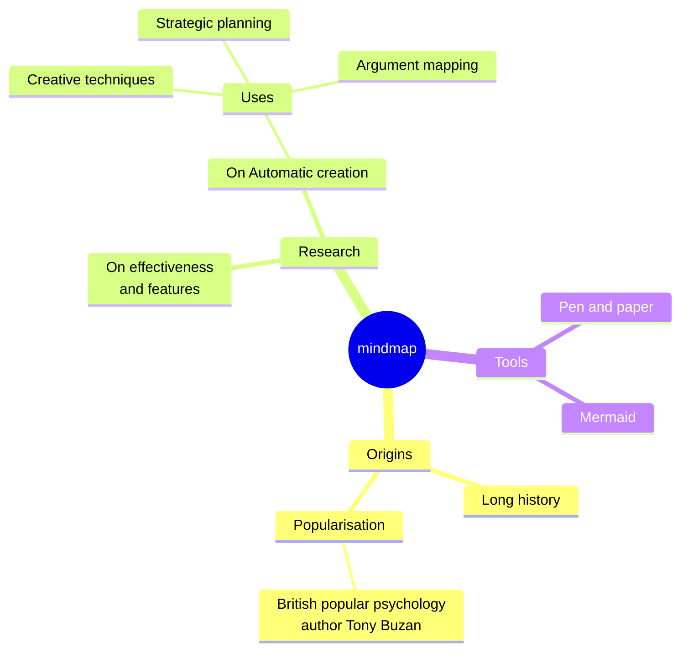
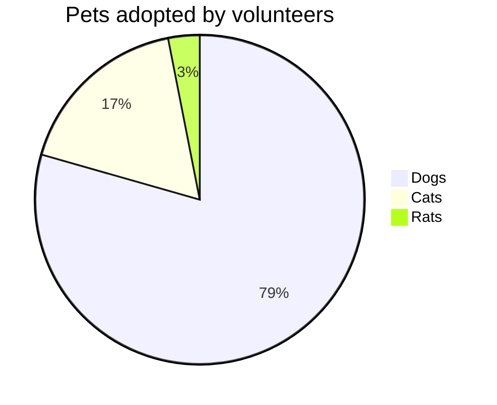

# Moeka
Moeka ist eine elegante, flüssige, lokal orientierte **Markdown-Editor-App**. Sie ist einfach zu bedienen und zugleich stark genug für anspruchsvolles Schreiben. Sie läuft auf macOS; ~~Windows und Linux~~ folgen später. Diese Anleitung hilft dir, schneller eine eigene Wissensbasis aufzubauen.

Moeka verwendet `Markdown` als Textformat. Markdown eignet sich gut für Autorinnen und Autoren, weil es lesbar bleibt und den Schreibfluss nicht stört. Unterstützte Syntax kannst du im Kontextmenü ansehen, über [Kurzbefehle](#tabelleninteraktion) anwenden oder auf einer leeren Zeile `/` eingeben, um das Formatmenü zu öffnen.

> Ein Markdown-Dokument sollte als reiner Text veröffentlicht werden können, ohne Formatierungsstile. Seine Syntax besteht vollständig aus Satzzeichen, die so gewählt sind, dass sie wie ihre Bedeutung aussehen: Sternchen wirken wie Hervorhebung, Listenmarker wie Listen. -- John Gruber


### Ungeordnete Liste
- Dies ist eine ungeordnete Liste.
  - Dies ist eine verschachtelte ungeordnete Liste.
  - Dies ist der zweite Eintrag.
- Dies ist der zweite Eintrag.
### Geordnete Liste
1. Dies ist eine geordnete Liste.
   1. Dies ist eine verschachtelte geordnete Liste.
   2. Dies ist der zweite Eintrag.
2. Dies ist der zweite Eintrag.
   - Dies ist eine ungeordnete Liste.
   - Dies ist der zweite Eintrag.
### Aufgabenliste
- [x] Hier kannst du Aufgaben eintragen.
  - [ ] Verschachtelte Aufgaben sind ebenfalls möglich.
  - [ ] Drücke in dieser Zeile `Tab` oder `Shift + Tab`.
- [ ] Füge später weitere erledigte Einträge hinzu.
***
### Tabelleninteraktion
| Funktion                   | Kurzbefehl        |
| -------------------------- | ----------------- |
| `Command + B`              | Fett              |
| `Command + I`              | Kursiv            |
| `Command + U`              | Unterstreichen |
| `Command + Shift + X`      | Durchgestrichen   |
| `Command + E`              | Inline-Code       |
| `Command + Option + C`     | Codeblock         |
| `Command + Option + Q`     | Zitat             |
| `Command + Option + U`     | Ungeordnete Liste |
| `Command + Option + O`     | Geordnete Liste   |
| `Command + Option + Enter` | Aufgabe           |
| `Command + K`              | Link              |
| `Command + Option + T`     | Tabelle |
| `Command + 0`              | Absatz |
| `/ image`                  | Bild              |

| --------------------- | --------  |
| --------------------- | --------- |
| `[[`                  | Wiki-Link |
| `/ image`             | Bild      |
## Codeblock-Syntax
```rust
fn greet(name: &str) {
  println!("hello, {name}");
}
```

### LaTeX-Formeln
Gib eine einfache Anzeigeformel ein, um eine Blockvorschau im Dokument zu sehen.

$$
E = mc^2
$$

### Mermaid-Diagrammbeispiel
Nutze ein einfaches Diagramm, um die Vorschau zu testen.





## Inline-Syntax
- Verwende **Fett** oder *italic* kursiv für Hervorhebung.
- Verwende ++Unterstreichung++ für wichtige Phrasen; `~U~` wird als Tiefstellung gerendert, nicht als Unterstreichung.
- Beispiele: ++underline++ und die HTML-Form <u>underline</u>.
- Verwende `Inline-Code` für Schlüsselwörter oder kurze Codefragmente.
## Callout-Syntax
> [!TIP] Dies ist ein Callout-Titel
> Du kannst im Callout weiter schreiben. Eingeklappt zeigt es das passende emoji, der Titel bleibt fett.

> [!WARNING] Hinweis
> NOTE, IMPORTANT, WARNING, CAUTION und weitere Typen werden unterstützt.
## Link-Syntax
- Nutze einen [internen Link](#moeka), um zu einer Überschrift in der aktuellen Datei zu springen.
- Nutze Wiki-Links wie [[My Design Style.md]], um Dateien zu verbinden.
- Nutze einen [externen Link](https://google.com), um eine Webadresse zu öffnen.
- Nutze Fußnoten[^note], um zu einer Referenzzeile zu springen.
- Nutze einen [Dateilink](Feature Plan.md), um eine Datei oder Überschrift zu öffnen.
- Halte `Command` gedrückt und klicke auf diese Links, um sie zu öffnen.
## Erweiterte Inline-Syntax
- Tiefstellung: H~2~O. Hochstellung: E=mc^2^. Auch Foo~zoo~ oder Bar^baz^ funktionieren.
- ==Hervorhebung== wird für stärkere Betonung unterstützt.
- Emoji-Shortcodes wie `:rocket:` werden unterstützt, zum Beispiel :rocket: .
- [^note]: Dies ist die Fußnotenzeile, zu der andere Stellen springen können.

Weitere Informationen findest du im [Markdown-Syntaxleitfaden von GitHub](https://docs.github.com/en/get-started/writing-on-github/getting-started-with-writing-and-formatting-on-github/basic-writing-and-formatting-syntax).
