# Moeka
Moeka ist eine schlichte, flüssige und vollständig lokale **Markdown-Editor-App**. Sie ist angenehm einfach zu bedienen und zugleich für Wissensmanagement und dichte Inhaltsgestaltung gerüstet. Du kannst sie auf macOS, ~~Windows und Linux~~ verwenden ([jetzt unterstützt](https://moeka.app/)). Wir hoffen, dass dieser schlanke Editor allen hilft, schnell eine eigene Wissensbasis aufzubauen; diese Anleitung zeigt dir den Einstieg.

Moeka verwendet `Markdown` als Textformat. Markdown eignet sich gut für Autorinnen und Autoren, weil es lesbar bleibt und den Schreibfluss nicht stört. Unterstützte Syntax kannst du im Kontextmenü ansehen, über [Kurzbefehle](#tabellenunterstützung) anwenden oder auf einer leeren Zeile `/` eingeben, um das Formatmenü zu öffnen und das gewünschte Format per Stichwort zu suchen.

> Ein Markdown-Dokument sollte als reiner Text veröffentlicht werden können, ohne Formatierungsstile. Seine Syntax besteht vollständig aus Satzzeichen, die so gewählt sind, dass sie wie ihre Bedeutung aussehen: Sternchen wirken wie Hervorhebung, Listenmarker wie Listen. -- John Gruber


### Ungeordnete Liste
- Dies ist eine ungeordnete Liste.
  - Dies ist eine verschachtelte ungeordnete Liste.
  - Dies ist der zweite Eintrag.
- Dies ist der zweite Eintrag.
### Geordnete Liste
1. Dies ist eine geordnete Liste.
   1. Dies ist eine verschachtelte geordnete Liste.
   2. Dies ist der zweite Eintrag.
2. Dies ist der zweite Eintrag.
   - Dies ist eine ungeordnete Liste.
   - Dies ist der zweite Eintrag.
### Aufgabenliste
- [x] Hier kannst du Aufgaben eintragen.
  - [ ] Verschachtelte Aufgaben sind ebenfalls möglich.
  - [ ] Drücke in dieser Zeile `Tab` oder `Shift + Tab`.
- [ ] Füge später weitere erledigte Einträge hinzu.
***
### Tabellenunterstützung
| Funktion                     | Kurzbefehl                                       |
| ---------------------------- | ------------------------------------------------ |
| `Command / Ctrl + B`         | Fett                                             |
| `Command / Ctrl + I`         | Kursiv                                           |
| `Command / Ctrl + U`         | Unterstrichen                                    |
| `Command / Ctrl + Shift + X` | Durchgestrichen                                  |
| `Command / Ctrl + E`         | Inline-Code                                      |
| Weitere Syntax               | Siehe `/`-Befehl oder Formatmenü per Rechtsklick |
## Codeblock-Syntax
```rust
fn greet(name: &str) {
  println!("hello, {name}");
}
```
### LaTeX-Formeln
Umschließe eine Formel mit `$...$`, um sie wie $E = mc^2$ in einer Zeile darzustellen, oder setze `$$` jeweils allein in eine Zeile, um eine Blockformel zu schreiben:

$$
\operatorname*{arg\,min}_{\theta \in \mathbb{R}^n}
\left[
  \frac{1}{m}\sum_{i=1}^{m}
  \left\lVert f_\theta(x_i)-y_i \right\rVert_2^2
  + \lambda \left\lVert \theta \right\rVert_2^2
\right]
$$
### Mermaid-Diagrammbeispiel

```mermaid
mindmap
  root((Moeka))
    Schreiben
      Markdown
      Bidirektionale Links
      Tabellen und Aufgaben
    Visualisierung
      Mermaid
        Abläufe und Sequenzen
        Datendiagramme
      LaTeX
    Lokal zuerst
      Arbeitsbereiche
      Versionsverlauf
      Anlagenverwaltung
    Ausgabe
      PDF
      Bilder
      Klartext
```

## Inline-Syntax
- Verwende **Fett** oder *italic* kursiv für Hervorhebung.
- Verwende ++Unterstreichung++ für wichtige Phrasen; `~U~` wird als Tiefstellung gerendert, nicht als Unterstreichung.
- Beispiele: ++underline++ und die HTML-Form <u>underline</u>.
- Verwende `Inline-Code` für Schlüsselwörter oder kurze Codefragmente.
## Callout-Syntax
> [!TIP] Dies ist ein Callout-Titel
> Du kannst im Callout weiter schreiben und ihn auch einklappen.

> [!WARNING] Hinweis
> NOTE, IMPORTANT, WARNING, CAUTION und weitere Typen werden unterstützt.
## Link-Syntax
- Nutze einen [internen Link](#moeka), um zu einer Überschrift in der aktuellen Datei zu springen.
- Nutze Wiki-Links wie [[Referenz zum Designstil.md]], um Dateien zu verbinden.
- Nutze einen [externen Link](https://google.com), um eine Webadresse zu öffnen.
- Nutze Fußnoten[^note], um zu einer Referenzzeile zu springen.
- Nutze einen [Dateilink](<Referenz zum Designstil.md>), um eine Datei oder Überschrift zu öffnen.
- Halte `Command / Ctrl` gedrückt und klicke auf diese Links, um sie zu öffnen.
## Erweiterte Inline-Syntax
- Tiefstellung: H~2~O. Hochstellung: E=mc^2^. Auch Foo~zoo~ oder Bar^baz^ funktionieren.
- ==Hervorhebung== wird für stärkere Betonung unterstützt.
- Emoji-Shortcodes wie `:rocket:` werden unterstützt, zum Beispiel :rocket: .
- [^note]: Dies ist die Fußnotenzeile, zu der andere Stellen springen können.

Weitere Informationen findest du im [Markdown-Syntaxleitfaden von GitHub](https://docs.github.com/en/get-started/writing-on-github/getting-started-with-writing-and-formatting-on-github/basic-writing-and-formatting-syntax).
