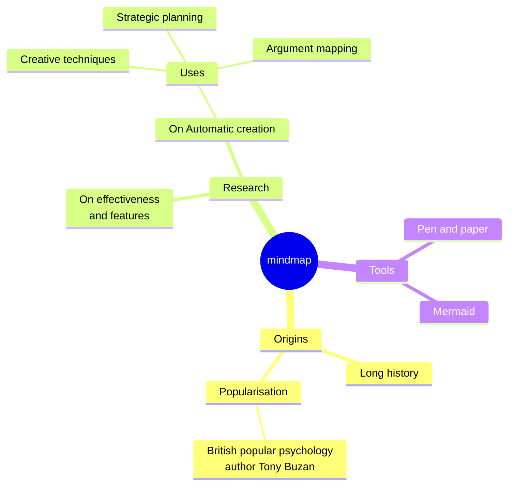
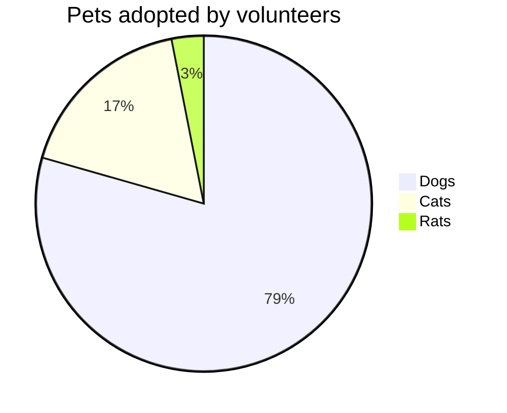

# Moeka
Moeka is an elegant, fluid, local-first **Markdown editing app**. It is simple to start with, yet capable enough for serious writing. You can use it on macOS, with ~~Windows and Linux~~ coming later. This short guide helps you build your own knowledge base more quickly.

Moeka uses `Markdown` as its text format. Markdown is ideal for writers because it stays readable without getting in the way of drafting. You can preview supported syntax from the context menu, use the listed [shortcuts](#table-interaction), or type `/` on an empty line to open the format menu and search for the format you need.

> A Markdown-formatted document should be publishable as plain text, without looking like it has been marked up with tags or formatting instructions. Its syntax is made entirely of punctuation characters, carefully chosen so they look like what they mean. Asterisks around a word actually look like emphasis, and list markers look like lists. -- John Gruber


### Unordered List
- This is an unordered list.
  - This is a nested unordered list.
  - This is the second item.
- This is the second item.
### Ordered List
1. This is an ordered list.
   1. This is a nested ordered list.
   2. This is the second item.
2. This is the second item.
   - This is an unordered list.
   - This is the second item.
### Todo List
- [x] You can write todo items here.
  - [ ] Nested todo items are supported too.
  - [ ] Try pressing `Tab` or `Shift + Tab` on this line.
- [ ] Add more completed items later.
***
### Table Interaction
| Feature                                 | Shortcut       |
| --------------------------------------- | -------------- |
| `Command / Ctrl + B`                    | Bold           |
| `Command / Ctrl + I`                    | Italic         |
| `Command / Ctrl + U`                    | Underline      |
| `Command / Ctrl + Shift + X`            | Strikethrough  |
| `Command / Ctrl + E`                    | Inline code    |
| `Command / Ctrl + Option / Alt + C`     | Code block     |
| `Command / Ctrl + Option / Alt + Q`     | Quote          |
| `Command / Ctrl + Option / Alt + U`     | Unordered list |
| `Command / Ctrl + Option / Alt + O`     | Ordered list   |
| `Command / Ctrl + Option / Alt + Enter` | Todo           |
| `Command / Ctrl + K`                    | Link           |
| `Command / Ctrl + Option / Alt + T`     | Table          |
| `Command / Ctrl + 0`                    | Paragraph      |
| `/ image`                               | Image          |

| --------------------- | --------- |
| --------------------- | --------- |
| `[[`                  | Wiki link |
| `/ image`             | Image     |
## Code Block Syntax
```rust
fn greet(name: &str) {
  println!("hello, {name}");
}
```

### LaTeX Math
Enter a simple display formula to see a block preview in the document.

$$
E = mc^2
$$

### Mermaid Diagram Example
Use a simple diagram to see how chart previews work.





## Inline Syntax
- Use **bold** or *italic* text for emphasis.
- Use ++underline++ for phrases that need attention; `~U~` is rendered as subscript, not underline.
- Underline examples: ++underline++ and the HTML form <u>underline</u>.
- Use `inline code` for keywords or short code fragments.
## Callout Syntax
> [!TIP] This is a callout title
> Keep writing body text inside the callout. When folded, it shows the matching emoji and keeps the title bold.

> [!WARNING] Notice
> NOTE, IMPORTANT, WARNING, CAUTION, and other callout types are supported.
## Link Syntax
- Use an [internal link](#moeka) to jump to a heading in the current file.
- Use [[My Design Style.md]] wiki links to connect files.
- Use an [external link](https://google.com) to open any web address.
- Use footnote syntax[^note] to jump to a reference line.
- Use a [file link](Feature Plan.md) to jump to a file or heading.
- Hold `Command / Ctrl` and click any of the above links to open them.
## Local Attachments
- Pasting an image or file, or dropping one from Finder into a Markdown document, copies it to the attachment location selected in Settings. Dropping a file from Moeka's sidebar inserts a link without copying the file.
- Attachment locations can be the document folder, a workspace folder, or a subfolder beside the current document. Custom folders must be relative paths inside the workspace.
- Newly inserted attachments use document-relative paths and standard Markdown links, such as ``.
- Existing Markdown links and WikiLinks such as `![[assets/image.png]]` are both parsed and displayed.
- Existing links are not updated automatically after files or folders are moved or renamed.
## Extended Inline Syntax
- Subscript example: H~2~O. Superscript example: E=mc^2^. English text also works: Foo~zoo~ or Bar^baz^.
- ==Highlight== is supported for stronger emphasis.
- Emoji shortcodes such as `:rocket:` are supported, for example :rocket: .
- [^note]: This is the footnote line that other places can jump to.

For more Markdown details, see GitHub's [Markdown syntax guide](https://docs.github.com/en/get-started/writing-on-github/getting-started-with-writing-and-formatting-on-github/basic-writing-and-formatting-syntax) and try more basic patterns.
