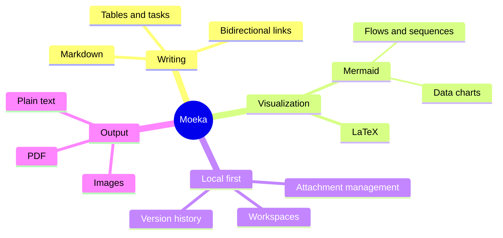

# Moeka
Moeka is a simple, fluid, fully local **Markdown editing app**. It is easy to use while remaining capable of knowledge management and dense content layout. You can use it on macOS, ~~Windows and Linux~~ ([now supported](https://moeka.app/)). We hope this focused editor helps everyone build a personal knowledge base quickly; read on for a brief introduction.

Moeka uses `Markdown` as its text format. Markdown is ideal for writers because it stays readable without getting in the way of drafting. You can preview supported syntax from the context menu, use the listed [shortcuts](#table-support), or type `/` on an empty line to open the format menu and search for the format you need.

> A Markdown-formatted document should be publishable as plain text, without looking like it has been marked up with tags or formatting instructions. Its syntax is made entirely of punctuation characters, carefully chosen so they look like what they mean. Asterisks around a word actually look like emphasis, and list markers look like lists. -- John Gruber


### Unordered List
- This is an unordered list.
  - This is a nested unordered list.
  - This is the second item.
- This is the second item.
### Ordered List
1. This is an ordered list.
   1. This is a nested ordered list.
   2. This is the second item.
2. This is the second item.
   - This is an unordered list.
   - This is the second item.
### Todo List
- [x] You can write todo items here.
  - [ ] Nested todo items are supported too.
  - [ ] Try pressing `Tab` or `Shift + Tab` on this line.
- [ ] Add more completed items later.
***
### Table Support
| Feature                      | Shortcut                                       |
| ---------------------------- | ---------------------------------------------- |
| `Command / Ctrl + B`         | Bold                                           |
| `Command / Ctrl + I`         | Italic                                         |
| `Command / Ctrl + U`         | Underline                                      |
| `Command / Ctrl + Shift + X` | Strikethrough                                  |
| `Command / Ctrl + E`         | Inline code                                    |
| More syntax                  | Use the `/` command or context formatting menu |
## Code Block Syntax
```rust
fn greet(name: &str) {
  println!("hello, {name}");
}
```
### LaTeX Math
Wrap syntax in `$...$` for an inline formula such as $E = mc^2$, or place `$$` on lines of their own for a block formula:

$$
\operatorname*{arg\,min}_{\theta \in \mathbb{R}^n}
\left[
  \frac{1}{m}\sum_{i=1}^{m}
  \left\lVert f_\theta(x_i)-y_i \right\rVert_2^2
  + \lambda \left\lVert \theta \right\rVert_2^2
\right]
$$
### Mermaid Diagram Example

## Inline Syntax
- Use **bold** or *italic* text for emphasis.
- Use ++underline++ for phrases that need attention; `~U~` is rendered as subscript, not underline.
- Underline examples: ++underline++ and the HTML form <u>underline</u>.
- Use `inline code` for keywords or short code fragments.
## Callout Syntax
> [!TIP] This is a callout title
> You can keep writing body text inside the callout, and fold it when needed.

> [!WARNING] Notice
> NOTE, IMPORTANT, WARNING, CAUTION, and other callout types are supported.
## Link Syntax
- Use an [internal link](#moeka) to jump to a heading in the current file.
- Use [[Design Style Reference.md]] wiki links to connect files.
- Use an [external link](https://google.com) to open any web address.
- Use footnote syntax[^note] to jump to a reference line.
- Use a [file link](<Design Style Reference.md>) to jump to a file or heading.
- Hold `Command / Ctrl` and click any of the above links to open them.
## Extended Inline Syntax
- Subscript example: H~2~O. Superscript example: E=mc^2^. English text also works: Foo~zoo~ or Bar^baz^.
- ==Highlight== is supported for stronger emphasis.
- Emoji shortcodes such as `:rocket:` are supported, for example :rocket: .
- [^note]: This is the footnote line that other places can jump to.

For more Markdown details, see GitHub's [Markdown syntax guide](https://docs.github.com/en/get-started/writing-on-github/getting-started-with-writing-and-formatting-on-github/basic-writing-and-formatting-syntax) and try more basic patterns.
