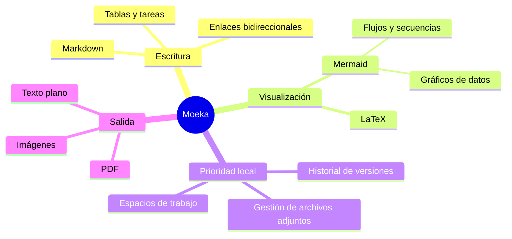

# Moeka
Moeka es una **aplicación de edición Markdown** sencilla, fluida y totalmente local. Es muy fácil de usar y, a la vez, capaz de gestionar conocimiento y componer contenido denso. Puedes usarla en macOS, ~~Windows y Linux~~ ([ya compatibles](https://moeka.app/)). Esperamos que este editor sencillo permita a cualquiera crear rápidamente su propia base de conocimiento; esta guía te ayudará a empezar.

Moeka usa `Markdown` como formato de texto. Markdown es ideal para escribir porque mantiene buena legibilidad sin interrumpir la creación. Puedes previsualizar la sintaxis admitida desde el menú contextual, usar los [atajos](#compatibilidad-con-tablas) o escribir `/` en una línea vacía para abrir el menú de formato y buscar el formato deseado por palabra clave.

> Un documento Markdown debería poder publicarse como texto plano, sin estilos de formato. Su sintaxis está formada solo por signos de puntuación elegidos para parecerse a lo que significan: los asteriscos parecen énfasis y los marcadores de lista parecen listas. -- John Gruber


### Lista sin orden
- Esta es una lista sin orden.
  - Esta es una lista anidada.
  - Este es el segundo elemento.
- Este es el segundo elemento.
### Lista ordenada
1. Esta es una lista ordenada.
   1. Esta es una lista ordenada anidada.
   2. Este es el segundo elemento.
2. Este es el segundo elemento.
   - Esta es una lista sin orden.
   - Este es el segundo elemento.
### Lista de tareas
- [x] Puedes escribir tareas aquí.
  - [ ] También puedes crear tareas anidadas.
  - [ ] Prueba `Tab` o `Shift + Tab` en esta línea.
- [ ] Agrega más elementos completados después.
***
### Compatibilidad con tablas
| Función                      | Atajo                                                   |
| ---------------------------- | ------------------------------------------------------- |
| `Command / Ctrl + B`         | Negrita                                                 |
| `Command / Ctrl + I`         | Cursiva                                                 |
| `Command / Ctrl + U`         | Subrayado                                               |
| `Command / Ctrl + Shift + X` | Tachado                                                 |
| `Command / Ctrl + E`         | Código en línea                                         |
| Más sintaxis                 | Consulta el comando `/` o el menú contextual de formato |
## Sintaxis de bloques de código
```rust
fn greet(name: &str) {
  println!("hello, {name}");
}
```
### Fórmulas LaTeX
Encierra la sintaxis entre `$...$` para escribir una fórmula en línea, como $E = mc^2$, o coloca cada `$$` en una línea independiente para escribir una fórmula de bloque:

$$
\operatorname*{arg\,min}_{\theta \in \mathbb{R}^n}
\left[
  \frac{1}{m}\sum_{i=1}^{m}
  \left\lVert f_\theta(x_i)-y_i \right\rVert_2^2
  + \lambda \left\lVert \theta \right\rVert_2^2
\right]
$$
### Ejemplo de diagrama Mermaid

## Sintaxis en línea
- Usa **negrita** o *italic* para enfatizar.
- Usa ++subrayado++ para marcar frases importantes; `~U~` se renderiza como subíndice, no como subrayado.
- Ejemplos de subrayado: ++underline++ y la forma HTML <u>underline</u>.
- Usa `código en línea` para palabras clave o fragmentos cortos.
## Sintaxis de avisos
> [!TIP] Este es un título de aviso
> Puedes seguir escribiendo dentro del aviso y también plegarlo.

> [!WARNING] Atención
> También se admiten NOTE, IMPORTANT, WARNING, CAUTION y otros tipos.
## Sintaxis de enlaces
- Usa un [enlace interno](#moeka) para saltar a un título del archivo actual.
- Usa enlaces wiki como [[Referencia de estilo de diseño.md]] para conectar archivos.
- Usa un [enlace externo](https://google.com) para abrir cualquier dirección web.
- Usa notas al pie[^note] para saltar a una referencia.
- Usa un [enlace de archivo](<Referencia de estilo de diseño.md>) para abrir un archivo o título.
- Mantén `Command / Ctrl` y haz clic para abrir estos enlaces.
## Sintaxis en línea extendida
- Subíndice: H~2~O. Superíndice: E=mc^2^. También funciona Foo~zoo~ o Bar^baz^.
- La sintaxis ==resaltada== ayuda a enfatizar más el texto.
- Se admiten emoji shortcodes como `:rocket:`, por ejemplo :rocket: .
- [^note]: Esta es la línea de nota al pie a la que se puede saltar desde otros lugares.

Para más detalles, consulta la [guía de sintaxis Markdown de GitHub](https://docs.github.com/en/get-started/writing-on-github/getting-started-with-writing-and-formatting-on-github/basic-writing-and-formatting-syntax).
