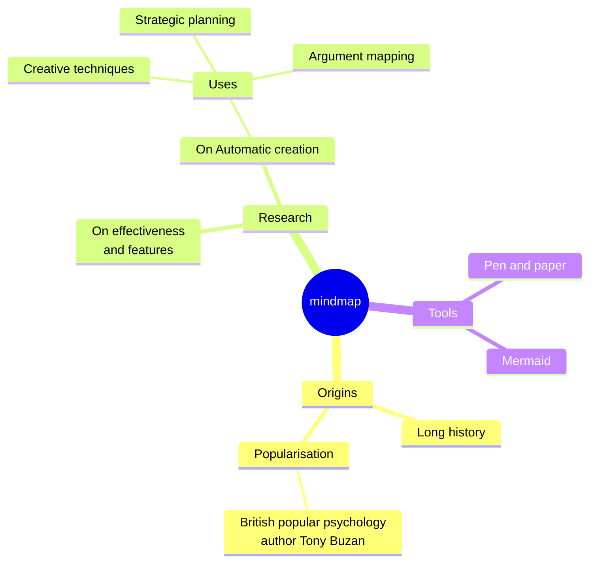
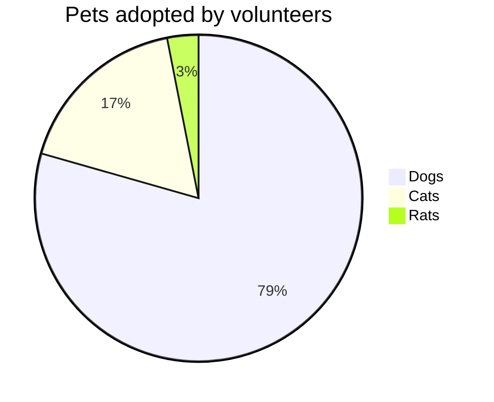

# Moeka
Moeka es una **aplicación de edición Markdown** elegante, fluida y local primero. Es fácil de empezar a usar, pero también sirve para quienes escriben mucho. Puedes usarla en macOS; ~~Windows y Linux~~ llegarán más adelante. Esta guía te ayuda a crear tu base de conocimiento con rapidez.

Moeka usa `Markdown` como formato de texto. Markdown es ideal para escribir porque mantiene buena legibilidad sin interrumpir la creación. Puedes previsualizar la sintaxis admitida desde el menú contextual, usar los [atajos](#interacción-con-tablas) o escribir `/` en una línea vacía para abrir el menú de formato.

> Un documento Markdown debería poder publicarse como texto plano, sin estilos de formato. Su sintaxis está formada solo por signos de puntuación elegidos para parecerse a lo que significan: los asteriscos parecen énfasis y los marcadores de lista parecen listas. -- John Gruber


### Lista sin orden
- Esta es una lista sin orden.
  - Esta es una lista anidada.
  - Este es el segundo elemento.
- Este es el segundo elemento.
### Lista ordenada
1. Esta es una lista ordenada.
   1. Esta es una lista ordenada anidada.
   2. Este es el segundo elemento.
2. Este es el segundo elemento.
   - Esta es una lista sin orden.
   - Este es el segundo elemento.
### Lista de tareas
- [x] Puedes escribir tareas aquí.
  - [ ] También puedes crear tareas anidadas.
  - [ ] Prueba `Tab` o `Shift + Tab` en esta línea.
- [ ] Agrega más elementos completados después.
***
### Interacción con tablas
| Función                                 | Atajo            |
| --------------------------------------- | ---------------- |
| `Command / Ctrl + B`                    | Negrita          |
| `Command / Ctrl + I`                    | Cursiva          |
| `Command / Ctrl + U`                    | Subrayar         |
| `Command / Ctrl + Shift + X`            | Tachado          |
| `Command / Ctrl + E`                    | Código en línea  |
| `Command / Ctrl + Option / Alt + C`     | Bloque de código |
| `Command / Ctrl + Option / Alt + Q`     | Cita             |
| `Command / Ctrl + Option / Alt + U`     | Lista sin orden  |
| `Command / Ctrl + Option / Alt + O`     | Lista ordenada   |
| `Command / Ctrl + Option / Alt + Enter` | Tarea            |
| `Command / Ctrl + K`                    | Enlace           |
| `Command / Ctrl + Option / Alt + T`     | Tabla            |
| `Command / Ctrl + 0`                    | Párrafo          |
| `/ image`                               | Imagen           |

| --------------------- | ----------- |
| --------------------- | ----------- |
| `[[`                  | Enlace wiki |
| `/ image`             | Imagen      |
## Sintaxis de bloques de código
```rust
fn greet(name: &str) {
  println!("hello, {name}");
}
```

### Fórmulas LaTeX
Escribe una fórmula de bloque sencilla para ver una vista previa en el documento.

$$
E = mc^2
$$

### Ejemplo de diagrama Mermaid
Usa un diagrama simple para observar la vista previa.





## Sintaxis en línea
- Usa **negrita** o *italic* para enfatizar.
- Usa ++subrayado++ para marcar frases importantes; `~U~` se renderiza como subíndice, no como subrayado.
- Ejemplos de subrayado: ++underline++ y la forma HTML <u>underline</u>.
- Usa `código en línea` para palabras clave o fragmentos cortos.
## Sintaxis de avisos
> [!TIP] Este es un título de aviso
> Puedes seguir escribiendo dentro del aviso. Al plegarlo, muestra el emoji correspondiente y mantiene el título en negrita.

> [!WARNING] Atención
> También se admiten NOTE, IMPORTANT, WARNING, CAUTION y otros tipos.
## Sintaxis de enlaces
- Usa un [enlace interno](#moeka) para saltar a un título del archivo actual.
- Usa enlaces wiki como [[My Design Style.md]] para conectar archivos.
- Usa un [enlace externo](https://google.com) para abrir cualquier dirección web.
- Usa notas al pie[^note] para saltar a una referencia.
- Usa un [enlace de archivo](Feature Plan.md) para abrir un archivo o título.
- Mantén `Command / Ctrl` y haz clic para abrir estos enlaces.
## Sintaxis en línea extendida
- Subíndice: H~2~O. Superíndice: E=mc^2^. También funciona Foo~zoo~ o Bar^baz^.
- La sintaxis ==resaltada== ayuda a enfatizar más el texto.
- Se admiten emoji shortcodes como `:rocket:`, por ejemplo :rocket: .
- [^note]: Esta es la línea de nota al pie a la que se puede saltar desde otros lugares.

Para más detalles, consulta la [guía de sintaxis Markdown de GitHub](https://docs.github.com/en/get-started/writing-on-github/getting-started-with-writing-and-formatting-on-github/basic-writing-and-formatting-syntax).
