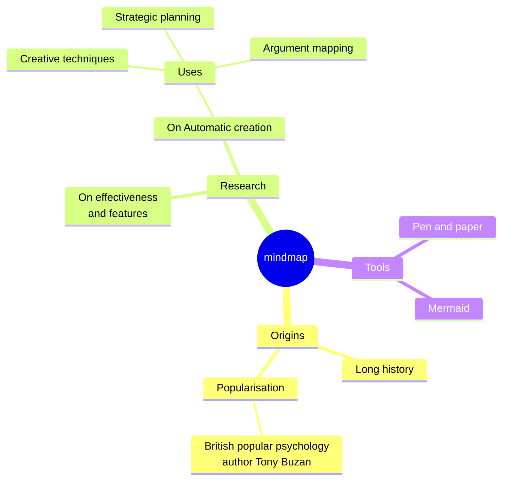
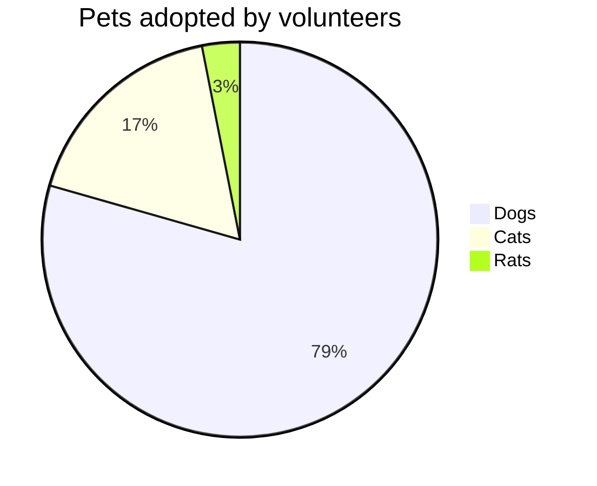

# Moeka
Moeka est une application de **rédaction Markdown** élégante, fluide et locale d'abord. Elle est simple à prendre en main, tout en restant assez puissante pour les écrivains intensifs. Elle fonctionne sur macOS, avec ~~Windows et Linux~~ prévus plus tard. Ce guide vous aide à créer rapidement votre base de connaissances.

Moeka utilise `Markdown` comme format de texte. Markdown convient très bien à l'écriture, car il reste lisible sans interrompre le flux de création. Vous pouvez prévisualiser les syntaxes prises en charge depuis le menu contextuel, utiliser les [raccourcis](#interaction-avec-les-tableaux), ou saisir `/` sur une ligne vide pour ouvrir le menu de mise en forme.

> Un document Markdown devrait pouvoir être publié comme texte brut, sans styles de mise en forme. Sa syntaxe est entièrement composée de ponctuation, choisie pour ressembler à ce qu'elle signifie : les astérisques ressemblent à de l'emphase, et les marqueurs de liste ressemblent à des listes. -- John Gruber


### Liste non ordonnée
- Ceci est une liste non ordonnée.
  - Ceci est une liste imbriquée.
  - Ceci est le deuxième élément.
- Ceci est le deuxième élément.
### Liste ordonnée
1. Ceci est une liste ordonnée.
   1. Ceci est une liste ordonnée imbriquée.
   2. Ceci est le deuxième élément.
2. Ceci est le deuxième élément.
   - Ceci est une liste non ordonnée.
   - Ceci est le deuxième élément.
### Liste de tâches
- [x] Vous pouvez saisir des tâches ici.
  - [ ] Les tâches imbriquées sont aussi prises en charge.
  - [ ] Essayez `Tab` ou `Shift + Tab` sur cette ligne.
- [ ] Ajoutez d'autres éléments terminés plus tard.
***
### Interaction avec les tableaux
| Fonction               | Raccourci          |
| ---------------------- | ------------------ |
| `Command + B`          | Gras               |
| `Command + I`          | Italique           |
| `Command + Shift + S`  | Barré              |
| `Command + E`          | Code en ligne      |
| `Command + Option + C` | Bloc de code       |
| `Command + Option + Q` | Citation           |
| `Command + Option + U` | Liste non ordonnée |
| `Command + Option + O` | Liste ordonnée     |
| `Command + Option + T` | Tâche              |
| `Command + K`          | Lien               |
| `Command + Shift + I`  | Image              |

| --------------------- | --------  |
| --------------------- | --------- |
| `[[`                  | Lien wiki |
| `Command + Shift + I` | Image     |
## Syntaxe des blocs de code
```rust
fn greet(name: &str) {
  println!("hello, {name}");
}
```

### Formules LaTeX
Saisissez une formule affichée simple pour voir un aperçu en bloc dans le document.

$$
E = mc^2
$$

### Exemple de diagramme Mermaid
Utilisez un diagramme simple pour observer l'aperçu des graphiques.





## Syntaxe en ligne
- Utilisez le **gras** ou l'*italique* pour l'emphase.
- Utilisez ++souligné++ pour attirer l'attention ; `~U~` devient un indice, pas un soulignement.
- Exemples de soulignement : ++underline++ et la forme HTML <u>underline</u>.
- Utilisez `code en ligne` pour les mots-clés ou courts fragments de code.
## Syntaxe des encarts
> [!TIP] Ceci est un titre d'encart
> Vous pouvez continuer le texte dans l'encart. Une fois replié, l'emoji correspondant s'affiche et le titre reste en gras.

> [!WARNING] Attention
> Les types NOTE, IMPORTANT, WARNING, CAUTION et d'autres sont pris en charge.
## Syntaxe des liens
- Utilisez un [lien interne](#moeka) pour atteindre un titre du fichier courant.
- Utilisez les liens wiki [[My Design Style.md]] pour relier des fichiers.
- Utilisez un [lien externe](https://google.com) pour ouvrir une adresse web.
- Utilisez la syntaxe de note de bas de page[^note] pour aller à une référence.
- Utilisez un [lien de fichier](Feature Plan.md) pour ouvrir un fichier ou un titre.
- Maintenez `Command` et cliquez sur ces liens pour les ouvrir.
## Syntaxe en ligne étendue
- Exemple d'indice : H~2~O. Exemple d'exposant : E=mc^2^. Le texte anglais fonctionne aussi : Foo~zoo~ ou Bar^baz^.
- La syntaxe ==surlignée== est prise en charge pour renforcer l'emphase.
- Les emoji shortcodes comme `:rocket:` sont pris en charge, par exemple :rocket: .
- [^note]: Ceci est la ligne de note de bas de page accessible depuis ailleurs.

Pour plus de détails sur Markdown, consultez le [guide de syntaxe Markdown de GitHub](https://docs.github.com/en/get-started/writing-on-github/getting-started-with-writing-and-formatting-on-github/basic-writing-and-formatting-syntax) et essayez d'autres bases.
