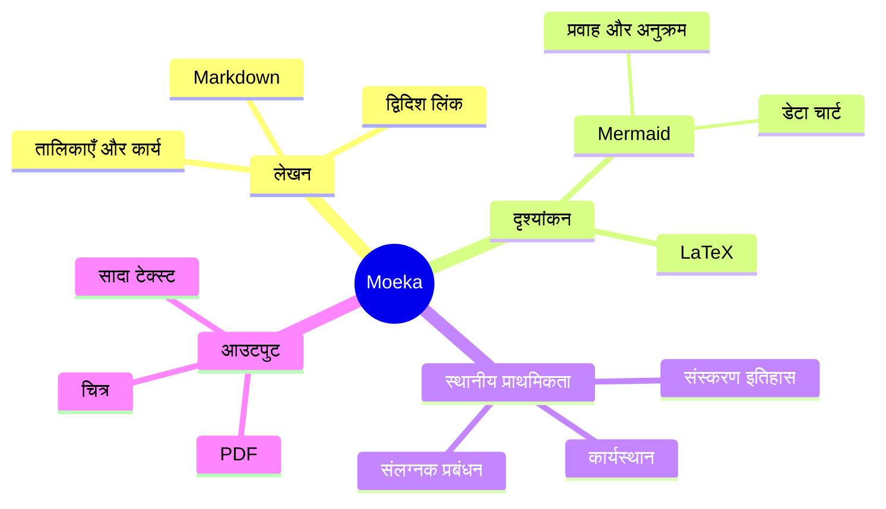

# Moeka
Moeka एक सरल, सहज और पूरी तरह स्थानीय **Markdown संपादन ऐप** है। इसका उपयोग बेहद आसान है, फिर भी यह ज्ञान प्रबंधन और सघन सामग्री संयोजन में पूरी तरह सक्षम है। आप इसे macOS, ~~Windows और Linux~~ पर उपयोग कर सकते हैं ([अब समर्थित](https://moeka.app/))। हमें आशा है कि यह सरल संपादक सभी को अपना ज्ञान-भंडार जल्दी बनाने में मदद करेगा; यह मार्गदर्शिका आपको इसकी मूल बातें बताती है।

Moeka टेक्स्ट प्रारूप के रूप में `Markdown` का उपयोग करता है। Markdown लेखकों के लिए अच्छा है, क्योंकि यह पठनीय रहता है और लेखन प्रवाह में बाधा नहीं डालता। समर्थित सिंटैक्स को संदर्भ मेनू से देखा जा सकता है, [शॉर्टकट](#तालिका-समर्थन) से लागू किया जा सकता है, या खाली पंक्ति में `/` टाइप करके फ़ॉर्मैट मेनू खोला और कीवर्ड से इच्छित फ़ॉर्मैट खोजा जा सकता है।

> Markdown दस्तावेज़ ऐसा होना चाहिए जिसे बिना सजावटी शैली के साधारण टेक्स्ट के रूप में प्रकाशित किया जा सके। इसका सिंटैक्स पूरी तरह विराम चिह्नों से बना है, जिन्हें इस तरह चुना गया है कि वे अपने अर्थ जैसे दिखें: तारांकन ज़ोर जैसा दिखता है और सूची चिह्न सूची जैसे दिखते हैं। -- John Gruber


### अव्यवस्थित सूची
- यह एक अव्यवस्थित सूची है।
  - यह एक नेस्टेड अव्यवस्थित सूची है।
  - यह दूसरा आइटम है।
- यह दूसरा आइटम है।
### व्यवस्थित सूची
1. यह एक व्यवस्थित सूची है।
   1. यह एक नेस्टेड व्यवस्थित सूची है।
   2. यह दूसरा आइटम है।
2. यह दूसरा आइटम है।
   - यह एक अव्यवस्थित सूची है।
   - यह दूसरा आइटम है।
### कार्य सूची
- [x] आप यहाँ कार्य लिख सकते हैं।
  - [ ] नेस्टेड कार्य भी समर्थित हैं।
  - [ ] इस पंक्ति पर `Tab` या `Shift + Tab` दबाकर देखें।
- [ ] बाद में पूर्ण किए गए और आइटम जोड़ें।
***
### तालिका समर्थन
| सुविधा                       | शॉर्टकट                                      |
| ---------------------------- | -------------------------------------------- |
| `Command / Ctrl + B`         | बोल्ड                                        |
| `Command / Ctrl + I`         | इटैलिक                                       |
| `Command / Ctrl + U`         | रेखांकित                                     |
| `Command / Ctrl + Shift + X` | स्ट्राइकथ्रू                                 |
| `Command / Ctrl + E`         | इनलाइन कोड                                   |
| अधिक सिंटैक्स                | `/` कमांड या दायाँ-क्लिक फ़ॉर्मैट मेनू देखें |
## कोड ब्लॉक सिंटैक्स
```rust
fn greet(name: &str) {
  println!("hello, {name}");
}
```
### LaTeX गणित
इनलाइन सूत्र लिखने के लिए सिंटैक्स को `$...$` में रखें, जैसे $E = mc^2$; ब्लॉक सूत्र के लिए दोनों `$$` को अलग-अलग पंक्ति में रखें:

$$
\operatorname*{arg\,min}_{\theta \in \mathbb{R}^n}
\left[
  \frac{1}{m}\sum_{i=1}^{m}
  \left\lVert f_\theta(x_i)-y_i \right\rVert_2^2
  + \lambda \left\lVert \theta \right\rVert_2^2
\right]
$$
### Mermaid आरेख उदाहरण

## इनलाइन सिंटैक्स
- ज़ोर देने के लिए **बोल्ड** या *italic* इटैलिक का उपयोग करें।
- महत्वपूर्ण वाक्यांशों के लिए ++underline++ का उपयोग करें; `~U~` अंडरलाइन नहीं, सबस्क्रिप्ट बनता है।
- अंडरलाइन उदाहरण: ++underline++ और HTML रूप <u>underline</u>।
- कीवर्ड या छोटे कोड के लिए `इनलाइन कोड` का उपयोग करें।
## कॉलआउट सिंटैक्स
> [!TIP] यह कॉलआउट शीर्षक है
> कॉलआउट के अंदर आप आगे लिख सकते हैं और उसे समेट भी सकते हैं।

> [!WARNING] ध्यान दें
> NOTE, IMPORTANT, WARNING, CAUTION और अन्य प्रकार समर्थित हैं।
## लिंक सिंटैक्स
- वर्तमान फ़ाइल के शीर्षक पर जाने के लिए [आंतरिक लिंक](#moeka) का उपयोग करें।
- फ़ाइलों को जोड़ने के लिए [[डिज़ाइन शैली संदर्भ.md]] जैसे wiki लिंक का उपयोग करें।
- किसी भी वेब पते को खोलने के लिए [बाहरी लिंक](https://google.com) का उपयोग करें।
- संदर्भ पंक्ति पर जाने के लिए फुटनोट सिंटैक्स[^note] का उपयोग करें।
- किसी फ़ाइल या शीर्षक पर जाने के लिए [फ़ाइल लिंक](<डिज़ाइन शैली संदर्भ.md>) का उपयोग करें।
- इन लिंक को खोलने के लिए `Command / Ctrl` दबाकर क्लिक करें।
## विस्तारित इनलाइन सिंटैक्स
- सबस्क्रिप्ट उदाहरण: H~2~O. सुपरस्क्रिप्ट उदाहरण: E=mc^2^. Foo~zoo~ या Bar^baz^ भी काम करते हैं।
- ==हाइलाइट== सिंटैक्स टेक्स्ट को अधिक स्पष्ट बनाता है।
- `:rocket:` जैसे emoji shortcode समर्थित हैं, जैसे :rocket: .
- [^note]: यह फुटनोट पंक्ति है जहाँ अन्य स्थानों से जाया जा सकता है।

Markdown के बारे में अधिक जानकारी के लिए GitHub की [Markdown सिंटैक्स गाइड](https://docs.github.com/en/get-started/writing-on-github/getting-started-with-writing-and-formatting-on-github/basic-writing-and-formatting-syntax) देखें।
