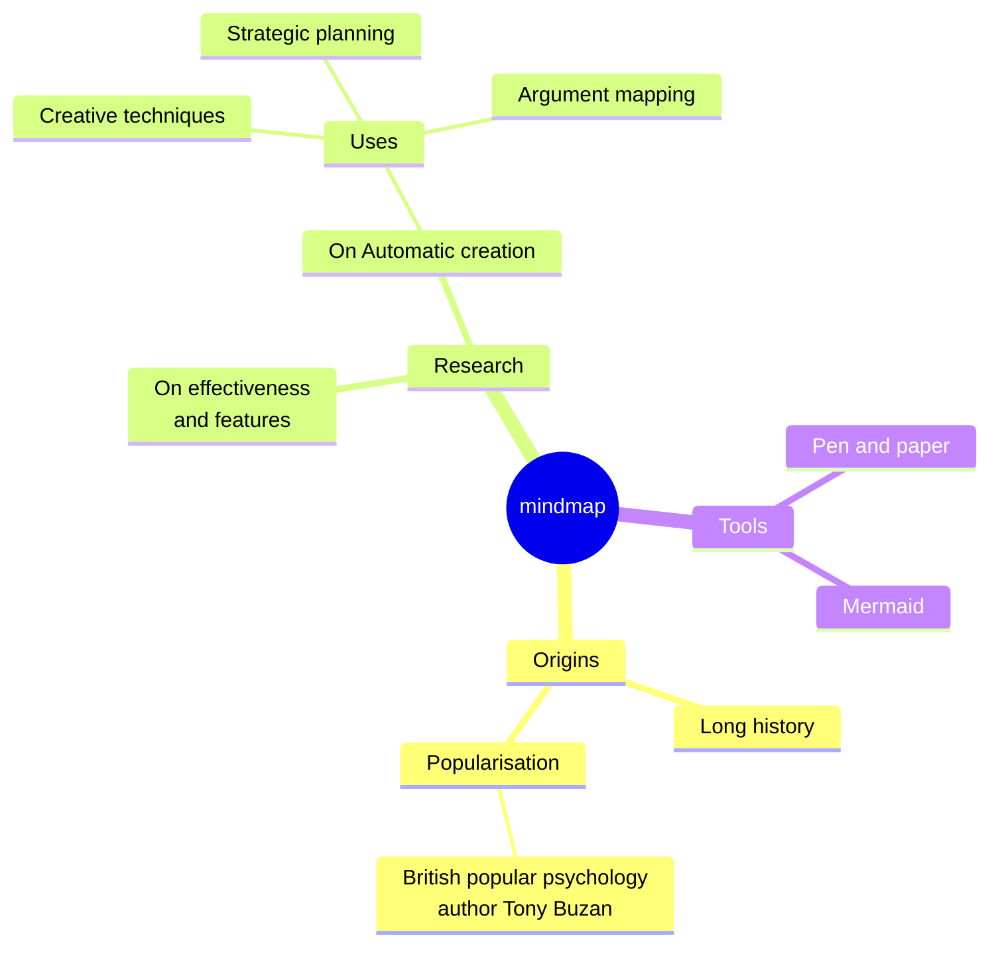
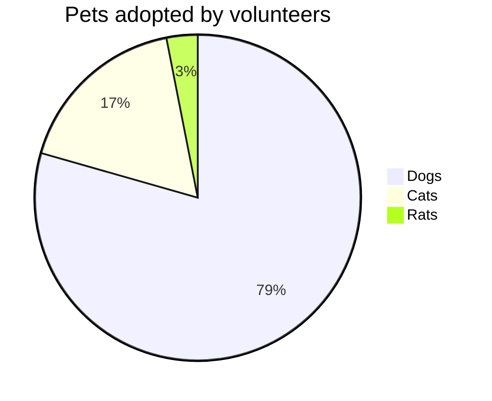

# Moeka
Moeka は、上品でなめらかなローカルファーストの **Markdown 編集アプリ**です。使い始めは簡単ですが、長く書く人の要求にも応えられます。macOS と Windows で利用でき、Linux は後日対応予定です。このガイドで、自分の知識ベースをすばやく作り始められます。

Moeka は `Markdown` をテキスト形式として使います。Markdown は読みやすさを保ちながら執筆の邪魔をしないため、文章を書く人に向いています。対応している構文はコンテキストメニューで確認でき、[ショートカット](#テーブル操作)でもすばやく書式を変更できます。空行で `/` を入力すると書式メニューが開き、キーワードで挿入したい形式を選べます。

> Markdown 形式の文書は、装飾されたスタイルなしにプレーンテキストとして公開できるべきです。構文は句読点だけで構成され、それぞれが意味に見えるよう慎重に選ばれています。たとえばアスタリスクは強調に見え、リスト記号はリストに見えます。-- John Gruber


### 箇条書きリスト
- これは箇条書きリストです。
  - これはネストした箇条書きです。
  - これは 2 番目の項目です。
- これは 2 番目の項目です。
### 番号付きリスト
1. これは番号付きリストです。
   1. これはネストした番号付きリストです。
   2. これは 2 番目の項目です。
2. これは 2 番目の項目です。
   - これは箇条書きリストです。
   - これは 2 番目の項目です。
### Todo リスト
- [x] ここに Todo を入力できます。
  - [ ] ネストした Todo も作れます。
  - [ ] この行で `Tab` または `Shift + Tab` を押してみてください。
- [ ] 完了した項目をあとで追加できます。
***
### テーブル操作
| 機能                                    | ショートカット   |
| --------------------------------------- | ---------------- |
| `Command / Ctrl + B`                    | 太字             |
| `Command / Ctrl + I`                    | 斜体             |
| `Command / Ctrl + U`                    | 下線             |
| `Command / Ctrl + Shift + X`            | 取り消し線       |
| `Command / Ctrl + E`                    | インラインコード |
| `Command / Ctrl + Option / Alt + C`     | コードブロック   |
| `Command / Ctrl + Option / Alt + Q`     | 引用             |
| `Command / Ctrl + Option / Alt + U`     | 箇条書き         |
| `Command / Ctrl + Option / Alt + O`     | 番号付きリスト   |
| `Command / Ctrl + Option / Alt + Enter` | Todo             |
| `Command / Ctrl + K`                    | リンク           |
| `Command / Ctrl + Option / Alt + T`     | 表               |
| `Command / Ctrl + 0`                    | 本文             |
| `/ image`                               | 画像             |

| --------------------- | ----------- |
| --------------------- | ----------- |
| `[[`                  | Wiki リンク |
| `/ image`             | 画像        |
## コードブロック構文
```rust
fn greet(name: &str) {
  println!("hello, {name}");
}
```

### LaTeX 数式
簡単な表示数式を入力すると、文書内にブロックプレビューが表示されます。

$$
E = mc^2
$$

### Mermaid 図の例
シンプルな図で、チャートプレビューの動作を確認できます。





## インライン構文
- **太字** や *italic* の斜体で強調できます。
- ++下線++ で注意したい語句を示せます。`~U~` は下線ではなく下付き文字になります。
- 下線の例：++underline++、HTML 形式の <u>underline</u> にも対応しています。
- `インラインコード` でキーワードや短いコードを示せます。
## コールアウト構文
> [!TIP] これはコールアウトのタイトルです
> コールアウト内に本文を書き続けられます。折りたたむと対応する emoji が表示され、タイトルは太字になります。

> [!WARNING] 注意
> NOTE、IMPORTANT、WARNING、CAUTION などの種類も使えます。
## リンク構文
- [内部リンク](#moeka) で現在のファイル内の見出しへ移動できます。
- [[My Design Style.md]] の Wiki リンクでファイル同士をつなげられます。
- [外部リンク](https://google.com) で任意の Web ページを開けます。
- 脚注構文[^note]で参照行へ移動できます。
- [ファイルリンク](Feature Plan.md) で指定したファイルや見出しへ移動できます。
- これらのリンクは `Command / Ctrl` キーを押しながらクリックすると開けます。
## 拡張インライン構文
- 下付き文字の例：H~2~O。上付き文字の例：E=mc^2^。英語の Foo~zoo~ や Bar^baz^ も使えます。
- ==ハイライト== 構文で文字を目立たせることもできます。
- `:rocket:` のような emoji shortcode にも対応しています。例：:rocket: 。
- [^note]: これは他の場所から移動できる脚注行です。

Markdown の詳細は GitHub の [Markdown 構文ガイド](https://docs.github.com/en/get-started/writing-on-github/getting-started-with-writing-and-formatting-on-github/basic-writing-and-formatting-syntax) を参照し、基本的な書き方を試してください。
