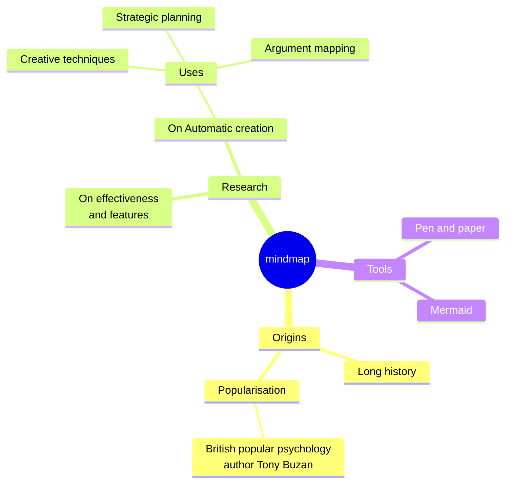
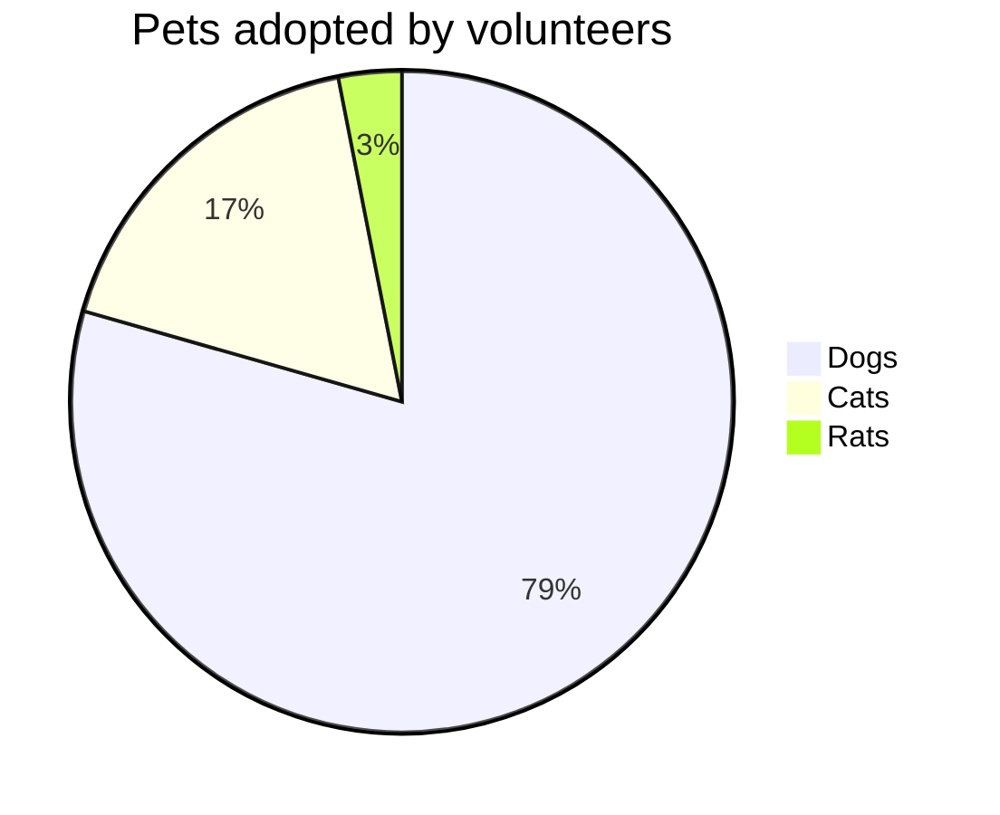

# Moeka
Moeka는 우아하고 부드러운 로컬 우선 **Markdown 편집 앱**입니다. 시작하기는 쉽지만, 많은 글을 쓰는 사용자에게도 충분히 강력합니다. macOS에서 사용할 수 있으며 ~~Windows와 Linux~~ 지원은 나중에 제공될 예정입니다. 아래 안내를 읽으면 나만의 지식 베이스를 더 빠르게 만들 수 있습니다.

Moeka는 `Markdown`을 텍스트 편집 형식으로 사용합니다. Markdown은 읽기 쉬우면서도 글쓰기를 방해하지 않아 작성자에게 잘 맞습니다. 지원 문법은 우클릭 메뉴에서 미리 볼 수 있고, [단축키](#표-상호작용)로 빠르게 서식을 바꿀 수 있습니다. 빈 줄에서 `/`를 입력하면 서식 메뉴가 열리며, 키워드로 필요한 형식을 바로 선택할 수 있습니다.

> Markdown 형식의 문서는 별도의 서식 스타일 없이 일반 텍스트로 게시할 수 있어야 합니다. 문법은 모두 구두점으로 이루어져 있으며, 그 자체가 의미처럼 보이도록 신중하게 선택되었습니다. 별표는 강조처럼 보이고, 목록 표시는 목록처럼 보입니다. -- John Gruber


### 순서 없는 목록
- 이것은 순서 없는 목록입니다.
  - 이것은 중첩된 순서 없는 목록입니다.
  - 이것은 두 번째 항목입니다.
- 이것은 두 번째 항목입니다.
### 순서 있는 목록
1. 이것은 순서 있는 목록입니다.
   1. 이것은 중첩된 순서 있는 목록입니다.
   2. 이것은 두 번째 항목입니다.
2. 이것은 두 번째 항목입니다.
   - 이것은 순서 없는 목록입니다.
   - 이것은 두 번째 항목입니다.
### 할 일 목록
- [x] 여기에 할 일을 입력할 수 있습니다.
  - [ ] 중첩된 할 일도 만들 수 있습니다.
  - [ ] 이 줄에서 `Tab` 또는 `Shift + Tab`을 눌러 보세요.
- [ ] 완료된 항목을 나중에 추가할 수 있습니다.
***
### 표 상호작용
| 기능                       | 단축키         |
| -------------------------- | -------------- |
| `Command + B`              | 굵게           |
| `Command + I`              | 기울임         |
| `Command + Shift + X`      | 취소선         |
| `Command + E`              | 인라인 코드    |
| `Command + Option + C`     | 코드 블록      |
| `Command + Option + Q`     | 인용           |
| `Command + Option + U`     | 순서 없는 목록 |
| `Command + Option + O`     | 순서 있는 목록 |
| `Command + Option + Enter` | 할 일          |
| `Command + K`              | 링크           |
| `/ image`                  | 이미지         |

| --------------------- | --------  |
| --------------------- | --------- |
| `[[`                  | 위키 링크 |
| `/ image`             | 이미지    |
## 코드 블록 문법
```rust
fn greet(name: &str) {
  println!("hello, {name}");
}
```

### LaTeX 수식
간단한 표시 수식을 입력하면 문서 안에서 블록 미리보기를 볼 수 있습니다.

$$
E = mc^2
$$

### Mermaid 다이어그램 예시
간단한 다이어그램으로 차트 미리보기를 확인해 보세요.





## 인라인 문법
- **굵게** 또는 *italic* 기울임으로 강조할 수 있습니다.
- ++밑줄++로 주의가 필요한 구절을 표시할 수 있습니다. `~U~`는 밑줄이 아니라 아래 첨자로 렌더링됩니다.
- 밑줄 예시: ++underline++, HTML 형식 <u>underline</u>도 지원합니다.
- `인라인 코드`로 키워드나 짧은 코드 조각을 표시할 수 있습니다.
## 콜아웃 문법
> [!TIP] 이것은 콜아웃 제목입니다
> 콜아웃 안에 본문을 계속 쓸 수 있습니다. 접으면 해당 emoji가 보이고 제목은 굵게 표시됩니다.

> [!WARNING] 주의
> NOTE, IMPORTANT, WARNING, CAUTION 등 여러 유형을 사용할 수 있습니다.
## 링크 문법
- [내부 링크](#moeka)로 현재 파일의 제목으로 이동할 수 있습니다.
- [[My Design Style.md]] 위키 링크로 파일을 서로 연결할 수 있습니다.
- [외부 링크](https://google.com)로 원하는 웹 주소를 열 수 있습니다.
- 각주 문법[^note]으로 참조 줄로 이동할 수 있습니다.
- [파일 링크](Feature Plan.md)로 지정한 파일이나 제목으로 이동할 수 있습니다.
- 위 링크들은 `Command` 키를 누른 채 클릭하면 열립니다.
## 확장 인라인 문법
- 아래 첨자 예시: H~2~O. 위 첨자 예시: E=mc^2^. Foo~zoo~ 또는 Bar^baz^ 같은 영어도 사용할 수 있습니다.
- ==하이라이트== 문법으로 텍스트를 더 눈에 띄게 만들 수 있습니다.
- `:rocket:` 같은 emoji shortcode도 지원합니다. 예: :rocket: .
- [^note]: 다른 위치에서 이동할 수 있는 각주 줄입니다.

Markdown에 대한 자세한 내용은 GitHub의 [Markdown 문법 가이드](https://docs.github.com/en/get-started/writing-on-github/getting-started-with-writing-and-formatting-on-github/basic-writing-and-formatting-syntax)를 참고하고 기본 작성법을 더 시도해 보세요.
