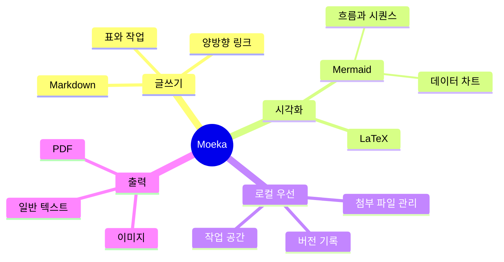

# Moeka
Moeka는 간결하고 매끄러우며 완전히 로컬에서 작동하는 **Markdown 편집 앱**입니다. 사용법은 간단하지만 지식 관리와 고밀도 콘텐츠 조판까지 충분히 해냅니다. macOS, ~~Windows, Linux~~([현재 지원](https://moeka.app/))에서 사용할 수 있습니다. 이 간결한 편집기로 누구나 자신의 지식 베이스를 빠르게 만들 수 있기를 바랍니다. 아래 안내에서 시작해 보세요.

Moeka는 `Markdown`을 텍스트 편집 형식으로 사용합니다. Markdown은 읽기 쉬우면서도 글쓰기를 방해하지 않아 작성자에게 잘 맞습니다. 지원 문법은 우클릭 메뉴에서 미리 볼 수 있고, [단축키](#표-지원)로 빠르게 서식을 바꿀 수 있습니다. 빈 줄에서 `/`를 입력하면 서식 메뉴가 열리며, 키워드로 필요한 형식을 바로 선택할 수 있습니다.

> Markdown 형식의 문서는 별도의 서식 스타일 없이 일반 텍스트로 게시할 수 있어야 합니다. 문법은 모두 구두점으로 이루어져 있으며, 그 자체가 의미처럼 보이도록 신중하게 선택되었습니다. 별표는 강조처럼 보이고, 목록 표시는 목록처럼 보입니다. -- John Gruber


### 순서 없는 목록
- 이것은 순서 없는 목록입니다.
  - 이것은 중첩된 순서 없는 목록입니다.
  - 이것은 두 번째 항목입니다.
- 이것은 두 번째 항목입니다.
### 순서 있는 목록
1. 이것은 순서 있는 목록입니다.
   1. 이것은 중첩된 순서 있는 목록입니다.
   2. 이것은 두 번째 항목입니다.
2. 이것은 두 번째 항목입니다.
   - 이것은 순서 없는 목록입니다.
   - 이것은 두 번째 항목입니다.
### 할 일 목록
- [x] 여기에 할 일을 입력할 수 있습니다.
  - [ ] 중첩된 할 일도 만들 수 있습니다.
  - [ ] 이 줄에서 `Tab` 또는 `Shift + Tab`을 눌러 보세요.
- [ ] 완료된 항목을 나중에 추가할 수 있습니다.
***
### 표 지원
| 기능                         | 단축키                                  |
| ---------------------------- | --------------------------------------- |
| `Command / Ctrl + B`         | 굵게                                    |
| `Command / Ctrl + I`         | 기울임                                  |
| `Command / Ctrl + U`         | 밑줄                                    |
| `Command / Ctrl + Shift + X` | 취소선                                  |
| `Command / Ctrl + E`         | 인라인 코드                             |
| 더 많은 문법                 | `/` 명령 또는 우클릭 서식 메뉴에서 확인 |
## 코드 블록 문법
```rust
fn greet(name: &str) {
  println!("hello, {name}");
}
```
### LaTeX 수식
`$...$`로 감싸면 $E = mc^2$ 같은 인라인 수식을, `$$`를 각각 한 줄에 단독으로 놓으면 블록 수식을 작성할 수 있습니다:

$$
\operatorname*{arg\,min}_{\theta \in \mathbb{R}^n}
\left[
  \frac{1}{m}\sum_{i=1}^{m}
  \left\lVert f_\theta(x_i)-y_i \right\rVert_2^2
  + \lambda \left\lVert \theta \right\rVert_2^2
\right]
$$
### Mermaid 다이어그램 예시

## 인라인 문법
- **굵게** 또는 *italic* 기울임으로 강조할 수 있습니다.
- ++밑줄++로 주의가 필요한 구절을 표시할 수 있습니다. `~U~`는 밑줄이 아니라 아래 첨자로 렌더링됩니다.
- 밑줄 예시: ++underline++, HTML 형식 <u>underline</u>도 지원합니다.
- `인라인 코드`로 키워드나 짧은 코드 조각을 표시할 수 있습니다.
## 콜아웃 문법
> [!TIP] 이것은 콜아웃 제목입니다
> 콜아웃 안에 본문을 계속 쓸 수 있으며, 접을 수도 있습니다.

> [!WARNING] 주의
> NOTE, IMPORTANT, WARNING, CAUTION 등 여러 유형을 사용할 수 있습니다.
## 링크 문법
- [내부 링크](#moeka)로 현재 파일의 제목으로 이동할 수 있습니다.
- [[디자인 스타일 참고.md]] 위키 링크로 파일을 서로 연결할 수 있습니다.
- [외부 링크](https://google.com)로 원하는 웹 주소를 열 수 있습니다.
- 각주 문법[^note]으로 참조 줄로 이동할 수 있습니다.
- [파일 링크](<디자인 스타일 참고.md>)로 지정한 파일이나 제목으로 이동할 수 있습니다.
- 위 링크들은 `Command / Ctrl` 키를 누른 채 클릭하면 열립니다.
## 확장 인라인 문법
- 아래 첨자 예시: H~2~O. 위 첨자 예시: E=mc^2^. Foo~zoo~ 또는 Bar^baz^ 같은 영어도 사용할 수 있습니다.
- ==하이라이트== 문법으로 텍스트를 더 눈에 띄게 만들 수 있습니다.
- `:rocket:` 같은 emoji shortcode도 지원합니다. 예: :rocket: .
- [^note]: 다른 위치에서 이동할 수 있는 각주 줄입니다.

Markdown에 대한 자세한 내용은 GitHub의 [Markdown 문법 가이드](https://docs.github.com/en/get-started/writing-on-github/getting-started-with-writing-and-formatting-on-github/basic-writing-and-formatting-syntax)를 참고하고 기본 작성법을 더 시도해 보세요.
