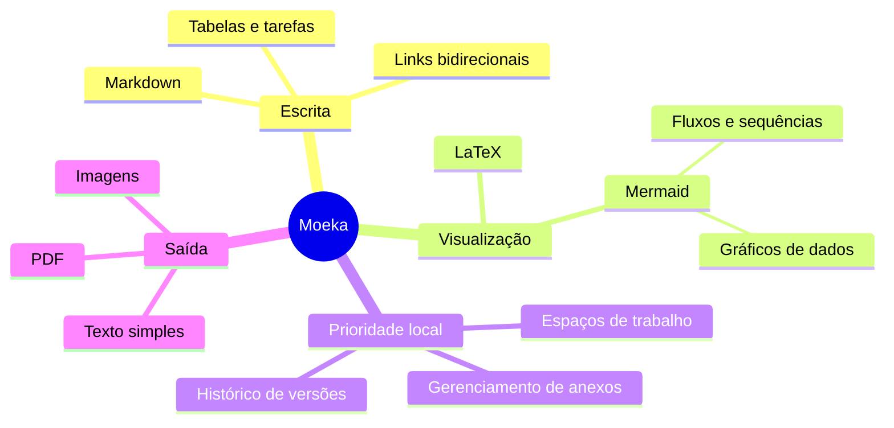

# Moeka
Moeka é um **editor Markdown** simples, fluido e totalmente local. É muito fácil de usar e, ao mesmo tempo, capaz de gerenciar conhecimento e compor conteúdo denso. Você pode usá-lo no macOS, ~~Windows e Linux~~ ([agora compatíveis](https://moeka.app/)). Esperamos que este editor enxuto ajude qualquer pessoa a criar rapidamente sua própria base de conhecimento; este guia apresenta o essencial.

Moeka usa `Markdown` como formato de texto. Markdown é ótimo para escrita porque mantém boa legibilidade sem atrapalhar a criação. Você pode pré-visualizar a sintaxe no menu de contexto, usar os [atalhos](#suporte-a-tabelas) ou digitar `/` em uma linha vazia para abrir o menu de formatação e buscar o formato desejado por palavra-chave.

> Um documento Markdown deve poder ser publicado como texto puro, sem estilos de formatação. Sua sintaxe é feita apenas de sinais de pontuação escolhidos para parecer com o que significam: asteriscos parecem ênfase e marcadores de lista parecem listas. -- John Gruber


### Lista não ordenada
- Esta é uma lista não ordenada.
  - Esta é uma lista não ordenada aninhada.
  - Este é o segundo item.
- Este é o segundo item.
### Lista ordenada
1. Esta é uma lista ordenada.
   1. Esta é uma lista ordenada aninhada.
   2. Este é o segundo item.
2. Este é o segundo item.
   - Esta é uma lista não ordenada.
   - Este é o segundo item.
### Lista de tarefas
- [x] Você pode escrever tarefas aqui.
  - [ ] Tarefas aninhadas também são suportadas.
  - [ ] Experimente `Tab` ou `Shift + Tab` nesta linha.
- [ ] Adicione mais itens concluídos depois.
***
### Suporte a tabelas
| Recurso                      | Atalho                                                             |
| ---------------------------- | ------------------------------------------------------------------ |
| `Command / Ctrl + B`         | Negrito                                                            |
| `Command / Ctrl + I`         | Itálico                                                            |
| `Command / Ctrl + U`         | Sublinhado                                                         |
| `Command / Ctrl + Shift + X` | Tachado                                                            |
| `Command / Ctrl + E`         | Código em linha                                                    |
| Mais sintaxe                 | Consulte o comando `/` ou o menu de formatação com o botão direito |
## Sintaxe de bloco de código
```rust
fn greet(name: &str) {
  println!("hello, {name}");
}
```
### Fórmulas LaTeX
Envolva a sintaxe com `$...$` para escrever uma fórmula em linha, como $E = mc^2$, ou coloque cada `$$` sozinho em uma linha para escrever uma fórmula em bloco:

$$
\operatorname*{arg\,min}_{\theta \in \mathbb{R}^n}
\left[
  \frac{1}{m}\sum_{i=1}^{m}
  \left\lVert f_\theta(x_i)-y_i \right\rVert_2^2
  + \lambda \left\lVert \theta \right\rVert_2^2
\right]
$$
### Exemplo de diagrama Mermaid

## Sintaxe em linha
- Use **negrito** ou *italic* para dar ênfase.
- Use ++sublinhado++ para marcar frases importantes; `~U~` vira subscrito, não sublinhado.
- Exemplos: ++underline++ e a forma HTML <u>underline</u>.
- Use `código em linha` para palavras-chave ou trechos curtos.
## Sintaxe de callout
> [!TIP] Este é um título de callout
> Você pode continuar escrevendo dentro do callout e também recolhê-lo.

> [!WARNING] Atenção
> NOTE, IMPORTANT, WARNING, CAUTION e outros tipos são suportados.
## Sintaxe de links
- Use um [link interno](#moeka) para ir a um título no arquivo atual.
- Use links wiki como [[Referência de estilo de design.md]] para conectar arquivos.
- Use um [link externo](https://google.com) para abrir qualquer endereço web.
- Use notas de rodapé[^note] para ir a uma referência.
- Use um [link de arquivo](<Referência de estilo de design.md>) para abrir um arquivo ou título.
- Segure `Command / Ctrl` e clique nesses links para abri-los.
## Sintaxe em linha estendida
- Subscrito: H~2~O. Sobrescrito: E=mc^2^. Também funciona Foo~zoo~ ou Bar^baz^.
- A sintaxe ==destacada== ajuda a enfatizar o texto.
- Emoji shortcodes como `:rocket:` são suportados, por exemplo :rocket: .
- [^note]: Esta é a linha de nota de rodapé acessível a partir de outros lugares.

Para mais detalhes, consulte o [guia de sintaxe Markdown do GitHub](https://docs.github.com/en/get-started/writing-on-github/getting-started-with-writing-and-formatting-on-github/basic-writing-and-formatting-syntax).
