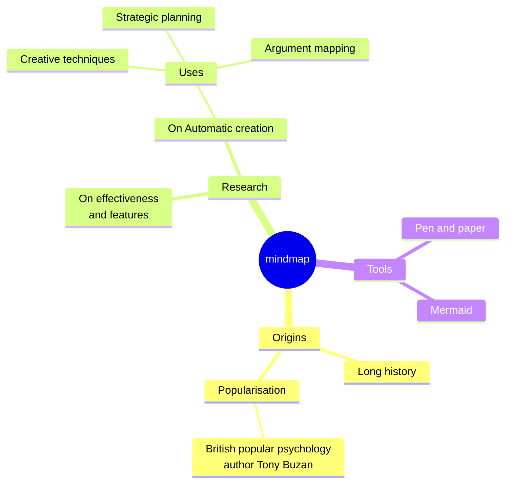
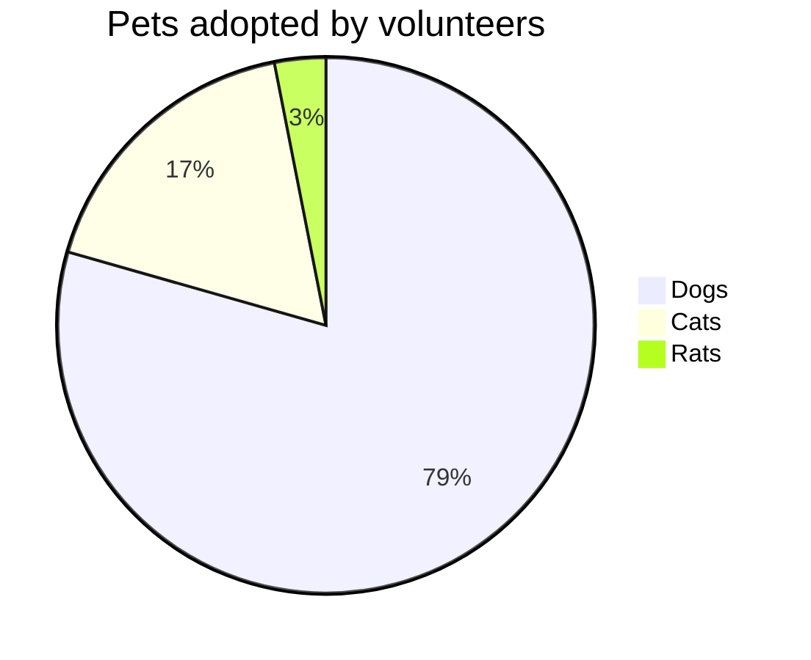

# Moeka
Moeka é um **editor Markdown** elegante, fluido e local-first. Ele é simples para começar, mas forte o bastante para quem escreve muito. Você pode usá-lo no macOS; ~~Windows e Linux~~ chegarão depois. Este guia ajuda você a criar sua base de conhecimento rapidamente.

Moeka usa `Markdown` como formato de texto. Markdown é ótimo para escrita porque mantém boa legibilidade sem atrapalhar a criação. Você pode pré-visualizar a sintaxe no menu de contexto, usar os [atalhos](#interação-com-tabelas) ou digitar `/` em uma linha vazia para abrir o menu de formatação.

> Um documento Markdown deve poder ser publicado como texto puro, sem estilos de formatação. Sua sintaxe é feita apenas de sinais de pontuação escolhidos para parecer com o que significam: asteriscos parecem ênfase e marcadores de lista parecem listas. -- John Gruber


### Lista não ordenada
- Esta é uma lista não ordenada.
  - Esta é uma lista não ordenada aninhada.
  - Este é o segundo item.
- Este é o segundo item.
### Lista ordenada
1. Esta é uma lista ordenada.
   1. Esta é uma lista ordenada aninhada.
   2. Este é o segundo item.
2. Este é o segundo item.
   - Esta é uma lista não ordenada.
   - Este é o segundo item.
### Lista de tarefas
- [x] Você pode escrever tarefas aqui.
  - [ ] Tarefas aninhadas também são suportadas.
  - [ ] Experimente `Tab` ou `Shift + Tab` nesta linha.
- [ ] Adicione mais itens concluídos depois.
***
### Interação com tabelas
| Recurso                    | Atalho             |
| -------------------------- | ------------------ |
| `Command + B`              | Negrito            |
| `Command + I`              | Itálico            |
| `Command + Shift + X`      | Tachado            |
| `Command + E`              | Código em linha    |
| `Command + Option + C`     | Bloco de código    |
| `Command + Option + Q`     | Citação            |
| `Command + Option + U`     | Lista não ordenada |
| `Command + Option + O`     | Lista ordenada     |
| `Command + Option + Enter` | Tarefa             |
| `Command + K`              | Link               |
| `/ image`                  | Imagem             |

| --------------------- | --------  |
| --------------------- | --------- |
| `[[`                  | Link wiki |
| `/ image`             | Imagem    |
## Sintaxe de bloco de código
```rust
fn greet(name: &str) {
  println!("hello, {name}");
}
```

### Fórmulas LaTeX
Digite uma fórmula simples em bloco para ver uma prévia no documento.

$$
E = mc^2
$$

### Exemplo de diagrama Mermaid
Use um diagrama simples para observar a prévia de gráficos.





## Sintaxe em linha
- Use **negrito** ou *italic* para dar ênfase.
- Use ++sublinhado++ para marcar frases importantes; `~U~` vira subscrito, não sublinhado.
- Exemplos: ++underline++ e a forma HTML <u>underline</u>.
- Use `código em linha` para palavras-chave ou trechos curtos.
## Sintaxe de callout
> [!TIP] Este é um título de callout
> Você pode continuar escrevendo dentro do callout. Ao recolher, ele mostra o emoji correspondente e mantém o título em negrito.

> [!WARNING] Atenção
> NOTE, IMPORTANT, WARNING, CAUTION e outros tipos são suportados.
## Sintaxe de links
- Use um [link interno](#moeka) para ir a um título no arquivo atual.
- Use links wiki como [[My Design Style.md]] para conectar arquivos.
- Use um [link externo](https://google.com) para abrir qualquer endereço web.
- Use notas de rodapé[^note] para ir a uma referência.
- Use um [link de arquivo](Feature Plan.md) para abrir um arquivo ou título.
- Segure `Command` e clique nesses links para abri-los.
## Sintaxe em linha estendida
- Subscrito: H~2~O. Sobrescrito: E=mc^2^. Também funciona Foo~zoo~ ou Bar^baz^.
- A sintaxe ==destacada== ajuda a enfatizar o texto.
- Emoji shortcodes como `:rocket:` são suportados, por exemplo :rocket: .
- [^note]: Esta é a linha de nota de rodapé acessível a partir de outros lugares.

Para mais detalhes, consulte o [guia de sintaxe Markdown do GitHub](https://docs.github.com/en/get-started/writing-on-github/getting-started-with-writing-and-formatting-on-github/basic-writing-and-formatting-syntax).
