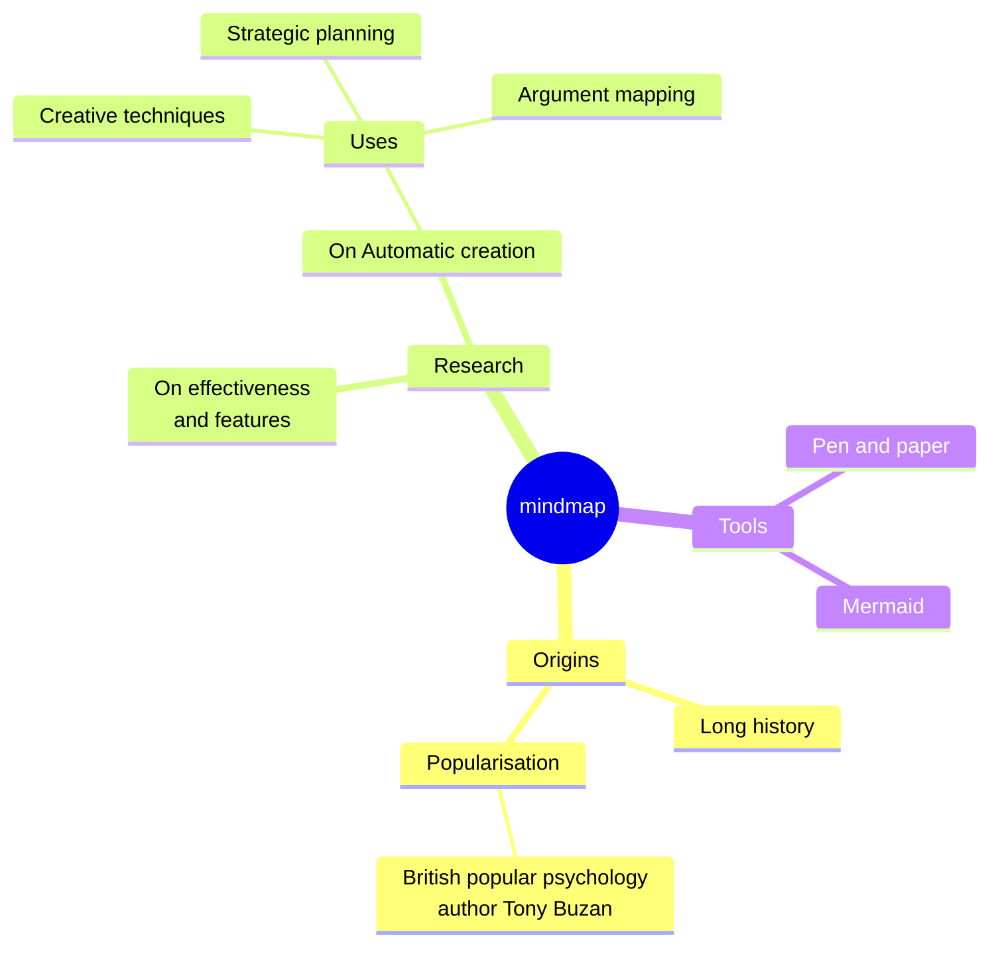
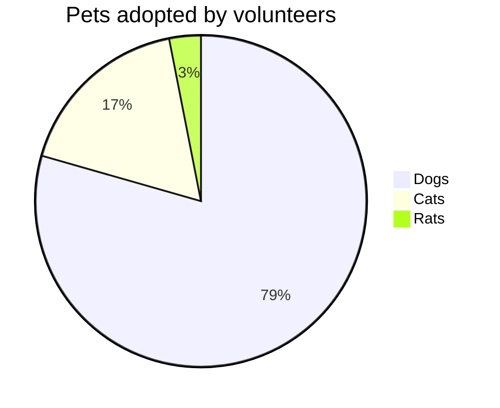

# Moeka
Moeka — элегантное, плавное и локальное приложение для **редактирования Markdown**. С ним легко начать, но его возможностей достаточно и для активных авторов. Приложение доступно на macOS; поддержка ~~Windows и Linux~~ появится позже. Это руководство поможет быстрее собрать собственную базу знаний.

Moeka использует `Markdown` как текстовый формат. Markdown удобен для письма: он остается читаемым и не мешает творческому процессу. Поддерживаемый синтаксис можно посмотреть в контекстном меню, применить через [сочетания клавиш](#работа-с-таблицами) или ввести `/` на пустой строке, чтобы открыть меню форматирования.

> Документ Markdown должен быть пригоден для публикации как обычный текст без оформления. Его синтаксис полностью состоит из знаков пунктуации, выбранных так, чтобы они выглядели как свое значение: звездочки похожи на выделение, а маркеры списка — на списки. -- John Gruber


### Неупорядоченный список
- Это неупорядоченный список.
  - Это вложенный неупорядоченный список.
  - Это второй пункт.
- Это второй пункт.
### Упорядоченный список
1. Это упорядоченный список.
   1. Это вложенный упорядоченный список.
   2. Это второй пункт.
2. Это второй пункт.
   - Это неупорядоченный список.
   - Это второй пункт.
### Список задач
- [x] Здесь можно записывать задачи.
  - [ ] Вложенные задачи тоже поддерживаются.
  - [ ] Попробуйте нажать `Tab` или `Shift + Tab` на этой строке.
- [ ] Позже добавьте выполненные пункты.
***
### Работа с таблицами
| Возможность                | Сочетание              |
| -------------------------- | ---------------------- |
| `Command + B`              | Жирный                 |
| `Command + I`              | Курсив                 |
| `Command + U`              | Подчеркнуть            |
| `Command + Shift + X`      | Зачеркнутый            |
| `Command + E`              | Встроенный код         |
| `Command + Option + C`     | Блок кода              |
| `Command + Option + Q`     | Цитата                 |
| `Command + Option + U`     | Неупорядоченный список |
| `Command + Option + O`     | Упорядоченный список   |
| `Command + Option + Enter` | Задача                 |
| `Command + K`              | Ссылка                 |
| `Command + Option + T`     | Таблица                |
| `Command + 0`              | Абзац                  |
| `/ image`                  | Изображение            |

| --------------------- | --------    |
| --------------------- | ----------- |
| `[[`                  | Wiki-ссылка |
| `/ image`             | Изображение |
## Синтаксис блока кода
```rust
fn greet(name: &str) {
  println!("hello, {name}");
}
```

### Формулы LaTeX
Введите простую блочную формулу, чтобы увидеть предпросмотр в документе.

$$
E = mc^2
$$

### Пример диаграммы Mermaid
Используйте простую диаграмму, чтобы посмотреть предпросмотр.





## Встроенный синтаксис
- Используйте **жирный** или *italic* курсив для выделения.
- Используйте ++подчеркивание++ для важных фраз; `~U~` отображается как нижний индекс, а не подчеркивание.
- Примеры: ++underline++ и HTML-вариант <u>underline</u>.
- Используйте `встроенный код` для ключевых слов или коротких фрагментов.
## Синтаксис блоков-заметок
> [!TIP] Это заголовок блока
> Внутри блока можно продолжать писать текст. После сворачивания показывается соответствующий emoji, а заголовок остается жирным.

> [!WARNING] Внимание
> Поддерживаются типы NOTE, IMPORTANT, WARNING, CAUTION и другие.
## Синтаксис ссылок
- Используйте [внутреннюю ссылку](#moeka), чтобы перейти к заголовку текущего файла.
- Используйте wiki-ссылки [[My Design Style.md]], чтобы связывать файлы.
- Используйте [внешнюю ссылку](https://google.com), чтобы открыть веб-адрес.
- Используйте сноски[^note], чтобы перейти к строке ссылки.
- Используйте [ссылку на файл](Feature Plan.md), чтобы открыть файл или заголовок.
- Удерживайте `Command` и щелкайте по этим ссылкам, чтобы открыть их.
## Расширенный встроенный синтаксис
- Нижний индекс: H~2~O. Верхний индекс: E=mc^2^. Также работает Foo~zoo~ или Bar^baz^.
- ==Подсветка== помогает сильнее выделить текст.
- Поддерживаются emoji shortcodes вроде `:rocket:`, например :rocket: .
- [^note]: Это строка сноски, к которой можно перейти из других мест.

Подробнее см. [руководство по синтаксису Markdown от GitHub](https://docs.github.com/en/get-started/writing-on-github/getting-started-with-writing-and-formatting-on-github/basic-writing-and-formatting-syntax).
