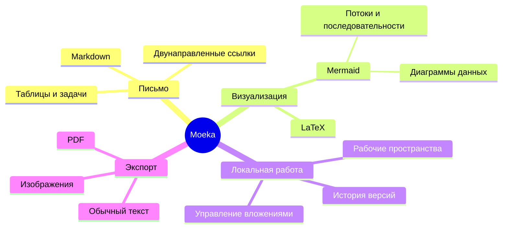

# Moeka
Moeka — элегантное, плавное и полностью локальное приложение для **редактирования Markdown**. Оно очень простое, но при этом подходит для управления знаниями и плотной вёрстки материалов. Moeka уже доступно на macOS, Windows и Linux ([скачать](https://moeka.app/)). Мы надеемся, что этот лаконичный редактор поможет каждому быстро создать собственную базу знаний; это руководство познакомит вас с основами.

Moeka использует `Markdown` как текстовый формат. Markdown удобен для письма: он остается читаемым и не мешает творческому процессу. Поддерживаемый синтаксис можно посмотреть в контекстном меню, применить через [сочетания клавиш](#поддержка-таблиц) или ввести `/` на пустой строке, чтобы открыть меню форматирования.

> Документ Markdown должен быть пригоден для публикации как обычный текст без оформления. Его синтаксис полностью состоит из знаков пунктуации, выбранных так, чтобы они выглядели как свое значение: звездочки похожи на выделение, а маркеры списка — на списки. -- John Gruber


### Неупорядоченный список
- Это неупорядоченный список.
  - Это вложенный неупорядоченный список.
  - Это второй пункт.
- Это второй пункт.
### Упорядоченный список
1. Это упорядоченный список.
   1. Это вложенный упорядоченный список.
   2. Это второй пункт.
2. Это второй пункт.
   - Это неупорядоченный список.
   - Это второй пункт.
### Список задач
- [x] Здесь можно записывать задачи.
  - [ ] Вложенные задачи тоже поддерживаются.
  - [ ] Попробуйте нажать `Tab` или `Shift + Tab` на этой строке.
- [ ] Позже добавьте выполненные пункты.
***
### Поддержка таблиц
| Возможность                   | Сочетание                                       |
| ----------------------------- | ----------------------------------------------- |
| `Command / Ctrl + B`          | Жирный                                          |
| `Command / Ctrl + I`          | Курсив                                          |
| `Command / Ctrl + U`          | Подчёркнутый                                    |
| `Command / Ctrl + Shift + X`  | Зачёркнутый                                     |
| `Command / Ctrl + E`          | Встроенный код                                  |
| Другие возможности синтаксиса | Команда `/` или контекстное меню форматирования |
## Синтаксис блока кода
```rust
fn greet(name: &str) {
  println!("hello, {name}");
}
```
### Формулы LaTeX
Заключите формулу в `$...$`, чтобы записать её в строке, например $E = mc^2$, или поместите каждый разделитель `$$` на отдельной строке для блочной формулы:
$$
\operatorname*{arg\,min}_{\theta \in \mathbb{R}^n}
\left[
  \frac{1}{m}\sum_{i=1}^{m}
  \left\lVert f_\theta(x_i)-y_i \right\rVert_2^2
  + \lambda \left\lVert \theta \right\rVert_2^2
\right]
$$
### Пример диаграммы Mermaid

## Встроенный синтаксис
- Используйте **жирный** или *italic* курсив для выделения.
- Используйте ++подчеркивание++ для важных фраз; `~U~` отображается как нижний индекс, а не подчеркивание.
- Примеры: ++underline++ и HTML-вариант <u>underline</u>.
- Используйте `встроенный код` для ключевых слов или коротких фрагментов.
## Синтаксис блоков-заметок
> [!TIP] Это заголовок блока
> Внутри блока можно продолжать писать текст. После сворачивания показывается соответствующий emoji, а заголовок остается жирным.

> [!WARNING] Внимание
> Поддерживаются типы NOTE, IMPORTANT, WARNING, CAUTION и другие.
## Синтаксис ссылок
- Используйте [внутреннюю ссылку](#moeka), чтобы перейти к заголовку текущего файла.
- Используйте wiki-ссылки [[Справочник по стилю дизайна.md]], чтобы связывать файлы.
- Используйте [внешнюю ссылку](https://google.com), чтобы открыть веб-адрес.
- Используйте сноски[^note], чтобы перейти к строке ссылки.
- Используйте [ссылку на файл](<Справочник по стилю дизайна.md>), чтобы открыть файл или заголовок.
- Удерживайте `Command / Ctrl` и щелкайте по этим ссылкам, чтобы открыть их.
## Расширенный встроенный синтаксис
- Нижний индекс: H~2~O. Верхний индекс: E=mc^2^. Также работает Foo~zoo~ или Bar^baz^.
- ==Подсветка== помогает сильнее выделить текст.
- Поддерживаются emoji shortcodes вроде `:rocket:`, например :rocket: .
- [^note]: Это строка сноски, к которой можно перейти из других мест.

Подробнее см. [руководство по синтаксису Markdown от GitHub](https://docs.github.com/en/get-started/writing-on-github/getting-started-with-writing-and-formatting-on-github/basic-writing-and-formatting-syntax).
