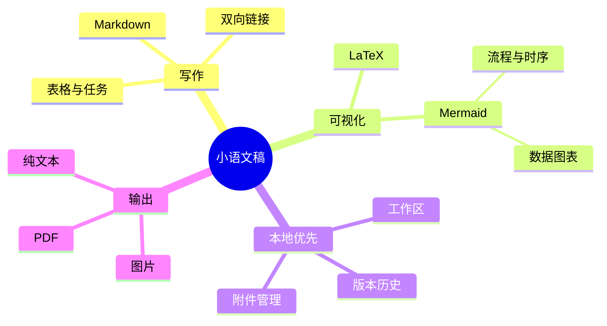

# 小语文稿
小语文稿是一个优雅，流畅，本地优先的 **Markdown 编辑应用**。它使用起来非常简单，但也能够胜任重度写作者的需求。你可以在 macOS 和 Windows 上使用它，Linux 版本稍后推出。我们希望这款简洁的编辑器能让所有人都能快速建立自己的知识库，阅读下面的指导帮助你更快地了解。

使用 `Markdown` 语言作为文本编辑格式，它非常适合文字工作者，在尽可能做到良好可读性的同时不干扰创作，小语文稿支持的语法可以通过右键菜单预览，你也可以用其标注的[快捷键](#表格语法)快速更改格式。另外也支持在空行内输入 `/` 来唤出格式菜单，键入关键字来快速选择需要插入的格式。

> Markdown 格式的文档应当是可作为纯文本发布的，没有格式化的样式，它的语法完全由标点符号组成，这些符号经过仔细筛选，让其本身就代表了字面上的意思，例如星号标记实际看起来是强调，列表标记看起来就像列表。—— John Gruber


### 无序列表
- 这是一个无序列表；
  - 这是二级无序列表；
  - 这是第二项；
- 这是第二项；
### 有序列表
1. 这是一个有序列表；
   1. 这是二级有序列表；
   2. 这是第二项；
2. 这是第二项；
   - 这是一个无序列表；
   - 这是第二项；
### 待办列表
- [x] 可以在这里录入一些待办事项。
  - [ ] 也可以有二级代办事项。
  - [ ] 试试在该行内按下 `Tab` 或 `Shift + Tab`。
- [ ] 追加录入一些已完成事项。
***
### 表格交互
| 功能                                    | 快捷键   |
| --------------------------------------- | -------- |
| `Command / Ctrl + B`                    | 加粗     |
| `Command / Ctrl + I`                    | 斜体     |
| `Command / Ctrl + U`                    | 下划线   |
| `Command / Ctrl + Shift + X`            | 删除线   |
| `Command / Ctrl + E`                    | 行内代码 |
| `Command / Ctrl + Option / Alt + C`     | 代码块   |
| `Command / Ctrl + Option / Alt + Q`     | 引用     |
| `Command / Ctrl + Option / Alt + U`     | 无序列表 |
| `Command / Ctrl + Option / Alt + O`     | 有序列表 |
| `Command / Ctrl + Option / Alt + Enter` | 待办事项 |
| `Command / Ctrl + K`                    | 链接     |
| `Command / Ctrl + Option / Alt + T`     | 表格     |
| `Command / Ctrl + 0`                    | 正文     |
| `/ image`                               | 图片     |
## 代码块语法
```rust
fn greet(name: &str) {
  println!("hello, {name}");
}
```
### LaTeX 数学公式
输入一个简单的行级公式，即可在文稿中看到块级预览效果。
$$
E = mc^2
$$
### Mermaid 图表示例

## 行内语法
- 可以使用**加粗**或者带有 *italic* 斜体语法来表示强调。
- 也可以使用++下划线++来标记需要补充注意的短语；`~U~` 会作为下标，而不是下划线。
- 下划线示例：++underline++，也兼容 HTML 写法 <u>underline</u>。
- 也可以使用 `行内代码` 来标记某个关键词或代码行。
## 提示块语法
> [!TIP] 这是一条提示块标题
> 可以在提示块里继续书写正文；折叠后会显示为对应的 emoji，标题会使用加粗样式。

> [!WARNING] 注意
> 也可以使用 NOTE、IMPORTANT、WARNING、CAUTION 等不同类型。
## 链接语法
- 可以使用[内部链接](#英文示例)，跳转到当前文件内的标题行。
- 通过 [[我的设计风格.md]] 双向链接语法在文件间互相引用。
- 或者使用[外部链接](https://google.com)，跳转到外部的任意链接。
- 还可以使用脚注语法[^note]跳转到脚注行用于引用参考。
- 另外可以使用[文件链接](功能规划.md)跳转到指定文件的指定标题。
- 以上所有语法，都可以按住 `Command / Ctrl` 键并点击后跳转。
## 行内扩展语法
- 下标示例：H~2~O，上标示例：E=mc^2^，可以用英文：Foo~zoo~ 或者 Bar^baz^ 等。
- 另外也支持==高亮==语法，让文本显得更加醒目强调。
- 还支持类似 `:rocket:` 这类 emoji shortcode 的语法，例如 :rocket: 。
- [^note]: 这里就是脚注行了，可以从其他地方跳转过来。

有关于更多 Markdown 格式的说明，可以参考 Github 的 [Markdown 语法指南](https://docs.github.com/en/get-started/writing-on-github/getting-started-with-writing-and-formatting-on-github/basic-writing-and-formatting-syntax)，了解和尝试更多基本写法。
