# 小语文稿
小语文稿是一个优雅，流畅，本地优先的 **Markdown 编辑应用**。它使用起来非常简单，但也能够胜任重度写作者的需求。你可以在 macOS，~~Windows 和 Linux~~（稍后推出）上使用它，我们希望这款简洁的编辑器能让所有人都能快速建立自己的知识库，阅读下面的指导帮助你更快的了解。

使用 `Markdown` 语言作为文本编辑格式，它非常适合文字工作者，在尽可能做到良好可读性的同时不干扰创作，小语文稿支持的语法可以通过右键菜单预览，你也可以用其标注的[快捷键](#表格语法)快速更改格式。另外也支持在空行内输入 `/` 来唤出格式菜单，键入关键字来快速选择需要插入的格式。

> Markdown 格式的文档应当是可作为纯文本发布的，没有格式化的样式，它的语法完全由标点符号组成，这些符号经过仔细筛选，让其本身就代表了字面上的意思，例如星号标记实际看起来是强调，列表标记看起来就像列表。—— John Gruber


### 无序列表
- 这是一个无序列表；
  - 这是二级无序列表；
  - 这是第二项；
- 这是第二项；
### 有序列表
1. 这是一个有序列表；
   1. 这是二级有序列表；
   2. 这是第二项；
2. 这是第二项；
   - 这是一个无序列表；
   - 这是第二项；
### 待办列表
- [x] 可以在这里录入一些待办事项。
  - [ ] 也可以有二级代办事项。
  - [ ] 试试在该行内按下 `Tab` 或 `Shift + Tab`。
- [ ] 追加录入一些已完成事项。
***
### 表格交互
| 功能                       | 快捷键   |
| -------------------------- | -------- |
| `Command + B`              | 加粗     |
| `Command + I`              | 斜体     |
| `Command + U`              | 下划线   |
| `Command + Shift + X`      | 删除线   |
| `Command + E`              | 行内代码 |
| `Command + Option + C`     | 代码块   |
| `Command + Option + Q`     | 引用     |
| `Command + Option + U`     | 无序列表 |
| `Command + Option + O`     | 有序列表 |
| `Command + Option + Enter` | 待办事项 |
| `Command + K`              | 链接     |
| `Command + Option + T`     | 表格     |
| `Command + 0`              | 正文     |
| `/ image`                  | 图片     |

| --------------------- | -------- |
| --------------------- | -------- |
| `[[`                  | 双向链接 |
| `/ image`             | 图片     |
## 代码块语法
```rust
fn greet(name: &str) {
  println!("hello, {name}");
}
```

### LaTeX 数学公式
输入一个简单的行级公式，即可在文稿中看到块级预览效果。

$$
E = mc^2
$$

### Mermaid 图表示例
小语文稿使用纯 Rust 渲染器显示 Mermaid 图表。下面覆盖当前可渲染的 27 种图表类型；ZenUML 采用无浏览器兼容子集。

#### 1. 流程图 Flowchart
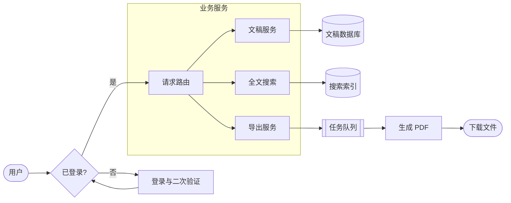

#### 2. 时序图 Sequence Diagram
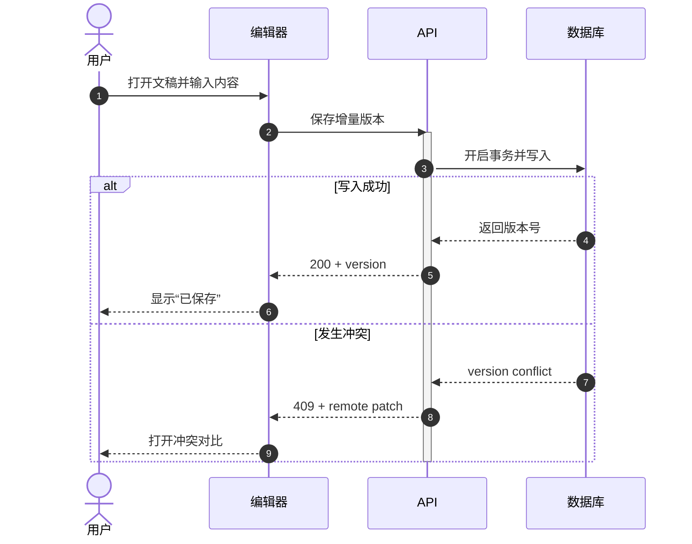

#### 3. 类图 Class Diagram
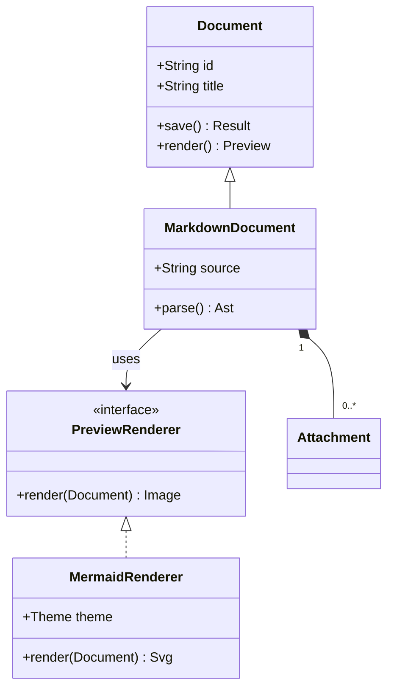

#### 4. 状态图 State Diagram
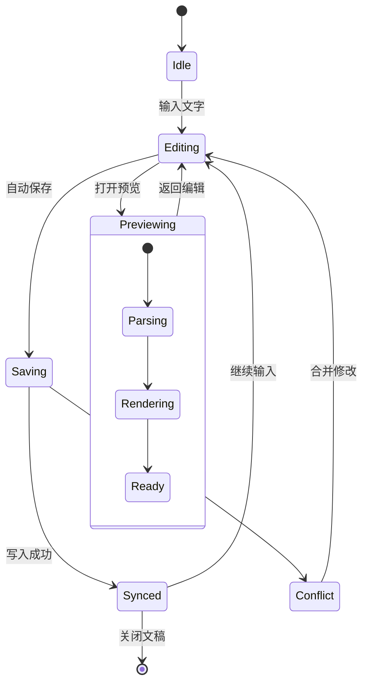

#### 5. 实体关系图 ER Diagram
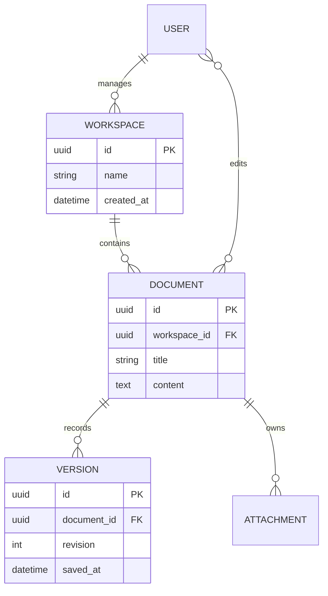

#### 6. 甘特图 Gantt
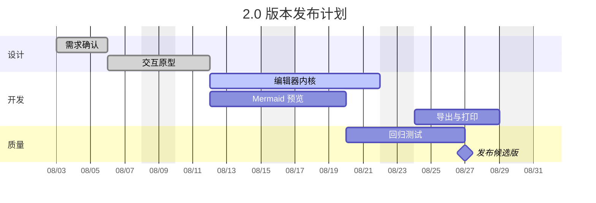

#### 7. 用户旅程图 Journey
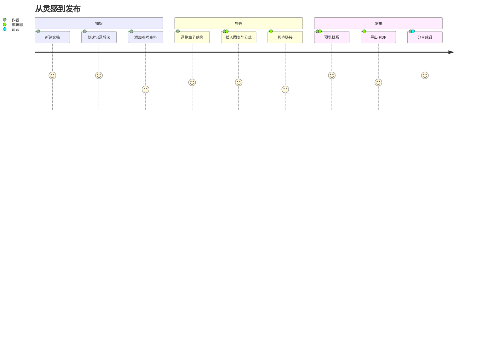

#### 8. 饼图 Pie Chart
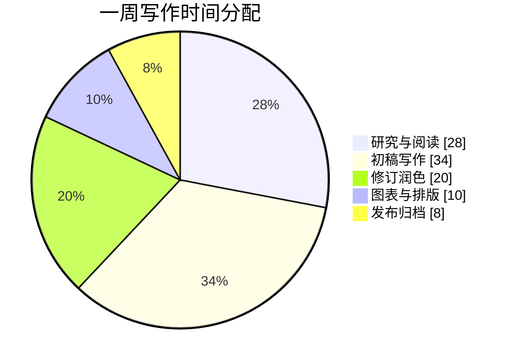

#### 9. Git 分支图 Git Graph
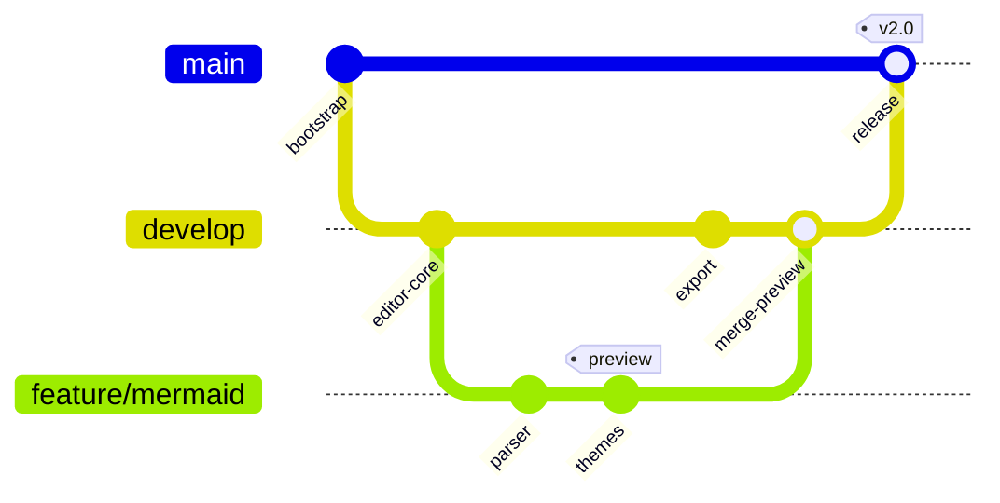

#### 10. 思维导图 Mindmap
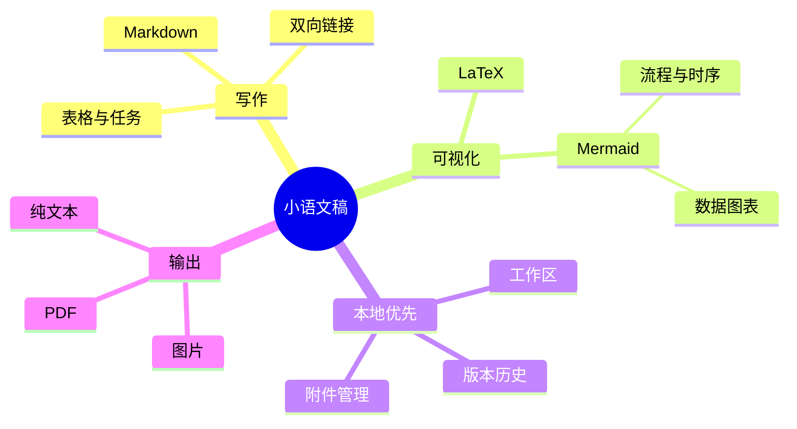

#### 11. 时间线 Timeline
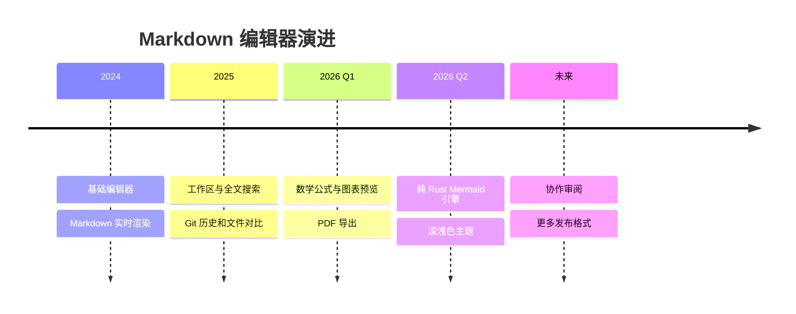

#### 12. 四象限图 Quadrant Chart
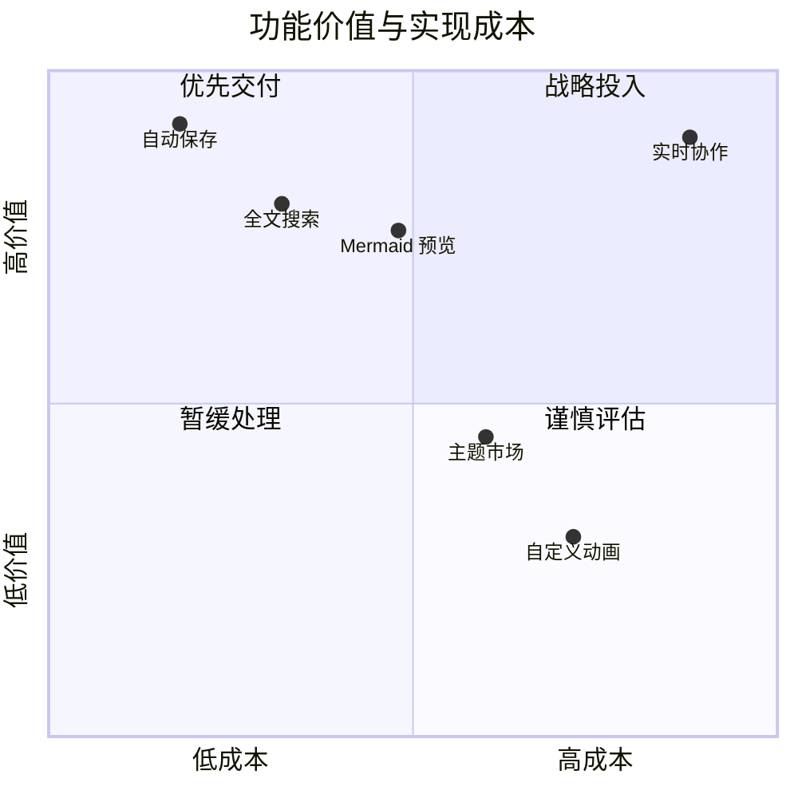

#### 13. XY 图表 XY Chart
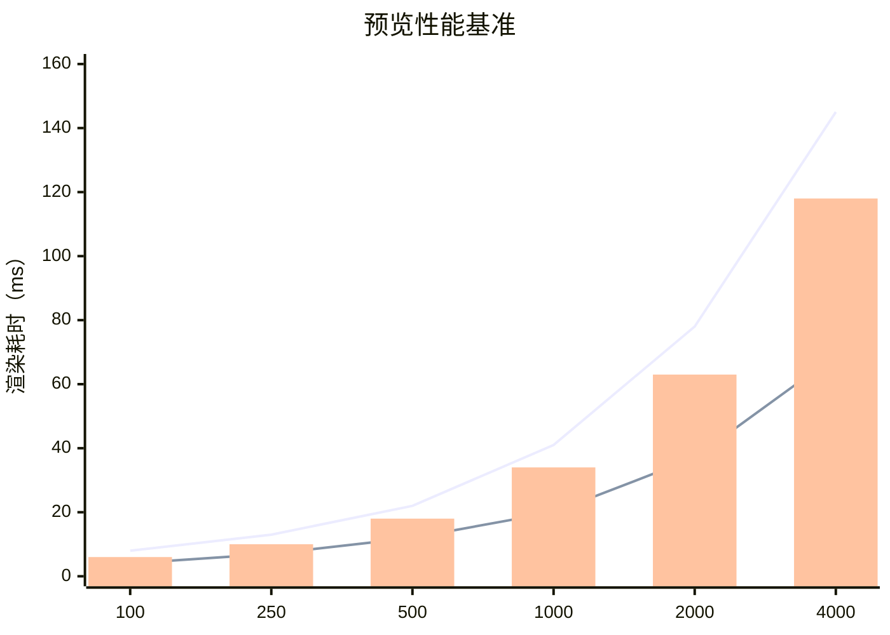

#### 14. 桑基图 Sankey
```mermaid
sankey-beta
访问首页,打开工作区,820
访问首页,离开,180
打开工作区,新建文稿,310
打开工作区,继续编辑,510
新建文稿,完成初稿,240
新建文稿,放弃,70
继续编辑,完成修订,430
继续编辑,暂存,80
完成初稿,导出,180
完成修订,导出,360
导出,分享,420
导出,仅归档,120
```

#### 15. 需求图 Requirement Diagram
```mermaid
requirementDiagram
  requirement autosave {
    id: REQ-01
    text: 编辑内容必须自动持久化
    risk: high
    verifymethod: test
  }
  functionalRequirement conflict_detection {
    id: REQ-02
    text: 保存前检测远端版本冲突
    risk: medium
    verifymethod: demonstration
  }
  element editor {
    type: application
    docref: editor-spec.md
  }
  element storage {
    type: service
    docref: storage-spec.md
  }
  editor - satisfies -> autosave
  storage - verifies -> autosave
  autosave - contains -> conflict_detection
  editor - satisfies -> conflict_detection
```

#### 16. C4 架构图
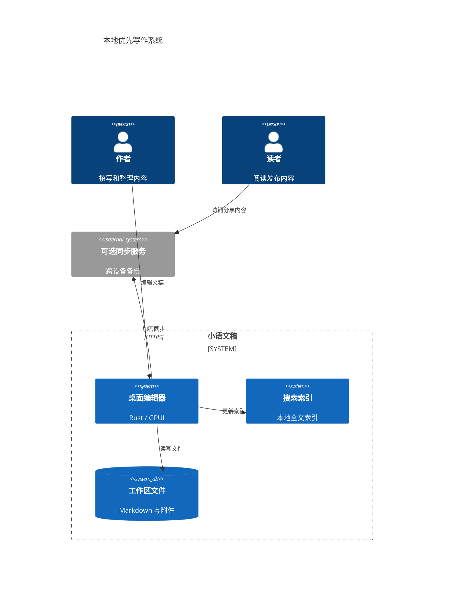

#### 17. 架构图 Architecture


#### 18. 块图 Block Diagram
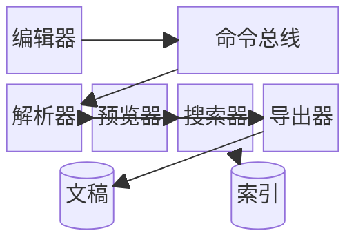

#### 19. 数据包图 Packet Diagram
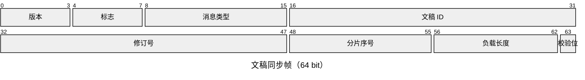

#### 20. 看板 Kanban


#### 21. 矩形树图 Treemap
```mermaid
treemap-beta
  title 工作区文件占用
  "文稿"
    "长篇写作": 42
    "日常笔记": 28
    "项目文档": 18
  "附件"
    "图片": 35
    "PDF": 16
    "音频": 8
  "缓存"
    "搜索索引": 12
    "预览图片": 9
```

#### 22. 雷达图 Radar
```mermaid
radar-beta
  title 编辑器能力对比
  axis Speed["速度"], Quality["排版"], Offline["离线"], Search["搜索"], Export["导出"], Ext["扩展性"]
  curve Moeka["小语文稿"]{88, 92, 100, 86, 84, 72}
  curve Browser["浏览器编辑器"]{68, 80, 35, 78, 75, 92}
  curve Plain["纯文本工具"]{96, 45, 100, 52, 38, 65}
  ticks 5
  min 0
  max 100
  graticule polygon
  showLegend true
```

#### 23. 韦恩图 Venn
```mermaid
venn-beta
  title 本地优先写作能力
  set Writing["写作"]:30
    text W1["Markdown"]
    text W2["大纲"]
  set Knowledge["知识管理"]:26
    text K1["双向链接"]
  set Publishing["发布"]:24
    text P1["PDF"]
  union Writing,Knowledge["结构化笔记"]:12
    text WK["标签与搜索"]
  union Writing,Publishing["成稿"]:10
  union Knowledge,Publishing["知识分享"]:8
  union Writing,Knowledge,Publishing["完整工作流"]:4
```

#### 24. ZenUML（兼容子集）
```mermaid
zenuml
  title 文稿发布流程
  Author
  Editor
  Exporter
  Author->Editor: 提交发布请求
  Editor.Validate() {
    Editor->Editor: 检查链接与资源
  }
  if(valid) {
    Editor->Exporter: 生成 PDF
    Exporter-->Author: 返回下载地址
  } else {
    Editor-->Author: 返回校验问题
  }
  opt {
    Author->Editor: 保存发布快照
  }
```

#### 25. 树视图 Tree View
```mermaid
treeView-beta
  title 工作区目录
  "我的工作区"
    "写作"
      "长篇小说"
        "第一章.md"
        "第二章.md"
      "随笔.md"
    "研究"
      "阅读笔记"
      "参考资料"
        "论文.pdf"
        "数据.csv"
    "assets"
      "images"
      "exports"
```

#### 26. 鱼骨图 Ishikawa
```mermaid
ishikawa-beta
  预览渲染不清晰
    字体
      缺少 Emoji 字体
      CJK 字宽估算错误
    布局
      节点间距不足
      长标签未换行
    颜色
      文本对比度不足
      深浅色变量混用
    输入
      复杂 Mermaid 语法
      自定义样式覆盖
    输出
      SVG 兼容性
      位图缩放失真
```

#### 27. 事件建模图 Event Modeling
```mermaid
eventmodeling
  timeframe 01 ui EditorOpened
  timeframe 02 command CreateDocument { title: "新文稿" } ->> 01
  timeframe 03 event DocumentCreated [[DocumentData]] ->> 02
  timeframe 04 view DocumentList ->> 03
  timeframe 05 command EditContent { revision: 1 } ->> 04
  timeframe 06 event ContentChanged [[RevisionData]] ->> 05
  timeframe 07 view LivePreview ->> 06
  resetframe 08 event WorkspaceRestored ->> 03 ->> 06

  data DocumentData {
    id: "doc-001"
    title: "新文稿"
  }
  data RevisionData {
    documentId: "doc-001"
    revision: 1
  }
```

## 行内语法
- 可以使用**加粗**或者带有 *italic* 斜体语法来表示强调。
- 也可以使用++下划线++来标记需要补充注意的短语；`~U~` 会作为下标，而不是下划线。
- 下划线示例：++underline++，也兼容 HTML 写法 <u>underline</u>。
- 也可以使用 `行内代码` 来标记某个关键词或代码行。
## 提示块语法
> [!TIP] 这是一条提示块标题
> 可以在提示块里继续书写正文；折叠后会显示为对应的 emoji，标题会使用加粗样式。

> [!WARNING] 注意
> 也可以使用 NOTE、IMPORTANT、WARNING、CAUTION 等不同类型。
## 链接语法
- 可以使用[内部链接](#英文示例)，跳转到当前文件内的标题行。
- 通过 [[我的设计风格.md]] 双向链接语法在文件间互相引用。
- 或者使用[外部链接](https://google.com)，跳转到外部的任意链接。
- 还可以使用脚注语法[^note]跳转到脚注行用于引用参考。
- 另外可以使用[文件链接](功能规划.md)跳转到指定文件的指定标题。
- 以上所有语法，都可以按住 `Command` 键并点击后跳转。
## 本地附件
- 在 Markdown 文档中粘贴图片或文件，或者从 Finder 拖入文件时，小语文稿会把资源复制到“设置”中选择的附件位置。从小语文稿侧边栏拖入文件只会插入链接，不会重复复制。
- 附件可以保存在当前文档同级、工作区指定目录，或当前文档旁的子文件夹。自定义目录必须是工作区内的相对路径。
- 新插入的附件使用文档相对路径和标准 Markdown 链接，例如 ``。
- 已有的 Markdown 链接和 `![[assets/image.png]]` 形式的 WikiLink 均可解析和预览。
- 移动或重命名文件、文件夹后，现有文档中的链接不会自动更新。
## 行内扩展语法
- 下标示例：H~2~O，上标示例：E=mc^2^，可以用英文：Foo~zoo~ 或者 Bar^baz^ 等。
- 另外也支持==高亮==语法，让文本显得更加醒目强调。
- 还支持类似 `:rocket:` 这类 emoji shortcode 的语法，例如 :rocket: 。
- [^note]: 这里就是脚注行了，可以从其他地方跳转过来。

有关于更多 Markdown 格式的说明，可以参考 Github 的 [Markdown 语法指南](https://docs.github.com/en/get-started/writing-on-github/getting-started-with-writing-and-formatting-on-github/basic-writing-and-formatting-syntax)，了解和尝试更多基本写法。
