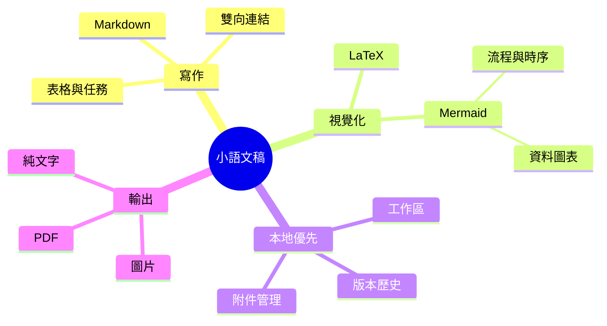

# 小語文稿
小語文稿是一個簡潔、流暢、完全本地的 **Markdown 編輯應用**。它簡單易用，也足以勝任知識管理與高密度內容排版。您可以在 macOS、~~Windows 與 Linux~~（[現已支援](https://moeka.app/)）上使用它。我們希望這款簡潔的編輯器能協助每個人快速建立自己的知識庫；閱讀以下指南即可開始。

小語文稿使用 `Markdown` 作為文字編輯格式。它適合文字工作者，能在維持良好可讀性的同時不打斷創作。支援的語法可以透過右鍵選單預覽，也可以用標示的[快捷鍵](#表格支援)快速變更格式。你也可以在空行輸入 `/` 開啟格式選單，輸入關鍵字快速選擇要插入的格式。

> Markdown 格式的文件應該能以純文字發布，不帶格式化樣式。它的語法完全由標點符號組成，這些符號經過仔細挑選，讓它們本身就像字面上的意思，例如星號看起來像強調，列表標記看起來像列表。-- John Gruber


### 無序列表
- 這是一個無序列表；
  - 這是二級無序列表；
  - 這是第二項；
- 這是第二項；
### 有序列表
1. 這是一個有序列表；
   1. 這是二級有序列表；
   2. 這是第二項；
2. 這是第二項；
   - 這是一個無序列表；
   - 這是第二項；
### 待辦列表
- [x] 可以在這裡記錄一些待辦事項。
  - [ ] 也可以有二級待辦事項。
  - [ ] 試試在此行按下 `Tab` 或 `Shift + Tab`。
- [ ] 追加記錄一些已完成事項。
***
### 表格支援
| 功能                         | 快捷鍵                        |
| ---------------------------- | ----------------------------- |
| `Command / Ctrl + B`         | 粗體                          |
| `Command / Ctrl + I`         | 斜體                          |
| `Command / Ctrl + U`         | 底線                          |
| `Command / Ctrl + Shift + X` | 刪除線                        |
| `Command / Ctrl + E`         | 行內程式碼                    |
| 更多語法支援                 | 可參考 `/` 指令或右鍵格式選單 |
## 程式碼區塊語法
```rust
fn greet(name: &str) {
  println!("hello, {name}");
}
```
### LaTeX 數學公式
使用 `$...$` 包住語法來書寫行內公式，例如 $E = mc^2$；或將 `$$` 各自放在獨立一行來書寫區塊公式：

$$
\operatorname*{arg\,min}_{\theta \in \mathbb{R}^n}
\left[
  \frac{1}{m}\sum_{i=1}^{m}
  \left\lVert f_\theta(x_i)-y_i \right\rVert_2^2
  + \lambda \left\lVert \theta \right\rVert_2^2
\right]
$$
### Mermaid 圖表示例

## 行內語法
- 可以使用**粗體**或帶有 *italic* 的斜體語法表示強調。
- 也可以使用++底線++標記需要注意的短語；`~U~` 會作為下標，而不是底線。
- 底線示例：++underline++，也相容 HTML 寫法 <u>underline</u>。
- 可以使用 `行內程式碼` 標記關鍵字或短程式碼。
## 提示區塊語法
> [!TIP] 這是一條提示區塊標題
> 可以在提示區塊裡繼續書寫正文，它也可以被摺疊。

> [!WARNING] 注意
> 也可以使用 NOTE、IMPORTANT、WARNING、CAUTION 等不同類型。
## 連結語法
- 可以使用[內部連結](#小語文稿)，跳到目前檔案中的標題行。
- 透過 [[設計風格參考.md]] 雙向連結語法在檔案間互相引用。
- 或使用[外部連結](https://google.com)，跳到任意外部網址。
- 還可以使用腳註語法[^note]跳到腳註行作為引用。
- 另外可使用[檔案連結](設計風格參考.md)跳到指定檔案或標題。
- 以上所有語法，都可以按住 `Command / Ctrl` 鍵並點擊跳轉。
## 行內擴充語法
- 下標示例：H~2~O，上標示例：E=mc^2^，也可以使用英文：Foo~zoo~ 或 Bar^baz^。
- 也支援==高亮==語法，讓文字更醒目。
- 還支援 `:rocket:` 這類 emoji shortcode，例如 :rocket: 。
- [^note]: 這裡就是腳註行，可從其他地方跳轉過來。

更多 Markdown 格式說明，可以參考 GitHub 的 [Markdown 語法指南](https://docs.github.com/en/get-started/writing-on-github/getting-started-with-writing-and-formatting-on-github/basic-writing-and-formatting-syntax)，了解並嘗試更多基本寫法。
