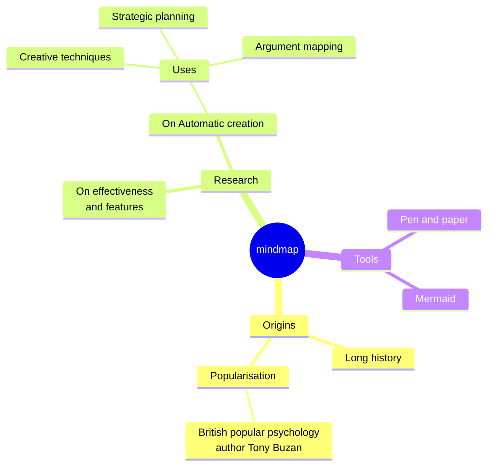
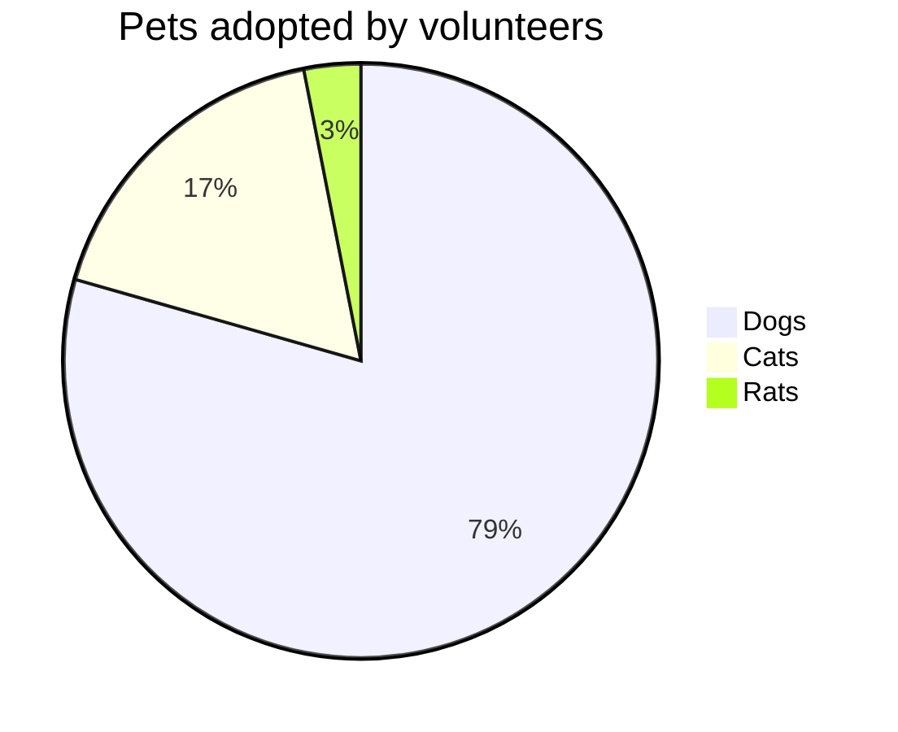

# 小語文稿
小語文稿是一個優雅、流暢、本地優先的 **Markdown 編輯應用**。它很容易上手，也能滿足重度寫作者的需求。你可以在 macOS，~~Windows 和 Linux~~（稍後推出）上使用它。閱讀下面的指南，可以更快建立自己的知識庫。

小語文稿使用 `Markdown` 作為文字編輯格式。它適合文字工作者，能在維持良好可讀性的同時不打斷創作。支援的語法可以透過右鍵選單預覽，也可以用標示的[快捷鍵](#表格互動)快速變更格式。你也可以在空行輸入 `/` 開啟格式選單，輸入關鍵字快速選擇要插入的格式。

> Markdown 格式的文件應該能以純文字發布，不帶格式化樣式。它的語法完全由標點符號組成，這些符號經過仔細挑選，讓它們本身就像字面上的意思，例如星號看起來像強調，列表標記看起來像列表。-- John Gruber


### 無序列表
- 這是一個無序列表；
  - 這是二級無序列表；
  - 這是第二項；
- 這是第二項；
### 有序列表
1. 這是一個有序列表；
   1. 這是二級有序列表；
   2. 這是第二項；
2. 這是第二項；
   - 這是一個無序列表；
   - 這是第二項；
### 待辦列表
- [x] 可以在這裡記錄一些待辦事項。
  - [ ] 也可以有二級待辦事項。
  - [ ] 試試在此行按下 `Tab` 或 `Shift + Tab`。
- [ ] 追加記錄一些已完成事項。
***
### 表格互動
| 功能                       | 快捷鍵     |
| -------------------------- | ---------- |
| `Command + B`              | 粗體       |
| `Command + I`              | 斜體       |
| `Command + U`              | 底線 |
| `Command + Shift + X`      | 刪除線     |
| `Command + E`              | 行內程式碼 |
| `Command + Option + C`     | 程式碼區塊 |
| `Command + Option + Q`     | 引用       |
| `Command + Option + U`     | 無序列表   |
| `Command + Option + O`     | 有序列表   |
| `Command + Option + Enter` | 待辦事項   |
| `Command + K`              | 連結       |
| `Command + Option + T`     | 表格 |
| `Command + 0`              | 正文 |
| `/ image`                  | 圖片       |

| --------------------- | -------- |
| --------------------- | -------- |
| `[[`                  | 雙向連結 |
| `/ image`             | 圖片     |
## 程式碼區塊語法
```rust
fn greet(name: &str) {
  println!("hello, {name}");
}
```

### LaTeX 數學公式
輸入一個簡單的區塊公式，即可在文稿中看到預覽效果。

$$
E = mc^2
$$

### Mermaid 圖表示例
用一個最簡單的流程圖觀察圖表預覽效果。





## 行內語法
- 可以使用**粗體**或帶有 *italic* 的斜體語法表示強調。
- 也可以使用++底線++標記需要注意的短語；`~U~` 會作為下標，而不是底線。
- 底線示例：++underline++，也相容 HTML 寫法 <u>underline</u>。
- 可以使用 `行內程式碼` 標記關鍵字或短程式碼。
## 提示區塊語法
> [!TIP] 這是一條提示區塊標題
> 可以在提示區塊中繼續書寫正文；摺疊後會顯示對應 emoji，標題會使用粗體樣式。

> [!WARNING] 注意
> 也可以使用 NOTE、IMPORTANT、WARNING、CAUTION 等不同類型。
## 連結語法
- 可以使用[內部連結](#小語文稿)，跳到目前檔案中的標題行。
- 透過 [[我的設計風格.md]] 雙向連結語法在檔案間互相引用。
- 或使用[外部連結](https://google.com)，跳到任意外部網址。
- 還可以使用腳註語法[^note]跳到腳註行作為引用。
- 另外可使用[檔案連結](功能規劃.md)跳到指定檔案或標題。
- 以上所有語法，都可以按住 `Command` 鍵並點擊跳轉。
## 行內擴充語法
- 下標示例：H~2~O，上標示例：E=mc^2^，也可以使用英文：Foo~zoo~ 或 Bar^baz^。
- 也支援==高亮==語法，讓文字更醒目。
- 還支援 `:rocket:` 這類 emoji shortcode，例如 :rocket: 。
- [^note]: 這裡就是腳註行，可從其他地方跳轉過來。

更多 Markdown 格式說明，可以參考 GitHub 的 [Markdown 語法指南](https://docs.github.com/en/get-started/writing-on-github/getting-started-with-writing-and-formatting-on-github/basic-writing-and-formatting-syntax)，了解並嘗試更多基本寫法。
