# Mermaid 图表画廊

这是一份供 Moeka 实际预览的图表样例集，包含常见图表语法、C4 子类型和复杂连线示例。直接在编辑或阅读模式打开本文件即可，不需要网络或外部图片。

## 如何查看

- 切换编辑器的浅色、深色和不同色系主题，检查 SVG 图表配色是否随当前主题变化。
- 默认示例不指定颜色；最后的显式配色示例用于检查作者指定颜色是否保留。
- 点击图表可查看源码及预览；源码模式只显示语法。使用大纲面板按标题跳转，可避免一次展开过多源码。
- Mermaid 图表由 Ondine 编译为 SVG，并根据当前编辑器主题适配配色；SVG 背景保持透明。

| 类别 | 内容 |
| --- | --- |
| 结构与流程 | 流程图、类图、状态图、ER 图、需求图、架构图、C4、块图 |
| 交互与计划 | 时序图、条件分支时序图、甘特图、用户旅程、时间线、看板、Git 图 |
| 数据与知识 | 饼图、象限图、XY 图、桑基图、雷达图、矩形树图、韦恩图、思维导图 |
| 扩展 | 数据包、目录树、鱼骨图、事件建模、渲染器信息 |

## 流程与结构

### 01 · 流程图：纵向分支

检查分支连接、双语标签和 `Fix → Draft` 回边的可读性。

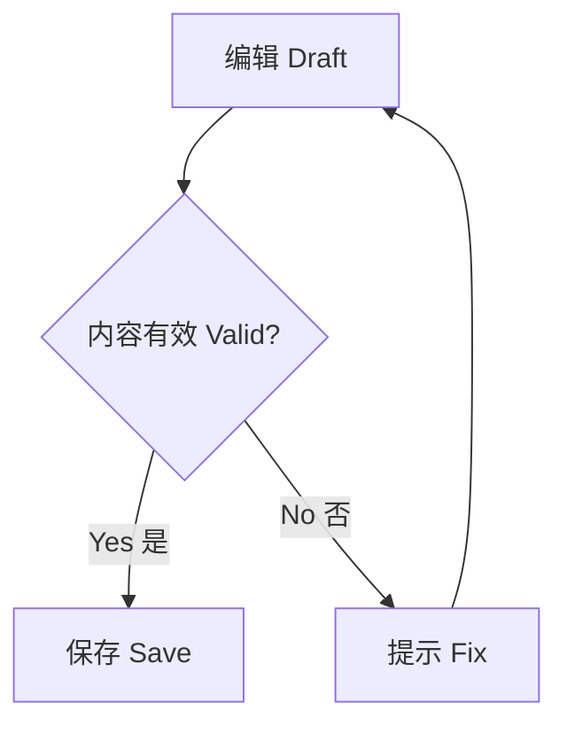

### 02 · 流程图：横向布局

检查短图的横向留白、节点间距和中英文基线。


### 03 · 流程图：graph 别名


### 04 · 流程图：嵌套分组

检查分组底色和标题，以及连接组外节点时的布局回退。

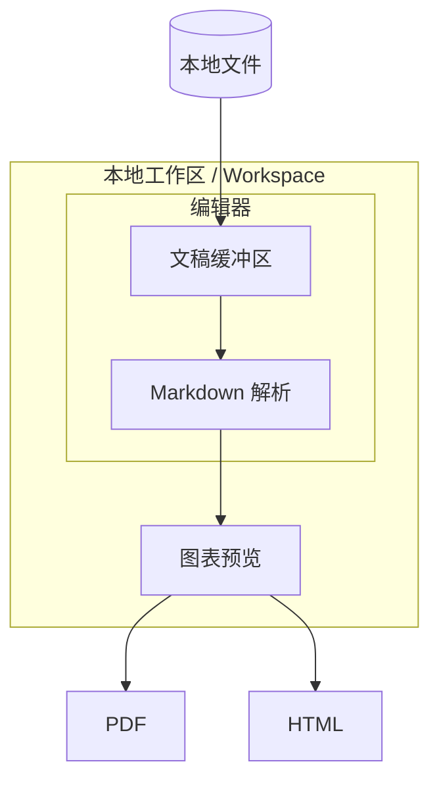

### 05 · 流程图：回边、自环和平行边

检查平行边、回边、自环以及虚线和粗线在预览中的可读性。

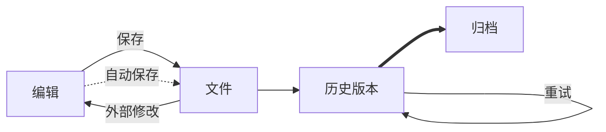

### 06 · 流程图：常见节点形状

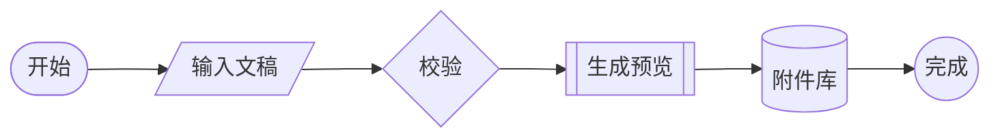

### 07 · 类图

检查继承、组合、聚合、关联以及成员文字。

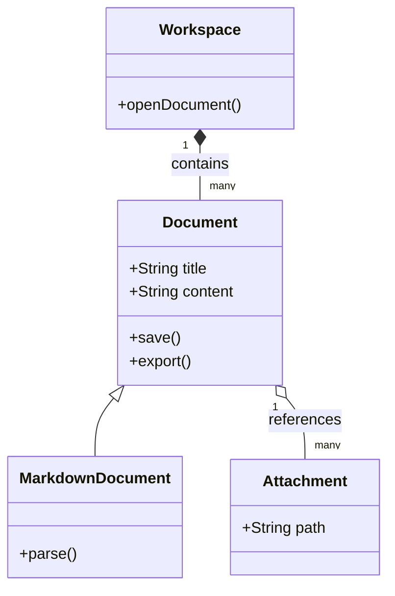

### 08 · 类图：v2 头部

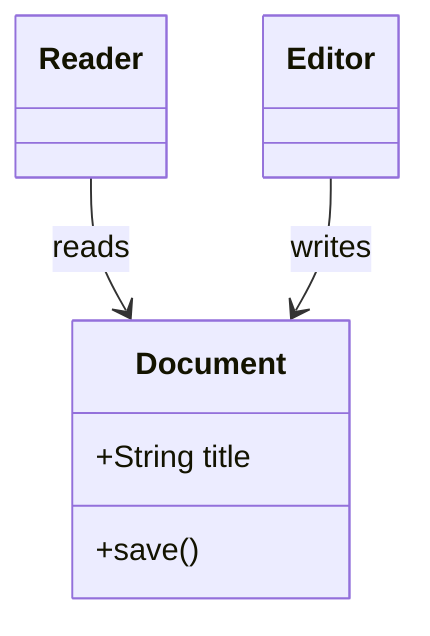

### 09 · 状态图：嵌套状态

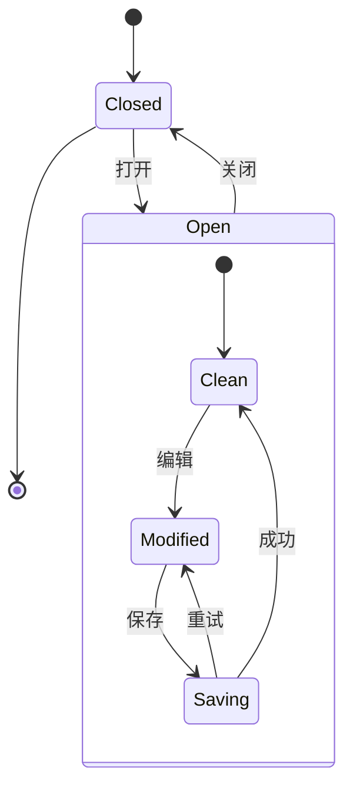

### 10 · 状态图：传统头部

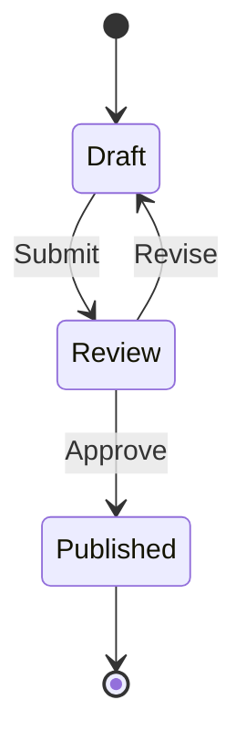

### 11 · 实体关系图

检查基数标记、字段、主外键和关系标签，不要将语义箭头替换成普通箭头。

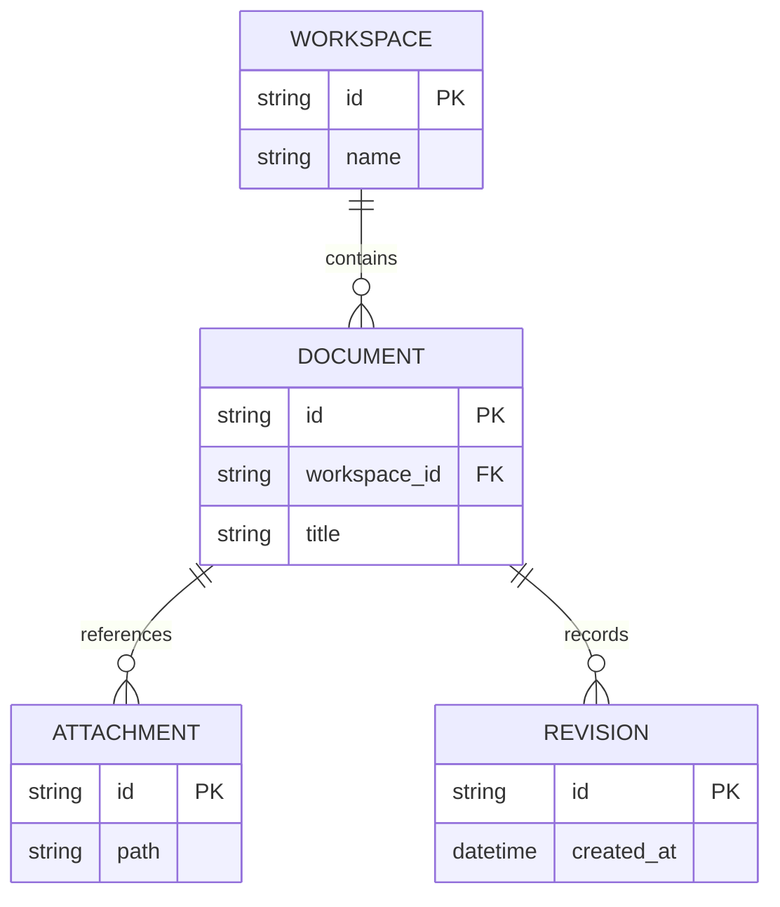

### 12 · 需求图

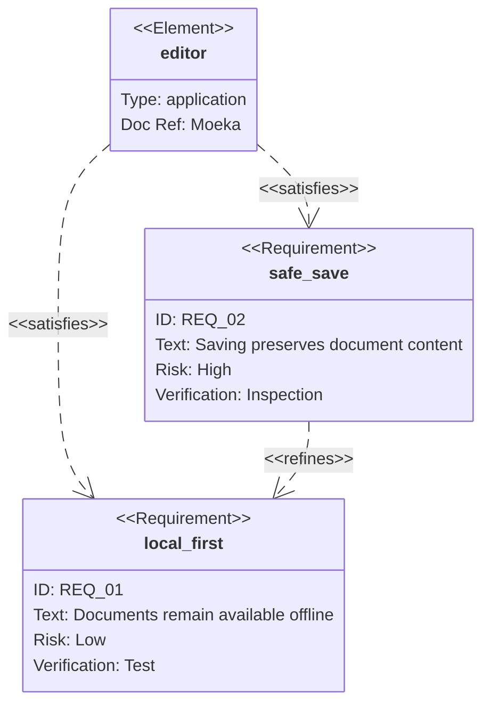

### 13 · 架构图

使用内置图标，不依赖远程图标包。

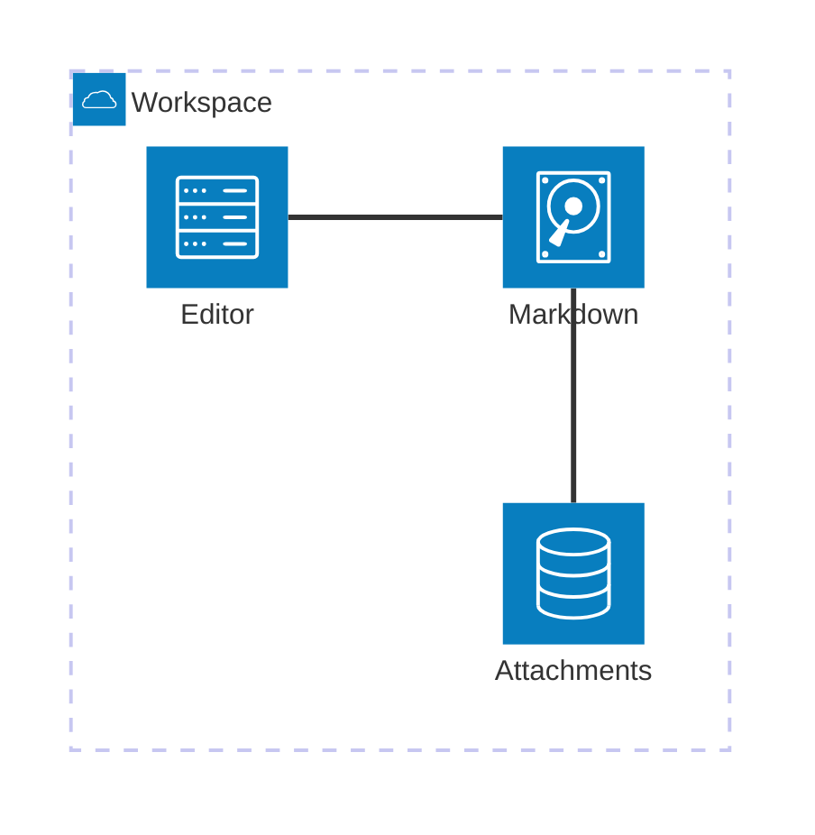

### 14 · 块图

检查网格、跨列节点和连接。

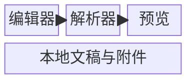

## 交互与计划

### 15 · 时序图：完整交互

检查激活条、注释、alt/else、循环和虚线回复。

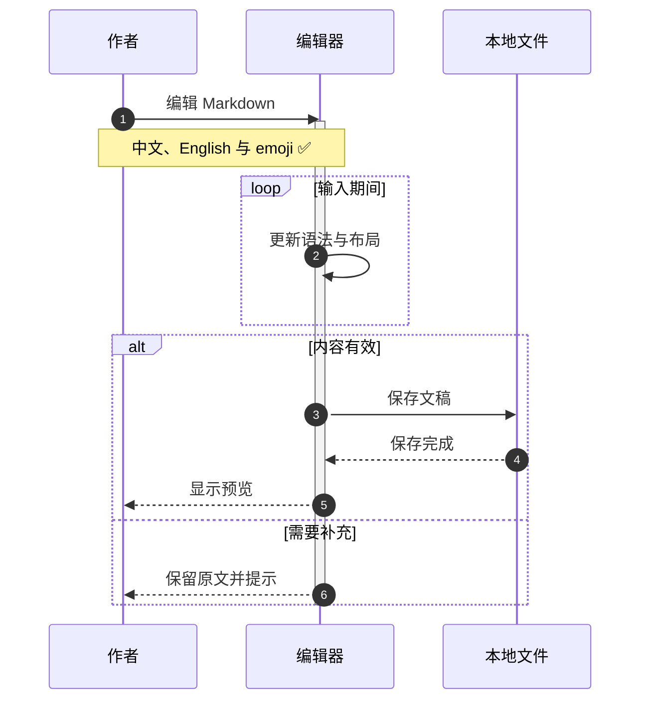

### 16 · 时序图：语义箭头

检查实心、开口、异步、虚线和取消叉。

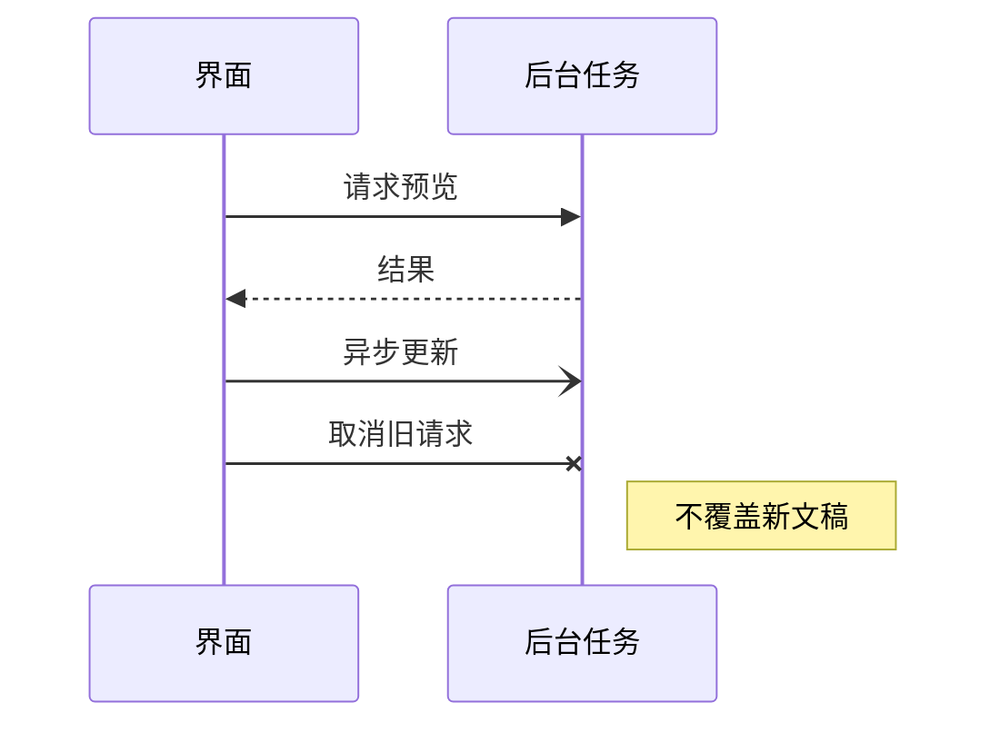

### 17 · 条件分支时序图

使用标准 Mermaid 时序图语法展示条件分支。

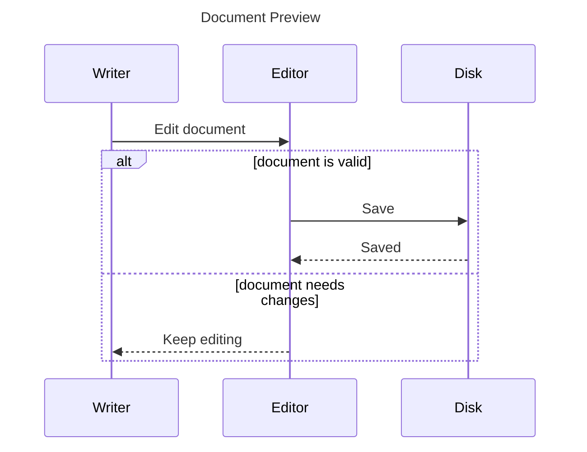

### 18 · 甘特图

使用固定日期，避免每天打开文档时结果变化。

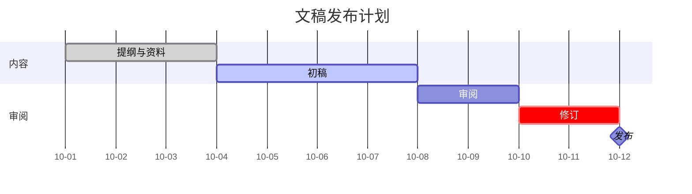

### 19 · 用户旅程

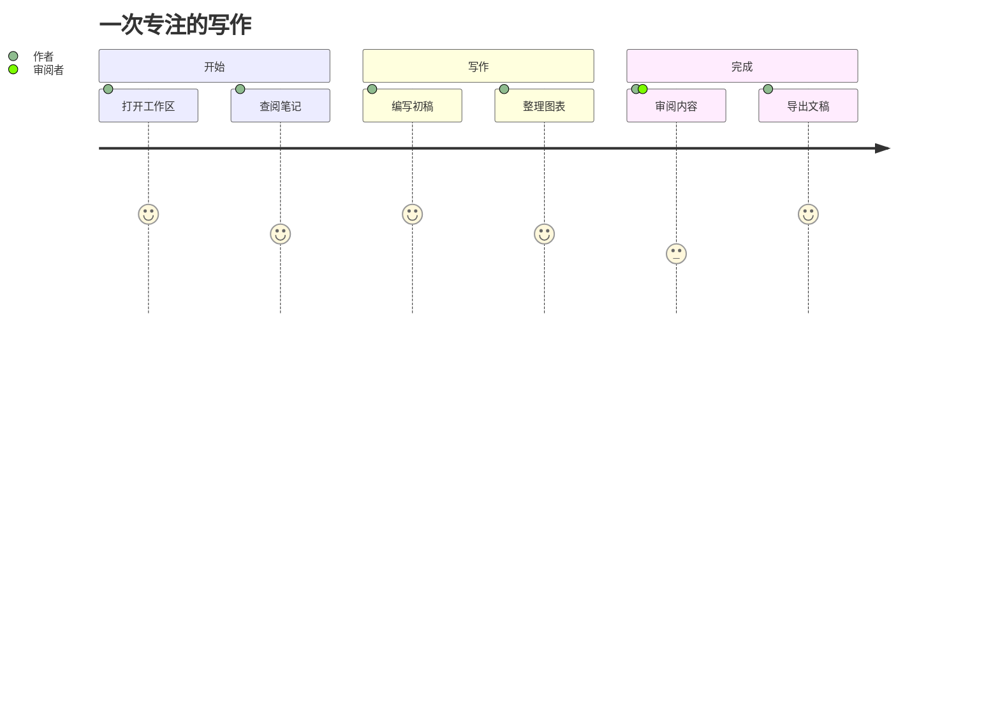

### 20 · 时间线

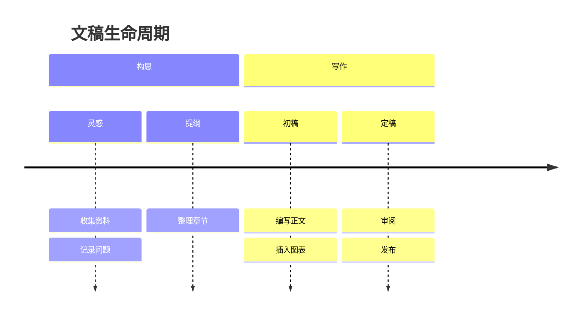

### 21 · 看板

```mermaid
kanban
    ideas[灵感]
        capture[收集参考]
        outline[整理提纲]
    writing[写作中]
        draft[完成初稿]
        diagrams[绘制图表]
    review[待审阅]
        proofread[校对文字]
    done[已完成]
        publish[发布文稿]
```

### 22 · Git 图

```mermaid
gitGraph
    commit id: "初稿"
    branch review
    checkout review
    commit id: "审阅意见"
    checkout main
    commit id: "补充图表"
    merge review id: "合并修订"
    commit id: "发布" tag: "v1.0"
```

## 数据与知识

### 23 · 思维导图

```mermaid
mindmap
    root((知识工作))
        收集
            灵感
            参考资料
        组织
            双向链接
            目录与标签
        表达
            Markdown
            图表
            数学公式
        发布
            PDF
            HTML
```

### 24 · 饼图

检查分类颜色、百分比、图例和长短标签的对比度。

```mermaid
pie showData
    title 文稿内容构成
    "正文 / Writing" : 42
    "研究 / Research" : 24
    "图表 / Diagrams" : 18
    "代码 / Code" : 10
    "附注 / Notes" : 6
```

### 25 · 象限图

```mermaid
quadrantChart
    title 内容整理优先级
    x-axis Low Effort --> High Effort
    y-axis Low Impact --> High Impact
    quadrant-1 Plan
    quadrant-2 Do First
    quadrant-3 Later
    quadrant-4 Reconsider
    Fix typos: [0.15, 0.35]
    Add examples: [0.35, 0.82]
    Rewrite chapter: [0.78, 0.78]
    Reorder appendix: [0.72, 0.24]
```

### 26 · XY 柱状图与折线图

```mermaid
xychart-beta
    title "每日写作 / Daily Writing"
    x-axis [Mon, Tue, Wed, Thu, Fri, Sat, Sun]
    y-axis "Words" 0 --> 1600
    bar [420, 800, 650, 1200, 980, 1450, 1100]
    line [500, 650, 800, 900, 1000, 1150, 1300]
```

### 27 · 桑基图

```mermaid
sankey-beta
Ideas,Drafts,40
Research,Drafts,25
Drafts,Published,45
Drafts,Revisions,20
Revisions,Published,15
Revisions,Archive,5
```

### 28 · 雷达图

```mermaid
radar-beta
    title Writing Review
    axis clarity["Clarity"], structure["Structure"], evidence["Evidence"], detail["Detail"], rhythm["Rhythm"]
    curve draft["Draft"]{3, 4, 2, 4, 3}
    curve revised["Revised"]{5, 4, 4, 4, 5}
```

### 29 · 矩形树图

```mermaid
treemap-beta
    "Workspace"
        "Notes"
            "Research": 35
            "Ideas": 20
        "Documents"
            "Articles": 45
            "Guides": 30
        "Attachments": 25
```

### 30 · 韦恩图

```mermaid
venn-beta
    title Knowledge Connections
    set A["Writing"]: 30
    set B["Research"]: 25
    set C["Design"]: 20
    union A,B["Evidence"]: 8
    union A,C["Visual Story"]: 6
    union B,C["Exploration"]: 5
    union A,B,C["Clarity"]: 3
```

## C4 架构系列

### 31 · C4 Context

```mermaid
C4Context
    title Moeka System Context
    Person(writer, "Writer", "Creates Markdown documents")
    System(editor, "Moeka", "Local-first Markdown editor")
    System_Ext(storage, "Local Files", "Documents and attachments")
    Rel(writer, editor, "Writes and reads")
    Rel(editor, storage, "Reads and saves")
```

### 32 · C4 Container

```mermaid
C4Container
    title Moeka Containers
    Person(writer, "Writer")
    System_Boundary(app, "Moeka") {
        Container(ui, "Editor UI", "GPUI", "Editing and navigation")
        Container(worker, "Preview Worker", "Rust", "Diagram rendering")
        ContainerDb(files, "Workspace", "File System", "Markdown and assets")
    }
    Rel(writer, ui, "Edits")
    Rel(ui, worker, "Requests previews")
    Rel(ui, files, "Saves")
```

### 33 · C4 Component

```mermaid
C4Component
    title Editor Components
    Container_Boundary(editor, "Editor") {
        Component(buffer, "Buffer", "Rust", "Source text")
        Component(parser, "Parser", "Markdown", "Semantic structure")
        Component(preview, "Preview", "SVG", "Rendered diagrams")
    }
    Rel(buffer, parser, "Provides text")
    Rel(parser, preview, "Provides diagram blocks")
```

### 34 · C4 Dynamic

```mermaid
C4Dynamic
    title Preview Request
    Container(ui, "Editor UI", "GPUI")
    Container(worker, "Worker", "Rust")
    Container(renderer, "Renderer", "Mermaid")
    Rel(ui, worker, "Queue preview")
    Rel(worker, renderer, "Render SVG")
    Rel(renderer, ui, "Publish result")
```

### 35 · C4 Deployment

```mermaid
C4Deployment
    title Local Deployment
    Deployment_Node(computer, "Computer", "Desktop") {
        Deployment_Node(app, "Application", "Moeka") {
            Container(editor, "Editor", "Rust and GPUI")
        }
        Deployment_Node(disk, "Local Disk", "File System") {
            ContainerDb(workspace, "Workspace", "Markdown files")
        }
    }
    Rel(editor, workspace, "Reads and saves")
```

## 协议与扩展图表

### 36 · 数据包

```mermaid
packet-beta
    title Document Message Header
    0-3: "Version"
    4-7: "Flags"
    8-15: "Type"
    16-31: "Length"
    32-63: "Document ID"
    64-95: "Payload"
```

### 37 · 目录树

```mermaid
treeView-beta
    "Workspace"
        "Notes"
            "Ideas.md"
            "Research.md"
        "Articles"
            "Draft.md"
            "Published.md"
        "Assets"
            "Diagram.svg"
```

### 38 · 鱼骨图

```mermaid
ishikawa-beta
    Preview Quality
        Typography
            Font fallback
            Label wrapping
        Colors
            Theme harmony
            Text contrast
        Layout
            Edge routing
            Group spacing
        Performance
            Background work
            Cache reuse
```

### 39 · 事件建模

当前渲染器提供的扩展语法，用于查看时间帧、命令、事件和数据。

```mermaid
eventmodeling
    tf 01 cmd SaveDocument { documentId: number }
    tf 02 evt DocumentSaved { documentId: number }
    tf 03 ui Preview ->> 02
```

### 40 · 渲染器信息

这不是业务图表，保留它用于确认内置的信息图类型可正常呈现。

```mermaid
info
```

## 作者配色与透明度检查

### 41 · 显式节点颜色

只有本例主动指定节点颜色。切换主题时，这些作者颜色应保留，其他节点与图表整体仍应融入当前主题。

```mermaid
flowchart LR
    Draft[Draft] --> Review[Review]
    Review --> Ready[Ready]
    classDef review fill:#E8DDF0,stroke:#826394,color:#493356,stroke-width:1.5px
    classDef ready fill:#DDEADF,stroke:#66866B,color:#294B31,stroke-width:1.5px
    class Review review
    class Ready ready
```

### 42 · 透明画布

这段声明故意设置了醒目的背景色。Moeka 应继续保留透明画布，不出现粉色整块背景。

```mermaid
%%{init: {'themeVariables': {'background': '#D14070'}}}%%
flowchart LR
    Page[当前主题画布] --> Chart[透明图表]
    Chart --> Blend[自然融合]
```


## 检查清单

- 切换编辑器浅色和深色主题，确认图表配色随主题变化，SVG 画布仍然透明。
- 检查图表标签、连接线、作者指定颜色和数据标签的可读性，以及双语文本和 emoji 是否缺字。
- 同一浅深色外观下切换不同主题，检查颜色是否随当前主题变化。
- 检查文本、箭头、边框、图例和数据标签的可读性，以及中文、英文和 emoji 是否出现缺字。重点复查类图、状态图、用户旅程、时间线、看板、桑基图、C4、数据包及事件建模等样例。
- 分组标题、长消息和边标签是否重叠；回边、自环、ER 基数、组合菱形和取消叉是否保留语义。
- 图表空白处是否与文稿自然融合；预览、导出、放大查看是否存在残留背景。作者指定颜色应保留，整张 SVG 背景应透明。
- 首次打开本长文、快速滚动或切换主题后，是否出现错图、旧图覆盖、持续闪动或明显卡顿；连续异步完成不应使已测量图表或隐藏源码行反复塌缩。
- 在图表仍加载时拖动滚动条并暂时停住指针，确认当前范围变化后滑块仍按抓取位置映射，不被光标拉回；用滚轮滚动、按大纲跳转，再切换分栏 / 标签页返回，检查视口锚点和暂存分栏的高度是否稳定。

这些示例用于手动检查当前集成的 Ondine 渲染器，不承诺穷举 Mermaid 的每种语法组合。
