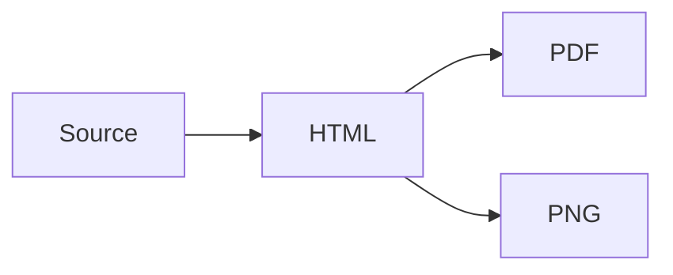

# Export gallery

## Inline formatting

**Bold** *italic* ~~deleted~~ ++underlined++ ==highlighted== H~2~O E=mc^2^ :rocket:.

中文**加粗。**文字，==**nested bold** and *italic*==，++**nested underline**++。

`**literal code** ==not highlighted==` and \==escaped==.

[External link](https://example.com), [section](#lists), [[note.md|Wiki alias]], and a footnote[^note].

### Lists

1. First ordered item
   - Nested unordered item
2. Second ordered item

- [x] Completed
- [ ] Pending
  - [x] Nested task

> Ordinary quote with **bold** and *italic*.

> [!TIP]- A folded editor callout exports its complete body
> Body with ==highlight== and $x^2$.

| Left | Center | Right |
| :--- | :---: | ---: |
| **bold** | *italic* | ~~deleted~~ |
| escaped \| pipe | first<br>second | $x+1$ |

```rust
fn greet(name: &str) {
    println!("Hello, {name}");
}
```

```unknown-language
<literal> & **not bold**
```

Inline formula $E=mc^2$, tall formula $\frac{a+b}{c+d}$.

$$
\sum_{i=1}^{n} i^2 = \frac{n(n+1)(2n+1)}{6}
$$

\[
\int_0^1 x^2\,dx = \frac{1}{3}
\]




![[export-sample.svg]]

---

[^note]: A footnote with **formatting**.

## End of export

This final paragraph must be present in every exported format.
