# Mermaid diagram gallery

This file provides 42 diagram fixtures for `mermaid_gallery_diagrams_render_in_light_and_dark_themes` and can also be opened in Moeka for native preview checks. See [AGENTS.md](../../AGENTS.md#rendering-and-themes) for maintenance guidance.

## How to inspect

- Switch among light, dark, and differently colored themes and check that every diagram has colored shapes or connections, readable labels, and theme-appropriate contrast.
- Most examples do not specify colors; the final explicit-color example checks that author-specified colors are retained.
- Click a diagram to inspect its source and preview; Source mode displays syntax only. Use the outline to navigate by heading without expanding too much source at once.
- Ondine compiles Mermaid diagrams to SVG and adapts their colors to the editor theme; SVG backgrounds remain transparent.

| Category | Examples |
| --- | --- |
| Structure and flow | Flowchart, class, state, ER, requirement, architecture, C4, and block diagrams |
| Interaction and planning | Sequence and conditional sequence, Gantt, user journey, timeline, Kanban, and Git diagrams |
| Data and knowledge | Pie, quadrant, XY, Sankey, radar, treemap, Venn, and mind map |
| Extensions | Packet, directory tree, fishbone, event modeling, and renderer information |

## Flow and structure

### 01 · Flowchart: vertical branching

Check branch connections, bilingual labels, and the readability of the `Fix → Draft` back edge.

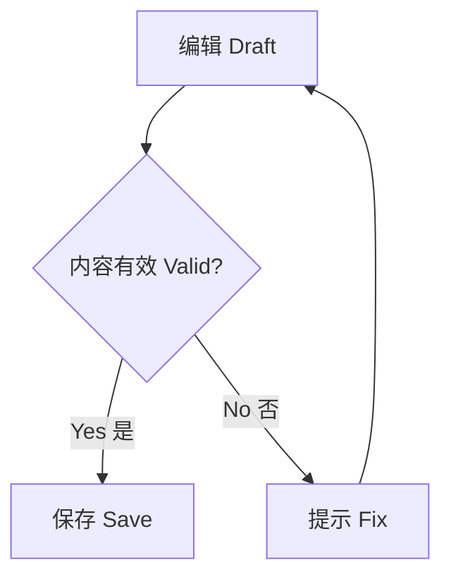

### 02 · Flowchart: horizontal layout

Check horizontal whitespace, node spacing, and Chinese/English baselines.

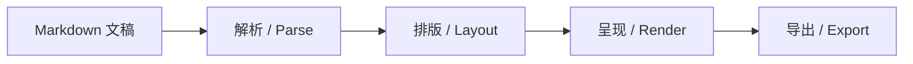

### 03 · Flowchart: graph alias

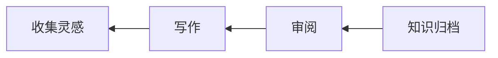

### 04 · Flowchart: nested groups

Check group backgrounds and titles, and layout fallback when connecting nodes outside the group.

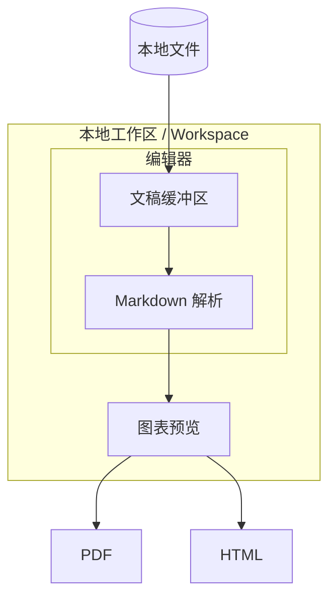

### 05 · Flowchart: back edges, self-loops, and parallel edges

Check the readability of parallel edges, back edges, self-loops, dashed lines, and thick lines.

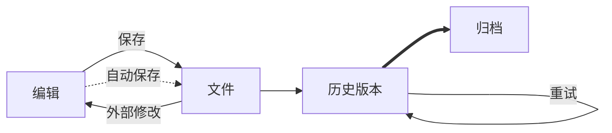

### 06 · Flowchart: common node shapes

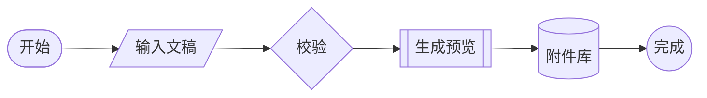

### 07 · Class diagram

Check inheritance, composition, aggregation, associations, and member text.

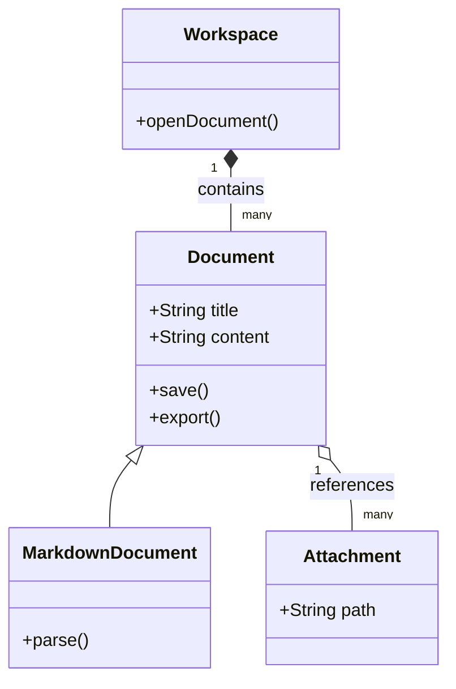

### 08 · Class diagram: v2 header

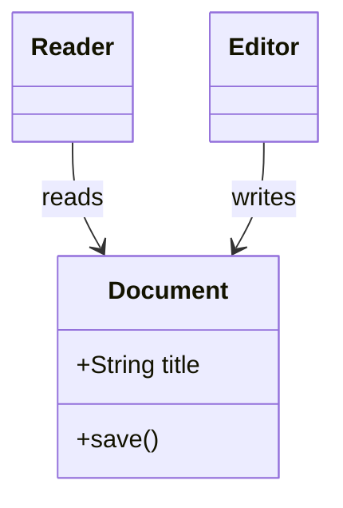

### 09 · State diagram: nested states

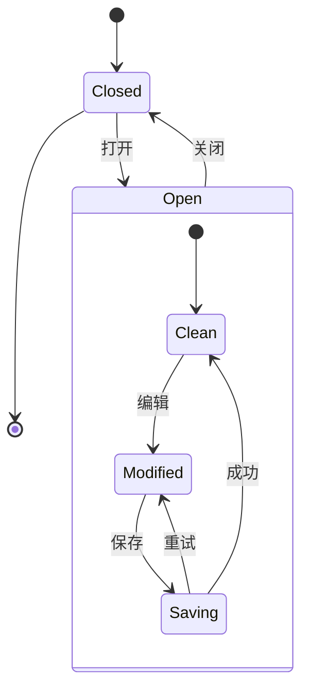

### 10 · State diagram: legacy header

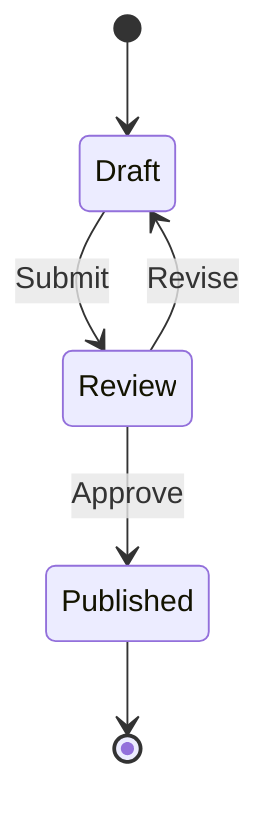

### 11 · Entity relationship diagram

Check cardinality markers, fields, primary/foreign keys, and relationship labels; do not replace semantic arrows with ordinary arrows.

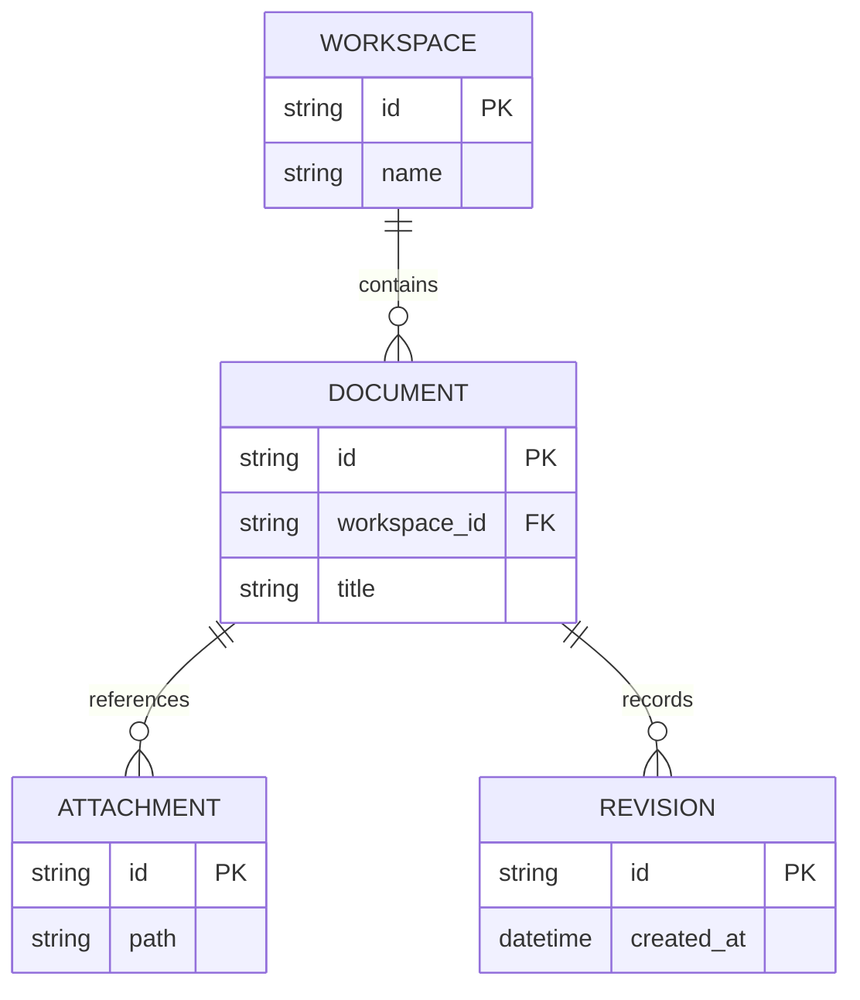

### 12 · Requirement diagram

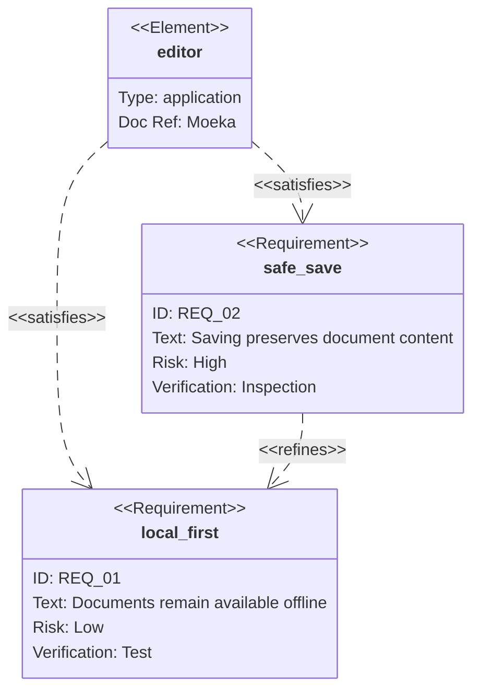

### 13 · Architecture diagram

Use built-in icons without relying on remote icon packs.

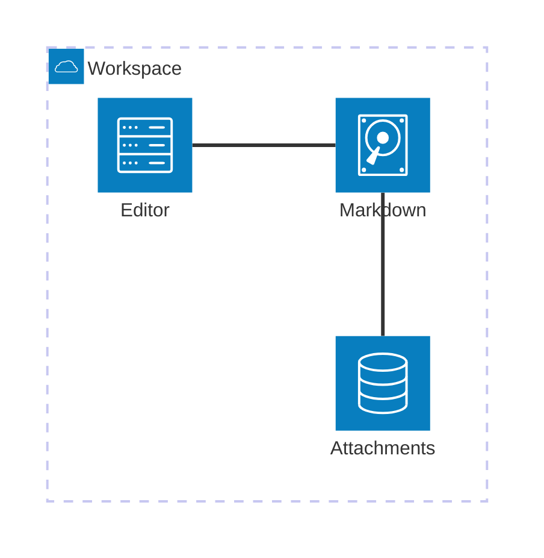

### 14 · Block diagram

Check the grid, spanning nodes, and connections.

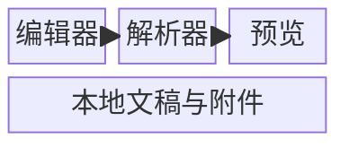

## Interaction and planning

### 15 · Sequence diagram: complete interaction

Check activation bars, notes, alt/else, loops, and dashed replies.

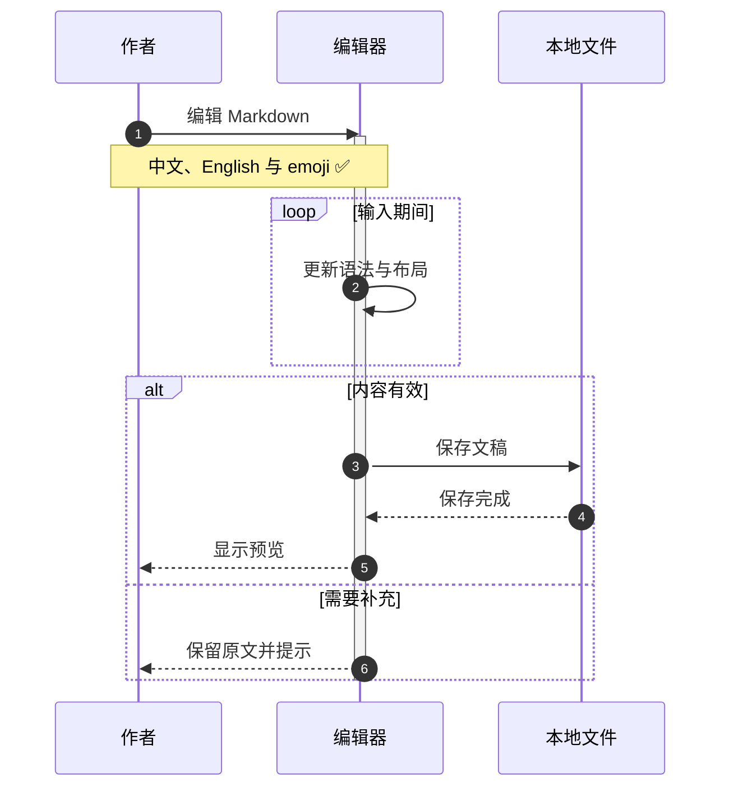

### 16 · Sequence diagram: semantic arrows

Check solid, open, asynchronous, dashed, and cancellation-cross arrows.

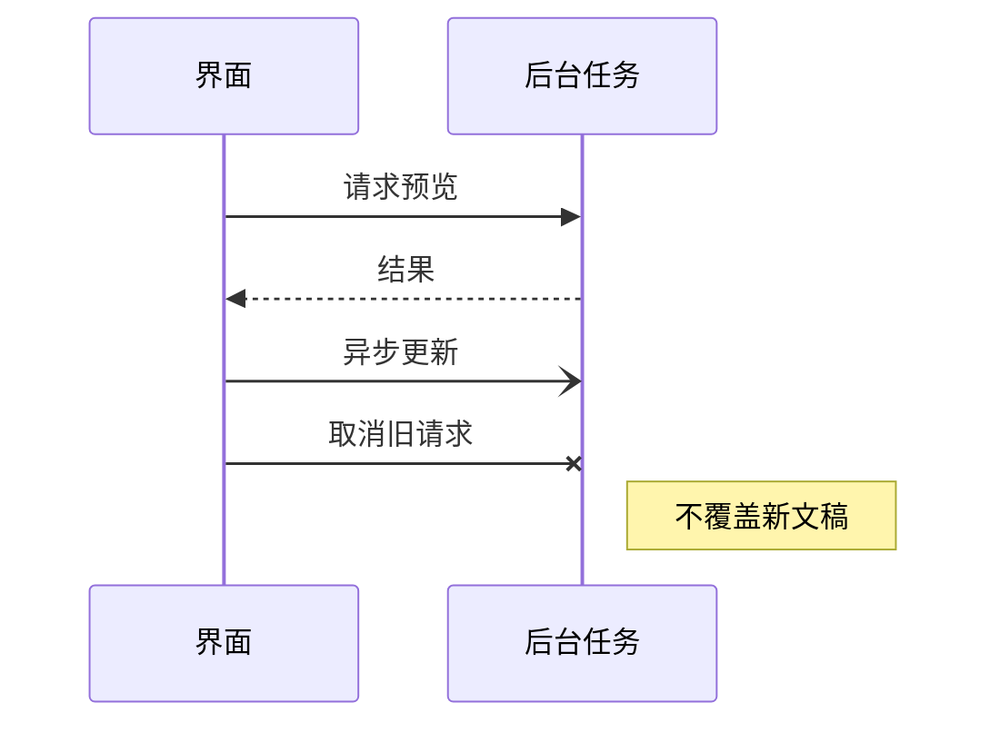

### 17 · Conditional sequence diagram

Use standard Mermaid sequence syntax to show conditional branches.

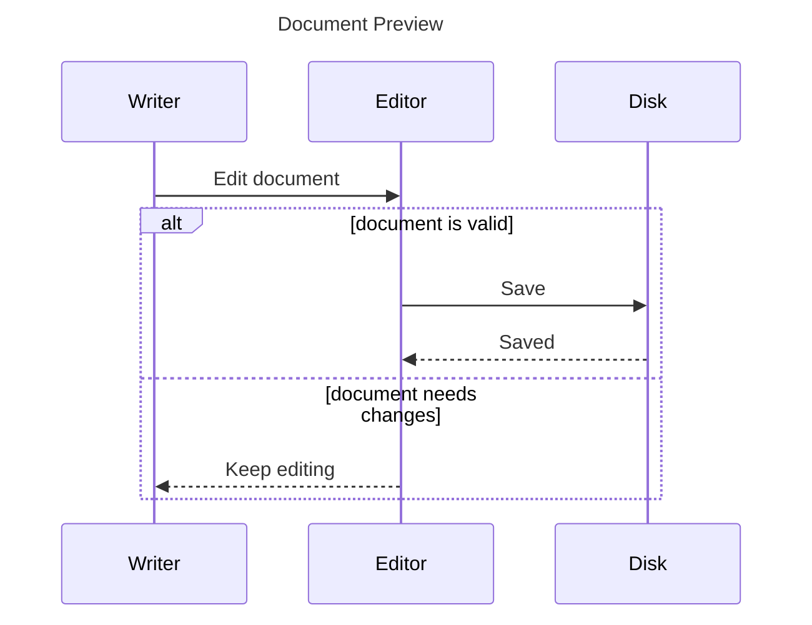

### 18 · Gantt chart

Use fixed dates so the result does not change from day to day.

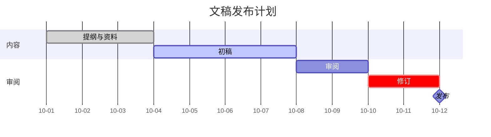

### 19 · User journey

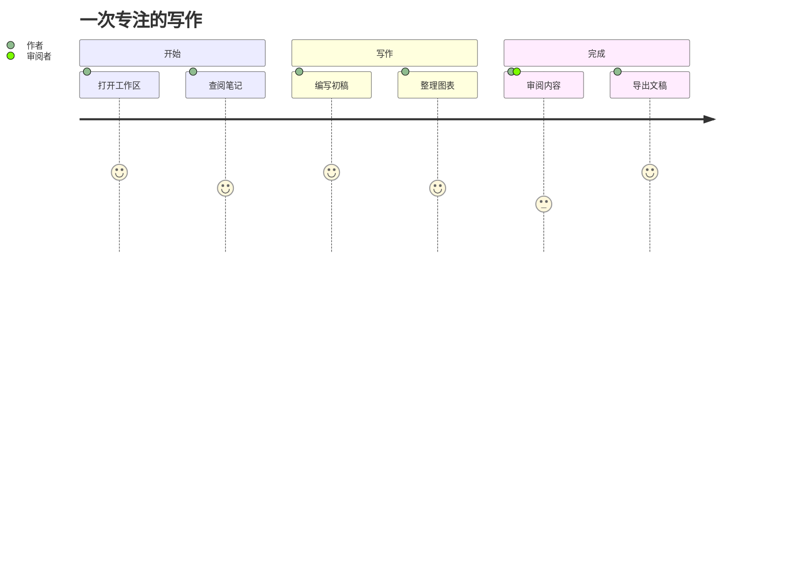

### 20 · Timeline

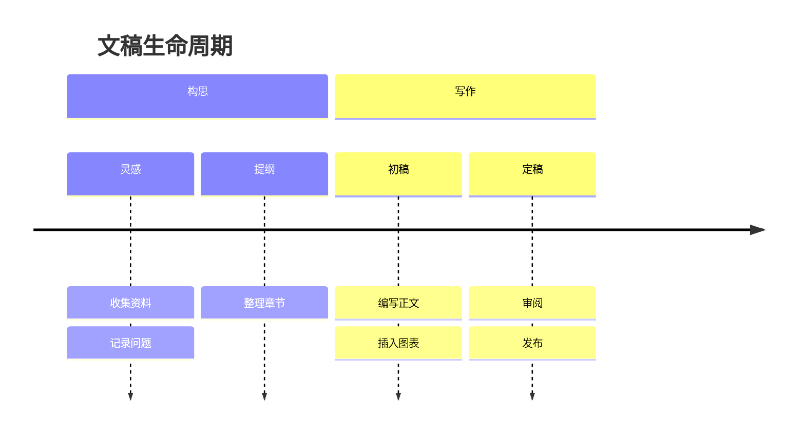

### 21 · Kanban

```mermaid
kanban
    ideas[灵感]
        capture[收集参考]
        outline[整理提纲]
    writing[写作中]
        draft[完成初稿]
        diagrams[绘制图表]
    review[待审阅]
        proofread[校对文字]
    done[已完成]
        publish[发布文稿]
```

### 22 · Git graph

```mermaid
gitGraph
    commit id: "初稿"
    branch review
    checkout review
    commit id: "审阅意见"
    checkout main
    commit id: "补充图表"
    merge review id: "合并修订"
    commit id: "发布" tag: "v1.0"
```

## Data and knowledge

### 23 · Mind map

```mermaid
mindmap
    root((知识工作))
        收集
            灵感
            参考资料
        组织
            双向链接
            目录与标签
        表达
            Markdown
            图表
            数学公式
        发布
            PDF
            HTML
```

### 24 · Pie chart

Check category colors, percentages, legends, and contrast for short and long labels.

```mermaid
pie showData
    title 文稿内容构成
    "正文 / Writing" : 42
    "研究 / Research" : 24
    "图表 / Diagrams" : 18
    "代码 / Code" : 10
    "附注 / Notes" : 6
```

### 25 · Quadrant chart

```mermaid
quadrantChart
    title 内容整理优先级
    x-axis Low Effort --> High Effort
    y-axis Low Impact --> High Impact
    quadrant-1 Plan
    quadrant-2 Do First
    quadrant-3 Later
    quadrant-4 Reconsider
    Fix typos: [0.15, 0.35]
    Add examples: [0.35, 0.82]
    Rewrite chapter: [0.78, 0.78]
    Reorder appendix: [0.72, 0.24]
```

### 26 · XY bar and line chart

```mermaid
xychart-beta
    title "每日写作 / Daily Writing"
    x-axis [Mon, Tue, Wed, Thu, Fri, Sat, Sun]
    y-axis "Words" 0 --> 1600
    bar [420, 800, 650, 1200, 980, 1450, 1100]
    line [500, 650, 800, 900, 1000, 1150, 1300]
```

### 27 · Sankey diagram

```mermaid
sankey-beta
Ideas,Drafts,40
Research,Drafts,25
Drafts,Published,45
Drafts,Revisions,20
Revisions,Published,15
Revisions,Archive,5
```

### 28 · Radar chart

```mermaid
radar-beta
    title Writing Review
    axis clarity["Clarity"], structure["Structure"], evidence["Evidence"], detail["Detail"], rhythm["Rhythm"]
    curve draft["Draft"]{3, 4, 2, 4, 3}
    curve revised["Revised"]{5, 4, 4, 4, 5}
```

### 29 · Treemap

```mermaid
treemap-beta
    "Workspace"
        "Notes"
            "Research": 35
            "Ideas": 20
        "Documents"
            "Articles": 45
            "Guides": 30
        "Attachments": 25
```

### 30 · Venn diagram

```mermaid
venn-beta
    title Knowledge Connections
    set A["Writing"]: 30
    set B["Research"]: 25
    set C["Design"]: 20
    union A,B["Evidence"]: 8
    union A,C["Visual Story"]: 6
    union B,C["Exploration"]: 5
    union A,B,C["Clarity"]: 3
```

## C4 architecture

### 31 · C4 Context

```mermaid
C4Context
    title Moeka System Context
    Person(writer, "Writer", "Creates Markdown documents")
    System(editor, "Moeka", "Local-first Markdown editor")
    System_Ext(storage, "Local Files", "Documents and attachments")
    Rel(writer, editor, "Writes and reads")
    Rel(editor, storage, "Reads and saves")
```

### 32 · C4 Container

```mermaid
C4Container
    title Moeka Containers
    Person(writer, "Writer")
    System_Boundary(app, "Moeka") {
        Container(ui, "Editor UI", "GPUI", "Editing and navigation")
        Container(worker, "Preview Worker", "Rust", "Diagram rendering")
        ContainerDb(files, "Workspace", "File System", "Markdown and assets")
    }
    Rel(writer, ui, "Edits")
    Rel(ui, worker, "Requests previews")
    Rel(ui, files, "Saves")
```

### 33 · C4 Component

```mermaid
C4Component
    title Editor Components
    Container_Boundary(editor, "Editor") {
        Component(buffer, "Buffer", "Rust", "Source text")
        Component(parser, "Parser", "Markdown", "Semantic structure")
        Component(preview, "Preview", "SVG", "Rendered diagrams")
    }
    Rel(buffer, parser, "Provides text")
    Rel(parser, preview, "Provides diagram blocks")
```

### 34 · C4 Dynamic

```mermaid
C4Dynamic
    title Preview Request
    Container(ui, "Editor UI", "GPUI")
    Container(worker, "Worker", "Rust")
    Container(renderer, "Renderer", "Mermaid")
    Rel(ui, worker, "Queue preview")
    Rel(worker, renderer, "Render SVG")
    Rel(renderer, ui, "Publish result")
```

### 35 · C4 Deployment

```mermaid
C4Deployment
    title Local Deployment
    Deployment_Node(computer, "Computer", "Desktop") {
        Deployment_Node(app, "Application", "Moeka") {
            Container(editor, "Editor", "Rust and GPUI")
        }
        Deployment_Node(disk, "Local Disk", "File System") {
            ContainerDb(workspace, "Workspace", "Markdown files")
        }
    }
    Rel(editor, workspace, "Reads and saves")
```

## Protocol and extension diagrams

### 36 · Packet diagram

```mermaid
packet-beta
    title Document Message Header
    0-3: "Version"
    4-7: "Flags"
    8-15: "Type"
    16-31: "Length"
    32-63: "Document ID"
    64-95: "Payload"
```

### 37 · Directory tree

```mermaid
treeView-beta
    "Workspace"
        "Notes"
            "Ideas.md"
            "Research.md"
        "Articles"
            "Draft.md"
            "Published.md"
        "Assets"
            "Diagram.svg"
```

### 38 · Fishbone diagram

```mermaid
ishikawa-beta
    Preview Quality
        Typography
            Font fallback
            Label wrapping
        Colors
            Theme harmony
            Text contrast
        Layout
            Edge routing
            Group spacing
        Performance
            Background work
            Cache reuse
```

### 39 · Event modeling

This renderer extension demonstrates time frames, commands, events, and data.

```mermaid
eventmodeling
    tf 01 cmd SaveDocument { documentId: number }
    tf 02 evt DocumentSaved { documentId: number }
    tf 03 ui Preview ->> 02
```

### 40 · Renderer information

This is not a business diagram; keep it to verify that the built-in information diagram renders.

```mermaid
info
```

## Author colors and transparency

### 41 · Explicit node colors

Only this example explicitly sets node colors. Theme changes must preserve those author colors while the other nodes and overall diagram follow the current theme.

```mermaid
flowchart LR
    Draft[Draft] --> Review[Review]
    Review --> Ready[Ready]
    classDef review fill:#E8DDF0,stroke:#826394,color:#493356,stroke-width:1.5px
    classDef ready fill:#DDEADF,stroke:#66866B,color:#294B31,stroke-width:1.5px
    class Review review
    class Ready ready
```

### 42 · Transparent canvas

This declaration deliberately sets a conspicuous background color. Moeka must retain a transparent canvas rather than displaying a solid pink background.

```mermaid
%%{init: {'themeVariables': {'background': '#D14070'}}}%%
flowchart LR
    Page[当前主题画布] --> Chart[透明图表]
    Chart --> Blend[自然融合]
```


## Checklist

- Switch between light and dark themes; confirm diagram colors change and the SVG canvas remains transparent.
- Check readability of diagram labels, connections, author colors, and data labels, and look for missing bilingual or emoji glyphs.
- Switch between different themes with the same light/dark appearance and confirm colors follow the current theme.
- Check text, arrows, borders, legends, and data labels, including Chinese, English, and emoji glyphs. Pay particular attention to class, state, journey, timeline, Kanban, Sankey, C4, packet, and event-modeling examples.
- Check for overlapping group titles, long messages, and edge labels. Preserve semantics of back edges, self-loops, ER cardinalities, composition diamonds, and cancellation crosses.
- Diagram whitespace should blend into the document; previews, exports, and enlarged views should not retain background artifacts. Preserve author colors while keeping the overall SVG background transparent.
- On first opening this long document, rapid scrolling, and theme changes, check for incorrect or stale diagrams, persistent flashing, and obvious stalls. Consecutive async completions must not repeatedly collapse measured diagrams or hidden source lines.
- While diagrams are loading, drag the scrollbar and pause the pointer; after the range changes, confirm the thumb follows the grab position rather than being pulled back by the cursor. Scroll with the wheel, navigate by outline, switch panes/tabs and return, then check viewport anchors and parked-pane heights.

These examples support manual inspection of the integrated Ondine renderer; they do not claim to cover every Mermaid syntax combination.
